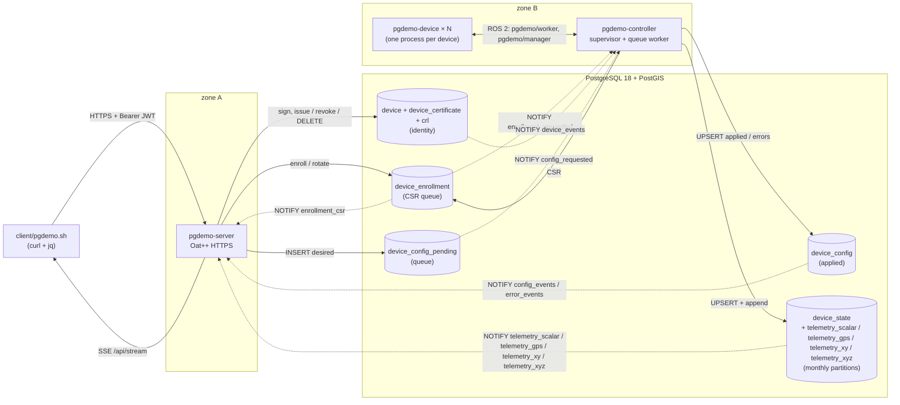
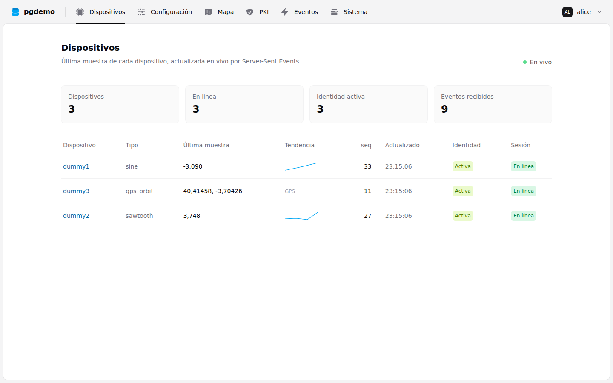
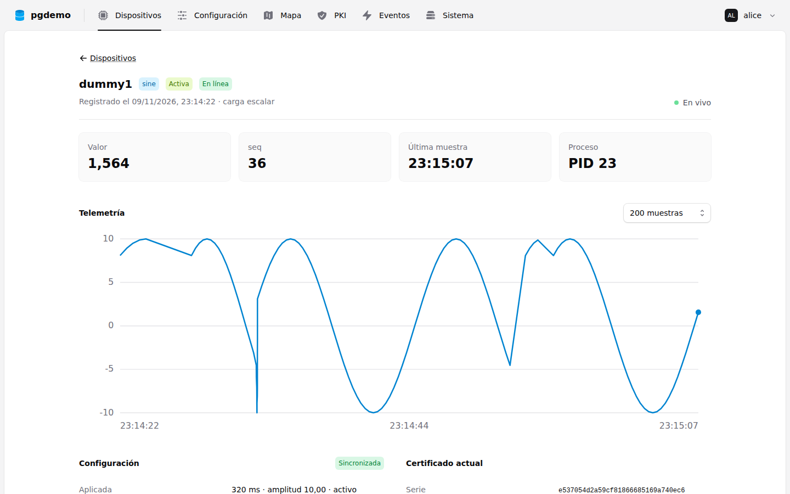
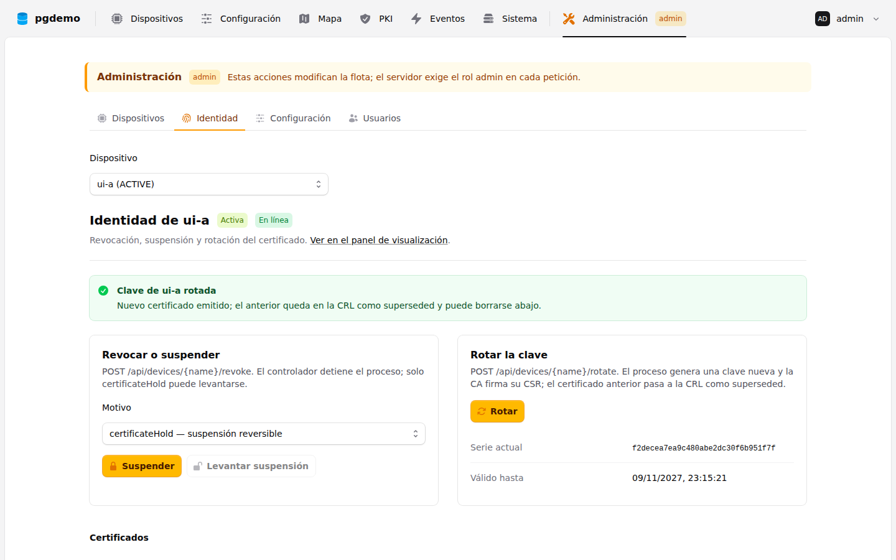

# PostgreSQL as a reactive, persistent message bus

A small, complete reference architecture in which **PostgreSQL is the only channel between two processes that never talk to each other**. Tables are the persistent queue and the source of truth; triggers and `LISTEN/NOTIFY` make the exchange reactive; roles and grants enforce the same authorization as the HTTP API.

The demo models a small IoT fleet of simulated devices. A device is a row of `device`, not a table, and each one runs as its own `pgdemo-device` process, supervised by the controller. Enrolling one through the API needs no schema change and no restart. Three devices are enrolled at the first start: `dummy1` (sine), `dummy2` (sawtooth) and `dummy3` (a GPS track stored with PostGIS). It covers:

- **Reactive IPC across network zones.** The server (zone A) and the controller (zone B) share no socket, no broker and no addresses. Each one only knows the database.
- **Device identity by certificate.** Every device is bound to an X.509 certificate (ECDSA P-384) signed by an internal root CA. The device process generates its key and a CSR, the server signs it, and the database records it through one `SECURITY DEFINER` function. A device is never without a certificate and may have had several; deleting its current certificate deletes it; revoking it (CRL) takes it out of service without deleting it. See [docs/DEVICE_PKI.md](docs/DEVICE_PKI.md). A second origin, [factory/](factory), signs the manager, the workers and the two SROS2 policy templates when its key files already exist. Those identity certificates are ECDSA-SHA256. The worker's key is derived from a simulated PUF and stays P-384.
- **Supervised device processes.** The controller is the manager. It starts each device, a worker, with `fork` + `execve`, and the child does not inherit `ROS_SECURITY_*`. The worker publishes `pgdemo/worker/` and subscribes to `pgdemo/manager/`. When the factory files are absent it proves its key with the signed challenge. When they exist, SROS2 is the admission and the manager publishes a CRL that each worker checks. A worker is restarted with a backoff when it dies. A node started on another host in the same ROS domain is admitted the same way. Workers do not talk to each other or to the database. `--max-devices` bounds the fleet.
- **Channel multiplexing on one connection.** One channel per payload shape, `telemetry_scalar`, `telemetry_gps`, `telemetry_xy` and `telemetry_xyz`, plus `device_events`, three enrollment channels and three control-plane channels, arrive on a single `LISTEN` socket, whatever the number of devices. A telemetry notification names the table; the server reads the new rows from `telemetry_read_cursor`. Every SSE event carries the device, and clients can filter by it.
- **PostGIS.** GPS devices send an origin, a radius and a bearing; `ST_Project` builds the point, and the same point is appended to the monthly telemetry.
- **Desired vs applied configuration.** An admin posts a desired configuration. The worker accepts or rejects it; the controller records that answer. The HTTP request waits for the outcome through a request-id **Dispatcher**, so a concurrent, synchronous API sits on top of an asynchronous queue.
- **Monthly-partitioned telemetry.** Every sample is appended to a `RANGE`-partitioned table shared by all devices of its payload. Partitions are created ahead of time, rows that landed in `DEFAULT` are moved, and retention drops whole months.
- **Secure authentication and authorization.** Passwords are stored as Argon2id hashes and requests carry ES384 JWTs. Each request runs under `SET LOCAL ROLE demo_admin | demo_normal`, so PostgreSQL enforces the role a second time, independently of the HTTP check.
- **TLS 1.3.** The Oat++ listener terminates HTTPS. OpenSSL 3.5's `X25519MLKEM768` is the group a stock client negotiates. liboqs, loaded as the `oqsprovider` module from the config beside the binary, is also accepted when the client offers one of its groups.



Read [docs/ARCHITECTURE.md](docs/ARCHITECTURE.md) for the design: sequence diagrams, the listener lifecycle, the Dispatcher, partitioning and the privilege matrix. [docs/DEVICE_PKI.md](docs/DEVICE_PKI.md) covers device identity: the CA, enrollment, rotation, revocation and the controller's supervision of device processes.

## Components

| Path | What it is |
|---|---|
| [`sql/`](sql) | Roles, schema, device identity, partition maintenance, triggers, views and grants (`00`–`05`, loaded in order). [sql/README.md](sql/README.md) describes the schema: entity diagram, identity constraints, partitions, channels and privileges. |
| [`libs/db`](libs/db) | `DatabaseManager` and [`ConnectionPool`](libs/db/include/db/ConnectionPool.hpp): a fixed set of query connections, checked out one thread at a time, and one `LISTEN` connection beside the pool. [libs/db/README.md](libs/db/README.md) is the pool and the channel thread. |
| [`libs/auth`](libs/auth) | `PasswordHasher` (Argon2id) and `JwtManager` (ES384), both on Botan 3. |
| [`libs/pki`](libs/pki) | Device PKI on Botan 3: `CertificateAuthority` (sign CSRs and a presented self-signed certificate, build the CRL, sign the fixed SROS2 policy), `DeviceKey` (P-384 key, CSR, and the same key from a 32-byte seed), `CertVerifier` (chain, subject, CRL, and the factory pair), and the challenge-response proof. |
| [`msgs/`](msgs) | ROS 2 interface contract between the manager and its workers: one struct per topic, under `pgdemo/manager/` and `pgdemo/worker/`. [msgs/README.md](msgs/README.md) lists every topic, its publisher and its fields. |
| [`server/`](server) | `pgdemo-server`: the REST API, the control panel and TLS. [server/README.md](server/README.md) is the route table, the panel's MVC and HTTPS with `oqsprovider`. |
| [`controller/`](controller) | `pgdemo-controller`, the manager: one worker per device (`fork` + `execve`, ROS 2 topics, challenge-response, restart with backoff), a sample queue per node, and the configuration queue. When the factory key and the manager key already exist, SROS2 is the admission and the manager publishes its CRL. [controller/README.md](controller/README.md) is the lifecycle. |
| [`factory/`](factory) | `pgdemo-factory`: the simulation root. A script creates `run/factory/root.key` first; the process signs a self-signed certificate and the two SROS2 policy templates, and returns a certificate for the same public key. [factory/README.md](factory/README.md). |
| [`device/`](device) | `pgdemo-device`: generates its key and CSR, or derives the same key from `devices.puf`, proves its identity to the controller (challenge, or SROS2 when the factory certificate chains) and streams samples from its generator. [device/README.md](device/README.md). |
| [`client/pgdemo.sh`](client/pgdemo.sh) | Command-line client: login, users, devices and certificates, PKI, telemetry, configuration, live monitor. |
| [`frontend/`](frontend) | The control panel: Next.js 16 static export with Tailwind CSS v4 and Catalyst, a visualization panel for every role and an administration panel for admins. [frontend/README.md](frontend/README.md) covers its design, architecture and screens. |
| [`webroot/`](webroot) | Where the built panel goes (`pnpm build` or `scripts/fetch-webroot.sh`) and what `pgdemo-server --webroot` serves; only its README is in git. |
| [`scripts/`](scripts) | `db-init.sh`, `run-all.sh` (start the processes), `stop-all.sh` (stop them), `fetch-webroot.sh` (download the built panel), `capture.sh` (network captures), key and certificate generation, including the device CA (`gen-device-ca.sh`) and the factory root (`gen-factory.sh`). |
| [`data/`](data) | Network captures of the client over HTTPS and over plain HTTP. |
| [`patches/`](patches) | libpqxx 8.0.0 patch that adds a truly blocking `wait_notification()`. |
| [`docker/`](docker) | Image and compose file with two isolated network zones. |
| [`tests/`](tests) | GoogleTest (auth, dispatcher, static files, database) and a Robot Framework end-to-end suite on docker compose, API and browser. |

## Quick start (Ubuntu 26.04)

```bash
sudo apt install build-essential cmake ninja-build git pkg-config patch \
    libpq-dev libbotan-3-dev libboost-json-dev libssl-dev libgtest-dev libgmock-dev \
    postgresql-18 postgresql-18-postgis-3 postgresql-client curl jq openssl

# ROS 2 Lyrical, from http://packages.ros.org/ros2/ubuntu (resolute). The
# controller and every device are nodes; cmake looks up rclcpp in this underlay.
source /opt/ros/lyrical/setup.bash
cmake -S . -B build -G Ninja -DCMAKE_BUILD_TYPE=Release
cmake --build build
```

libpqxx 8.0.0 (with the patch) and Oat++ 1.3.1 are downloaded and built by CMake.

Prepare the database. `db-init.sh` needs a superuser connection; on a local cluster the simplest one is a superuser role named after your account, used over the Unix socket:

```bash
sudo -u postgres createuser --superuser "$USER"     # once
PGHOST=/var/run/postgresql scripts/db-init.sh       # add --reset to start over
```

`db-init.sh` creates the roles and the `pgdemo` database, loads `sql/`, generates the device root CA in `run/ca/` (once) and registers it, queues the enrollment of the three seed devices, creates the API user `admin`, and writes generated passwords to `run/demo.env` (mode 0600, gitignored). A database created with an earlier schema needs `--reset`; it is not migrated. After a reset, also remove `run/devices/`: the device keys there belong to certificates the new database does not know. The two processes then connect over TCP to `127.0.0.1:5432` with those passwords (`scram-sha-256` in the default Ubuntu `pg_hba.conf`).

Start both processes. Each one logs in with its own PostgreSQL role. The ports are fixed, one per scheme:

```bash
scripts/run-all.sh                 # HTTPS, TLS 1.3 only, on 127.0.0.1:8443 (default)
scripts/run-all.sh --http          # plain HTTP on 127.0.0.1:8080
scripts/run-all.sh server          # only the server (also: controller); combines with --http
scripts/stop-all.sh                # stop the server, the controller and every device process
scripts/stop-all.sh server         # only the server (also: controller)
```

Logs go to `run/logs/` and are echoed to the console; Ctrl-C stops both processes and every device process. `scripts/stop-all.sh` sends the same SIGTERM from another terminal. PostgreSQL keeps running. The first HTTPS start generates the self-signed certificate `run/keys/tls.crt`. On the first start with both processes the seed devices enroll: the controller starts their processes, they publish a CSR on `pgdemo/worker/security/csr`, the server signs it, and the devices appear a second later. Each device's key and certificate are in `run/devices/NAME/`. A second controller on the same machine exits because the first holds `run/devices/.controller.lock`. `PGDEMO_MAX_DEVICES` (default 16) bounds how many device processes run. `run-all.sh` sources `/opt/ros/lyrical/setup.bash` when it is installed.

In another terminal, the client talks to the same scheme. Without options it calls `https://127.0.0.1:8443` and trusts `run/keys/tls.crt`; `--http`, always the first argument, switches it to `http://127.0.0.1:8080`:

```bash
. run/demo.env
PGDEMO_PASSWORD="$DEMO_ADMIN_PASSWORD" client/pgdemo.sh login admin
client/pgdemo.sh health
# server started with --http:
PGDEMO_PASSWORD="$DEMO_ADMIN_PASSWORD" client/pgdemo.sh --http login admin
client/pgdemo.sh --http health

client/pgdemo.sh devices                      # every device and its last sample
client/pgdemo.sh monitor                      # live events, including the dummy3 GPS track
client/pgdemo.sh config set dummy1 rate_ms=200 amplitude=25
client/pgdemo.sh config set dummy1 rate_ms=5  # rejected by the controller: 422 INVALID_RATE
client/pgdemo.sh config status                # applied vs desired, per device
client/pgdemo.sh burst 50                     # 50 concurrent requests through the Dispatcher
client/pgdemo.sh history dummy2 limit=5       # each row names its monthly partition

client/pgdemo.sh monitor telemetry_scalar,device,config sensor-a &   # SSE for one device
client/pgdemo.sh devices add sensor-a sine    # admin; 201 once its certificate is issued
client/pgdemo.sh data sensor-a                # last sample, identity, process and config sync state
client/pgdemo.sh devices certs sensor-a       # every certificate it has had
client/pgdemo.sh devices revoke sensor-a certificateHold   # suspended: the process stops
client/pgdemo.sh devices unrevoke sensor-a    # back in service
client/pgdemo.sh devices rotate sensor-a      # new key and certificate, the old one superseded
client/pgdemo.sh pki crl | openssl crl -noout -text        # the signed CRL
client/pgdemo.sh devices del sensor-a         # admin; its telemetry and CRL entries are kept

client/pgdemo.sh users add alice normal       # admin only
PGDEMO_PASSWORD=... client/pgdemo.sh login alice
client/pgdemo.sh users list                   # 403: normal users cannot manage users
```

Stop the controller and post a configuration: the API answers `202` with the request still `PENDING` in the queue. Start the controller again and it applies the request at start-up. The queue table, not the notification, is the source of truth.

## Quick start (Docker)

```bash
cp docker/.env.example docker/.env            # set both passwords
docker compose -f docker/compose.yaml --env-file docker/.env up --build
mkdir -p run && docker compose -f docker/compose.yaml --env-file docker/.env cp server:/app/run/keys/tls.crt run/docker-tls.crt
export PGDEMO_URL=https://127.0.0.1:8080 PGDEMO_CA=run/docker-tls.crt
. docker/.env && PGDEMO_PASSWORD="$DEMO_ADMIN_PASSWORD" client/pgdemo.sh login admin
```

Inside its container the server listens on HTTPS port 8443, like `scripts/run-all.sh`; compose publishes it on `127.0.0.1:8080` only. `PGDEMO_URL` and `PGDEMO_CA` point the client at that address and at the container's certificate. The server sits on `zone_a` (172.28.10.0/24). The controller sits on `zone_b` (172.28.20.0/24, `internal`, no outbound route), with its device processes in the same container. PostgreSQL is attached to both zones and is the only path between them. The end-to-end suite checks that the controller cannot open a TCP connection to the server. The CA key lives in the `ca-keys` volume, mounted only by `init` and `server`; the device keys live in `device-keys`, mounted only by `controller`.

## Control panel

The server also serves a web control panel on the same origin as the API: `https://127.0.0.1:8443/` with `scripts/run-all.sh`, `http://127.0.0.1:8080/` with `--http`, and `https://127.0.0.1:8080/` from Docker. It opens on a login page; every user gets the visualization tabs (devices live over SSE, detail with chart and history, configuration, GPS map, PKI and CRL, events, system, and a read-only Histórico of samples, applied configuration, enrollments and revocations), and the `admin` user also gets an amber administration panel to enroll and delete devices, revoke, suspend and rotate certificates, change configurations and manage users.



| | |
|---|---|
|  |  |

The panel is a Next.js static export built with the licensed Catalyst components, so neither its sources nor the build are in git. Fill `webroot/` before starting the server (or before building the Docker image):

```bash
scripts/fetch-webroot.sh                     # the panel CI built and tested on main (sha256 checked)
(cd frontend && pnpm install && pnpm build)  # or build it, with your copy of Catalyst
```

`scripts/run-all.sh` passes `--webroot webroot` when `webroot/index.html` exists and logs `panel: N files from …`; otherwise it warns "panel no disponible" and the server runs the API alone. [frontend/README.md](frontend/README.md) covers development, the design, the role model and every screen.

## TLS

`pgdemo-server` terminates TLS 1.3. A stock client negotiates `X25519MLKEM768`; a client that offers a liboqs group can negotiate that instead. How OpenSSL loads `oqsprovider`, and why `--http` does not, is [server/README.md](server/README.md#https-and-oqsprovider).

## Network captures

[`data/`](data) holds two loopback captures of `client/pgdemo.sh` making the same calls: `health`, `login`, `me`, `data dummy1` and `config status`.

| File | Contents |
|---|---|
| `data/https.pcapng` | HTTPS on port 8443, plus one `curl --tls-max 1.2` attempt that the server refuses |
| `data/https.keylog` | TLS session secrets written by curl (`SSLKEYLOGFILE`), valid for this capture only |
| `data/https-summary.txt` | Each handshake (TLS 1.3, `X25519MLKEM768`, `TLS_AES_256_GCM_SHA384`), the alert 70 refusing TLS 1.2, and the HTTP decrypted with the keylog |
| `data/http.pcapng` | Plain HTTP on port 8080 |
| `data/http-summary.txt` | The same requests, readable on the wire, including the login body and the token |

The captured calls log in as a throwaway user, `capture` / `capture-demo`, which exists only while the capture runs. The admin password never appears in the files.

Inspect them with Wireshark: open `data/https.pcapng` and set Preferences, Protocols, TLS, "(Pre)-Master-Secret log filename" to `data/https.keylog`. With `tshark`:

```bash
tshark -r data/https.pcapng -Y 'tls.handshake.type == 2' -V | grep -E 'Supported Version|Key Share Entry'
tshark -r data/https.pcapng -Y http                                     # nothing: encrypted
tshark -r data/https.pcapng -o tls.keylog_file:data/https.keylog -Y http
tshark -r data/http.pcapng -Y http
```

Regenerate them with `scripts/capture.sh`. It needs `dumpcap`, so your user has to be in the `wireshark` group, and `tshark` (`sudo apt install tshark`). Run it against a server already started in the matching mode:

```bash
scripts/run-all.sh            # terminal 1
scripts/capture.sh https      # terminal 2, then Ctrl-C in terminal 1
scripts/run-all.sh --http     # terminal 1
scripts/capture.sh http       # terminal 2
```

## HTTPS API

The route table, who may call each path, and the status codes of `POST /api/config` are [server/README.md](server/README.md#rest-api).

## Tests

```bash
cmake -S . -B build -G Ninja -DPGDEMO_BUILD_TESTS=ON && cmake --build build
ctest --test-dir build -LE db                  # unit: Argon2id, JWT, Dispatcher, EventHub, PKI, device streams

. run/demo.env                                 # database tests (controller stopped)
export PGDEMO_TEST_SERVER_CONNINFO="host=127.0.0.1 dbname=pgdemo user=demo_server password=$DEMO_SERVER_DB_PASSWORD"
export PGDEMO_TEST_CONTROLLER_CONNINFO="host=127.0.0.1 dbname=pgdemo user=demo_controller password=$DEMO_CONTROLLER_DB_PASSWORD"
export PGDEMO_TEST_OWNER_CONNINFO="host=/var/run/postgresql dbname=pgdemo"   # optional: a superuser
ctest --test-dir build -L db

python3 -m venv .venv && .venv/bin/pip install -r tests/e2e/requirements.txt
.venv/bin/rfbrowser init chromium                                     # the browser for the UI suites
scripts/fetch-webroot.sh                                              # the panel the image will serve
.venv/bin/robot --outputdir build/e2e tests/e2e                       # docker compose stack, API and UI
.venv/bin/robot --variable E2E_DEBUG:true --outputdir build/e2e tests/e2e  # same, with live command output

(cd frontend && pnpm test && pnpm lint)                               # the panel's own unit tests
```

Run the end-to-end suite from a shell without `run/demo.env` sourced: the suite generates its own passwords, and exported `PGHOST` or `DEMO_*` variables would override them.

The UI suites (`11` to `13`) drive the panel in Chromium with Robot Framework Browser: login and roles, every visualization tab as a normal user, and every administration action on a device of their own. They also produce the screenshots in [frontend/README.md](frontend/README.md) (`--variable UI_SCREENSHOTS:frontend/docs/screens`).

The unit tests cover the PKI library (CSR signing and its refusals, the issued profile, chain and CRL verification, the challenge-response proof) and the device side of the ROS 2 contract (a configuration that cancels the producer's wait, pause and resume, end of stream) without a database.

The database tests cover channel multiplexing, the registration and shutdown rules of the listener, concurrent checkouts from the query pool, partition routing, role enforcement inside PostgreSQL, the full NOTIFY-driven configuration loop through the Dispatcher, request expiry, and device identity: enrollment, the privileges around it, rotation, revocation and holds, the CRL that outlives a deleted certificate, and the cascade from the current certificate to the device. They sign real certificates, so they need the CA key in `run/ca/` (`PGDEMO_TEST_CA_DIR` moves it). With `PGDEMO_TEST_OWNER_CONNINFO` they also check, as the owner, that no device can be left without a certificate of its own.

The end-to-end suite ([`tests/e2e`](tests/e2e)) needs Docker with compose v2, `curl` and `jq`. [tests/e2e/README.md](tests/e2e/README.md) describes the disposable compose project, the two network zones and the lifecycle the suites drive.

CI ([`.github/workflows/ci.yml`](.github/workflows/ci.yml)) runs the unit and database tests on `ubuntu:26.04` against `postgis/postgis:18-3.7`; builds the panel with Catalyst from a private repository (deploy key `CATALYST_DEPLOY_KEY`) and uploads it as the artifact `webroot`; runs the end-to-end suite, API and UI, on the compose stack with that panel; and on `main` publishes the tested panel to the Release `webroot-latest`, where `scripts/fetch-webroot.sh` finds it.

## Documentation

API reference for every class, generated by Doxygen (needs `doxygen`; `graphviz` adds class diagrams):

```bash
sudo apt install doxygen graphviz
cmake --build build --target docs
xdg-open build/docs/html/index.html
```

The target fails on any undocumented class or public member. Configure with `-DPGDEMO_BUILD_DOCS=OFF` to leave it out.

## Scope

This is a demonstration of database architecture, not a product:

- **Self-signed TLS.** The API is TLS 1.3 and binds to loopback by default. `run/keys/tls.crt` is the trust anchor; replace it before exposing the port.
- **No reconnect.** If the listener connection drops, each process exits with status 1 so that a supervisor (compose `restart: unless-stopped`, systemd) restarts it. Queued work is not lost, because it lives in tables.
- **Small payloads.** NOTIFY payloads are limited to 8000 bytes, and these stay well below that.
- **One notification per history insert, one process per device.** A batch commits one `INSERT` and the statement trigger notifies once. Right for a handful of devices; [sql/README.md](sql/README.md#scaling-notes) explains what a real fleet would change.
- **A root CA online.** The server signs device certificates with the root key itself, and the CRL is checked from the database rather than by OCSP. A real PKI keeps the root offline and issues from an intermediate.

## Licence

MIT, see [LICENSE](LICENSE). The libpqxx patch follows the libpqxx BSD 3-Clause licence; see [patches/README.md](patches/README.md).
# postgresql
