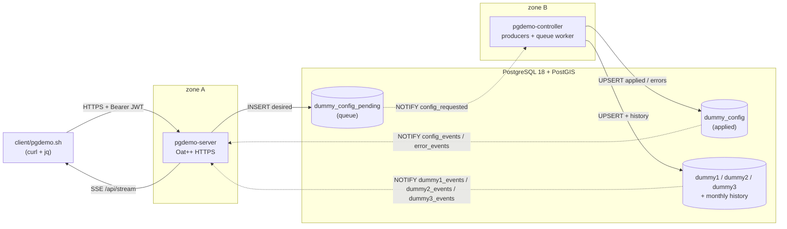
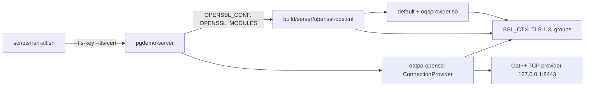

# PostgreSQL as a reactive, persistent message bus

A small, complete reference architecture in which **PostgreSQL is the only channel between two processes that never talk to each other**. Tables are the persistent queue and the source of truth; triggers and `LISTEN/NOTIFY` make the exchange reactive; roles and grants enforce the same authorization as the HTTP API.

The demo runs on dummy data with three tables, `dummy1`, `dummy2` and `dummy3` (a GPS track stored with PostGIS). It covers:

- **Reactive IPC across network zones.** The server (zone A) and the controller (zone B) share no socket, no broker and no addresses. Each one only knows the database.
- **Channel multiplexing on one connection.** `dummy1_events`, `dummy2_events` and `dummy3_events` (plus two control-plane channels) arrive on a single `LISTEN` socket. libpqxx routes each notification to the callback registered for its channel.
- **PostGIS.** `dummy3` stores a `geography(Point, 4326)`. The controller passes an origin, a radius and a bearing; `ST_Project` builds the point, and the same point is appended to the monthly history.
- **Desired vs applied configuration.** An admin posts a desired configuration. The controller validates it and applies or rejects it. The HTTP request waits for the outcome through a request-id **Dispatcher**, so a concurrent, synchronous API sits on top of an asynchronous queue.
- **Monthly-partitioned history.** Every sample is appended to a `RANGE`-partitioned history table. Partitions are created ahead of time, rows that landed in `DEFAULT` are moved, and retention drops whole months.
- **Secure authentication and authorization.** Passwords are stored as Argon2id hashes and requests carry ES384 JWTs. Each request runs under `SET LOCAL ROLE demo_admin | demo_normal`, so PostgreSQL enforces the role a second time, independently of the HTTP check.
- **TLS 1.3.** The Oat++ listener terminates HTTPS. OpenSSL 3.5's `X25519MLKEM768` is the group a stock client negotiates. liboqs, loaded as the `oqsprovider` module from the config beside the binary, is also accepted when the client offers one of its groups.



Read [docs/ARCHITECTURE.md](docs/ARCHITECTURE.md) for the design: sequence diagrams, the listener lifecycle, the Dispatcher, partitioning and the privilege matrix.

## Components

| Path | What it is |
|---|---|
| [`sql/`](sql) | Roles, schema, partition maintenance, triggers, views and grants (`00`–`05`, loaded in order). [sql/README.md](sql/README.md) describes the schema: entity diagram, partitions, channels and privileges. |
| [`libs/db`](libs/db) | `DatabaseManager`: query connection pool, listener connection and thread, callback registry, role-scoped transactions. |
| [`libs/auth`](libs/auth) | `PasswordHasher` (Argon2id) and `JwtManager` (ES384), both on Botan 3. |
| [`server/`](server) | `pgdemo-server`: Oat++ API, `AuthInterceptor`, `Dispatcher`, `EventHub` for Server-Sent Events. |
| [`controller/`](controller) | `pgdemo-controller`: one producer thread per table and the configuration queue worker. |
| [`client/pgdemo.sh`](client/pgdemo.sh) | Command-line client: login, users, data, history, configuration, live monitor. |
| [`scripts/`](scripts) | `db-init.sh`, `run-all.sh` (start the processes), `capture.sh` (network captures), key and certificate generation. |
| [`data/`](data) | Network captures of the client over HTTPS and over plain HTTP. |
| [`patches/`](patches) | libpqxx 8.0.0 patch that adds a truly blocking `wait_notification()`. |
| [`docker/`](docker) | Image and compose file with two isolated network zones. |
| [`tests/`](tests) | GoogleTest (auth, dispatcher, database) and a Robot Framework end-to-end suite on docker compose. |

## Quick start (Ubuntu 26.04)

```bash
sudo apt install build-essential cmake ninja-build git pkg-config patch \
    libpq-dev libbotan-3-dev libboost-json-dev libssl-dev libgtest-dev libgmock-dev \
    postgresql-18 postgresql-18-postgis-3 postgresql-client curl jq openssl

cmake -S . -B build -G Ninja -DCMAKE_BUILD_TYPE=Release
cmake --build build
```

libpqxx 8.0.0 (with the patch) and Oat++ 1.3.1 are downloaded and built by CMake.

Prepare the database. `db-init.sh` needs a superuser connection; on a local cluster the simplest one is a superuser role named after your account, used over the Unix socket:

```bash
sudo -u postgres createuser --superuser "$USER"     # once
PGHOST=/var/run/postgresql scripts/db-init.sh       # add --reset to start over
```

`db-init.sh` creates the roles and the `pgdemo` database, loads `sql/`, seeds the API user `admin`, and writes generated passwords to `run/demo.env` (mode 0600, gitignored). The two processes then connect over TCP to `127.0.0.1:5432` with those passwords (`scram-sha-256` in the default Ubuntu `pg_hba.conf`).

Start both processes. Each one logs in with its own PostgreSQL role. The ports are fixed, one per scheme:

```bash
scripts/run-all.sh                 # HTTPS, TLS 1.3 only, on 127.0.0.1:8443 (default)
scripts/run-all.sh --http          # plain HTTP on 127.0.0.1:8080
scripts/run-all.sh server          # only the server (also: controller); combines with --http
```

Logs go to `run/logs/` and are echoed to the console; Ctrl-C stops both processes. The first HTTPS start generates the self-signed certificate `run/keys/tls.crt`.

In another terminal, the client talks to the same scheme. Without options it calls `https://127.0.0.1:8443` and trusts `run/keys/tls.crt`; `--http`, always the first argument, switches it to `http://127.0.0.1:8080`:

```bash
. run/demo.env
PGDEMO_PASSWORD="$DEMO_ADMIN_PASSWORD" client/pgdemo.sh login admin
client/pgdemo.sh health
# server started with --http:
PGDEMO_PASSWORD="$DEMO_ADMIN_PASSWORD" client/pgdemo.sh --http login admin
client/pgdemo.sh --http health

client/pgdemo.sh monitor                      # live events, including the dummy3 GPS track
client/pgdemo.sh config set dummy1 rate_ms=200 amplitude=25
client/pgdemo.sh config set dummy1 rate_ms=5  # rejected by the controller: 422 INVALID_RATE
client/pgdemo.sh config status                # applied vs desired, per target
client/pgdemo.sh burst 50                     # 50 concurrent requests through the Dispatcher
client/pgdemo.sh history dummy2 limit=5       # each row names its monthly partition

client/pgdemo.sh users add alice normal       # admin only
PGDEMO_PASSWORD=... client/pgdemo.sh login alice
client/pgdemo.sh users list                   # 403: normal users cannot manage users
```

Stop the controller and post a configuration: the API answers `202` with the request still `PENDING` in the queue. Start the controller again and it applies the request at start-up. The queue table, not the notification, is the source of truth.

## Quick start (Docker)

```bash
cp docker/.env.example docker/.env            # set both passwords
docker compose -f docker/compose.yaml --env-file docker/.env up --build
mkdir -p run && docker compose -f docker/compose.yaml --env-file docker/.env cp server:/app/run/keys/tls.crt run/docker-tls.crt
export PGDEMO_URL=https://127.0.0.1:8080 PGDEMO_CA=run/docker-tls.crt
. docker/.env && PGDEMO_PASSWORD="$DEMO_ADMIN_PASSWORD" client/pgdemo.sh login admin
```

Inside its container the server listens on HTTPS port 8443, like `scripts/run-all.sh`; compose publishes it on `127.0.0.1:8080` only. `PGDEMO_URL` and `PGDEMO_CA` point the client at that address and at the container's certificate. The server sits on `zone_a` (172.28.10.0/24). The controller sits on `zone_b` (172.28.20.0/24, `internal`, no outbound route). PostgreSQL is attached to both zones and is the only path between them. The end-to-end suite checks that the controller cannot open a TCP connection to the server.

## TLS: oatpp-openssl, OpenSSL 3.5 and oqsprovider

oatpp-openssl only wraps the TCP socket. `oatpp::openssl::Config::createDefaultServerConfigShared(cert, key)` loads the certificate and the private key and sets nothing else: no protocol version, no groups. Those come from OpenSSL itself. Before Oat++ creates the `SSL_CTX`, `pgdemo-server` sets `OPENSSL_CONF` and `OPENSSL_MODULES` to its own directory (`build/server/`). There the build has copied [`server/openssl-oqs.cnf`](server/openssl-oqs.cnf) and `oqsprovider.so`. When OpenSSL builds the context it reads that file, which:

- activates the `default` provider and the liboqs `oqsprovider`;
- sets `MinProtocol = TLSv1.3`, so a TLS 1.2 client gets a `protocol_version` alert;
- sets `Groups = ?X25519MLKEM768 / ?x25519_mlkem512 / ?x25519_hqc1 / ?X25519`. `/` separates preference tiers: the server picks the hybrid `X25519MLKEM768`, native in OpenSSL 3.5, over the classic `X25519` that curl also offers. It accepts the liboqs groups when a client offers them.



`scripts/run-all.sh --http` omits `--tls-key` and `--tls-cert`. The server then uses the plain TCP provider on port 8080 and never loads the OpenSSL config.

## Network captures

[`data/`](data) holds two loopback captures of `client/pgdemo.sh` making the same calls: `health`, `login`, `me`, `data dummy1` and `config status`.

| File | Contents |
|---|---|
| `data/https.pcapng` | HTTPS on port 8443, plus one `curl --tls-max 1.2` attempt that the server refuses |
| `data/https.keylog` | TLS session secrets written by curl (`SSLKEYLOGFILE`), valid for this capture only |
| `data/https-summary.txt` | Each handshake (TLS 1.3, `X25519MLKEM768`, `TLS_AES_256_GCM_SHA384`), the alert 70 refusing TLS 1.2, and the HTTP decrypted with the keylog |
| `data/http.pcapng` | Plain HTTP on port 8080 |
| `data/http-summary.txt` | The same requests, readable on the wire, including the login body and the token |

The captured calls log in as a throwaway user, `capture` / `capture-demo`, which exists only while the capture runs. The admin password never appears in the files.

Inspect them with Wireshark: open `data/https.pcapng` and set Preferences, Protocols, TLS, "(Pre)-Master-Secret log filename" to `data/https.keylog`. With `tshark`:

```bash
tshark -r data/https.pcapng -Y 'tls.handshake.type == 2' -V | grep -E 'Supported Version|Key Share Entry'
tshark -r data/https.pcapng -Y http                                     # nothing: encrypted
tshark -r data/https.pcapng -o tls.keylog_file:data/https.keylog -Y http
tshark -r data/http.pcapng -Y http
```

Regenerate them with `scripts/capture.sh`. It needs `dumpcap`, so your user has to be in the `wireshark` group, and `tshark` (`sudo apt install tshark`). Run it against a server already started in the matching mode:

```bash
scripts/run-all.sh            # terminal 1
scripts/capture.sh https      # terminal 2, then Ctrl-C in terminal 1
scripts/run-all.sh --http     # terminal 1
scripts/capture.sh http       # terminal 2
```

## HTTPS API

Every route is TLS 1.3 on port 8443, or plain HTTP on port 8080 with `scripts/run-all.sh --http`. A stock client negotiates `X25519MLKEM768`. A client that offers a liboqs group (`x25519_mlkem512`, `x25519_hqc1`) can negotiate that instead. `client/pgdemo.sh` trusts `run/keys/tls.crt`.

| Method and path | Role | Description |
|---|---|---|
| `POST /api/auth/login` | public | `{"username","password"}` → ES384 token |
| `GET /api/health` | public | Listener liveness |
| `GET /api/auth/me` | any | Identity and the PostgreSQL group used for the request |
| `GET /api/db/info` | any | Server version, backend PIDs, libpqxx version, SSE and Dispatcher counters |
| `GET /api/data/{dummy1\|dummy2\|dummy3}` | any | Live rows (`dummy3` returns `lon` and `lat`) |
| `GET /api/history/{table}?from=&to=&item_id=&limit=` | any | History, newest first, with the partition name |
| `GET /api/stream?channels=dummy1,dummy2,dummy3,config,error` | any | Server-Sent Events |
| `GET /api/config` | any | `v_dummy_config_sync_status`: applied, desired, `SYNC`/`PENDING`/`ERROR` |
| `POST /api/config` | admin | `{"target", "rate_ms"?, "amplitude"?, "is_active"?}`, partial update |
| `GET /api/config/requests/{id}` | any | One request and its error, if any |
| `GET /api/config/history?target=&limit=` | any | Applied-configuration audit |
| `GET /api/users` | admin | User directory (no hashes) |
| `POST /api/users` | admin | `{"username","password","role"}` |
| `DELETE /api/users/{username}` | admin | The last admin cannot be removed |

`POST /api/config` returns `200` when the request is applied, `422` when the controller rejects it (or it expired), `202` when it is still queued after `--config-timeout-ms`, and `503` when the Dispatcher already holds 500 waiters.

## Tests

```bash
cmake -S . -B build -G Ninja -DPGDEMO_BUILD_TESTS=ON && cmake --build build
ctest --test-dir build -LE db                  # unit: Argon2id, JWT, Dispatcher, EventHub

. run/demo.env                                 # database tests (controller stopped)
export PGDEMO_TEST_SERVER_CONNINFO="host=127.0.0.1 dbname=pgdemo user=demo_server password=$DEMO_SERVER_DB_PASSWORD"
export PGDEMO_TEST_CONTROLLER_CONNINFO="host=127.0.0.1 dbname=pgdemo user=demo_controller password=$DEMO_CONTROLLER_DB_PASSWORD"
ctest --test-dir build -L db

python3 -m venv .venv && .venv/bin/pip install -r tests/e2e/requirements.txt
.venv/bin/robot --outputdir build/e2e tests/e2e                       # docker compose stack, 43 checks
.venv/bin/robot --variable E2E_DEBUG:true --outputdir build/e2e tests/e2e  # same, with live command output
```

The database tests cover channel multiplexing, the registration and shutdown rules of the listener, concurrent checkouts from the query pool, partition routing, role enforcement inside PostgreSQL, the full NOTIFY-driven configuration loop through the Dispatcher, and request expiry.

The end-to-end suite ([`tests/e2e`](tests/e2e)) needs Docker with compose v2, `curl` and `jq`. [tests/e2e/README.md](tests/e2e/README.md) describes the disposable compose project, the two network zones and the lifecycle the suites drive.

CI ([`.github/workflows/ci.yml`](.github/workflows/ci.yml)) runs the unit and database tests on `ubuntu:26.04` against `postgis/postgis:18-3.7`, and the end-to-end suite in a separate job on the compose stack.

## Documentation

API reference for every class, generated by Doxygen (needs `doxygen`; `graphviz` adds class diagrams):

```bash
sudo apt install doxygen graphviz
cmake --build build --target docs
xdg-open build/docs/html/index.html
```

The target fails on any undocumented class or public member. Configure with `-DPGDEMO_BUILD_DOCS=OFF` to leave it out.

## Scope

This is a demonstration of database architecture, not a product:

- **Self-signed TLS.** The API is TLS 1.3 and binds to loopback by default. `run/keys/tls.crt` is the trust anchor; replace it before exposing the port.
- **No reconnect.** If the listener connection drops, each process exits with status 1 so that a supervisor (compose `restart: unless-stopped`, systemd) restarts it. Queued work is not lost, because it lives in tables.
- **Small payloads.** NOTIFY payloads are limited to 8000 bytes, and these stay well below that.

## Licence

MIT, see [LICENSE](LICENSE). The libpqxx patch follows the libpqxx BSD 3-Clause licence; see [patches/README.md](patches/README.md).
# postgresql
