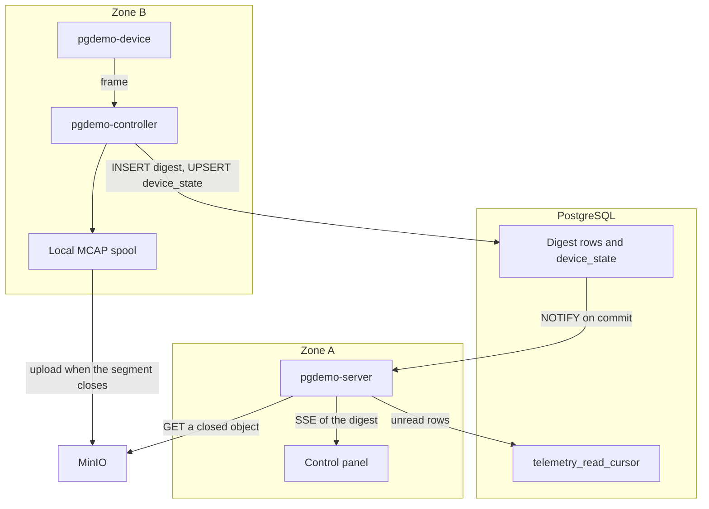
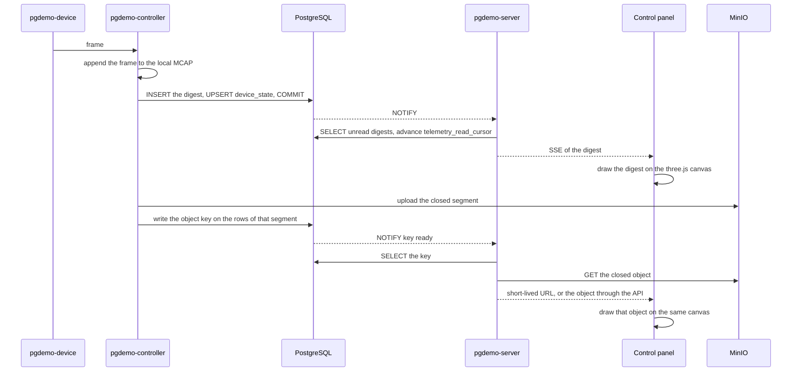
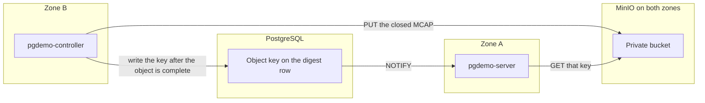
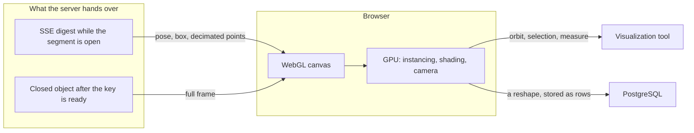
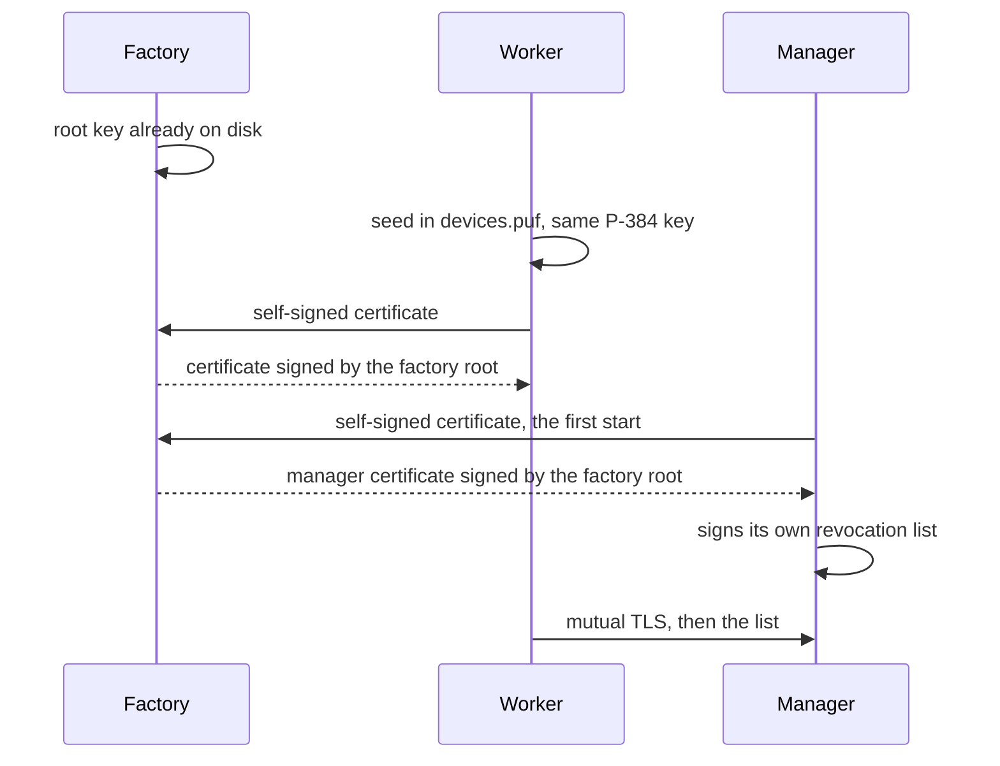

# Mass ingest

A fat sensor sample is split in two. The database stays the index and the wake-up. The blob stays out of the engine. Scalar, GPS, `xy` and `xyz` telemetry is unchanged. A digest row appears only when the sample would stop being a point.

This is one more sentence of the demo in [docs/ARCHITECTURE.md](docs/ARCHITECTURE.md), not a new store. The scaling limits of the current path are [sql/README.md](sql/README.md#scaling-notes).

## Digest and body

The **digest** follows the path the small samples already use. The controller writes one `INSERT` per batch, upserts `device_state` with the latest sample, and the statement trigger notifies once when the transaction commits. The server reads from `telemetry_read_cursor` and publishes the rows on the existing SSE stream. That is the live analysis.

A digest row carries `device_id`, `seq`, the sample time, and a few magnitudes: pose, point count, a box, an indicator. It also carries the object key once the segment has been uploaded. The key is empty while the segment is still open. Live analysis does not need it.

The **body** is the frame itself. The controller appends it to a local MCAP (rosbag2, already in ROS 2 Lyrical) and uploads that file to MinIO when the segment closes. PostgreSQL never sees those bytes, so they never enter the WAL. Post-mortem analysis queries by device and `recorded_at`, reads the keys, and opens those objects.

The notification carries the id, not the URL. A `NOTIFY` payload is limited to 8000 bytes, and the key is read from the row. Ids are `bigint`, as in the rest of the schema. The digest hangs off `device_id`. There is no parallel sensor registry.

On a failed upload the controller deletes the partial object, leaves the key empty, and marks the segment `FAILED`. The per-node queue already holds 256 samples and drops the one that just arrived past that cap, so a slow engine does not block the robot.

If the digest itself reached thousands of batches per second, the wake-up would move from `NOTIFY` to the logical decoding the scaling notes already name. The body does not enter that change.

## Out of scope

- A training store. FiftyOne, Lance, DVC, or WebDataset can read the MCAP later. This demo does not add frame indexes, embeddings, labelling queues, train/val splits, or a training format of its own.
- The cloud or the frame inside PostgreSQL (`bytea`, large objects, or a wide telemetry row).
- A data socket between `pgdemo-server` and `pgdemo-controller`. `zone_b` is `internal: true` in [docker/compose.yaml](docker/compose.yaml). The signal crosses as `NOTIFY`. The bytes go from the controller to MinIO. The day MinIO joins the compose file, it attaches to both zones the way PostgreSQL does. That is a shared service, not a socket between the two processes.
- A listening data port on the robot. A robot behind NAT cannot be dialled from outside either.
- A Python or JavaScript object-storage client. The server is C++20 and the controller is C++ with ROS 2.
- A `sensors` table beside `device`.

## Components

Two planes. The control plane is the one the demo already runs. The fat-data plane is the spool and MinIO. While the segment is open the server reads the digest and does not see the body. After the key is written it reads that closed object from MinIO. The panel talks only to the server.

## One segment

While the segment is open, the canvas follows the SSE of the digest. The full frame is drawn only after the key exists. The browser does not talk to MinIO.

## Producer and consumer

The controller produces the body and the server consumes it. The bulk frame never crosses a socket between them. MinIO is the buffer, attached to `zone_a` and `zone_b` the way PostgreSQL is, so each process uses the address of its own zone. PostgreSQL is the hand-off. The consumer learns that an object exists when the producer has finished it and written the key.

Two credentials, both from the environment and neither committed. The controller's pair can put, abort a multipart upload, and delete an object it failed to finish. The server's pair can get. The server cannot overwrite a recording, and the controller's secret never sits on the server. The panel receives neither pair. A short-lived URL, when the server mints one, is signed with the read credential and names one key.

The order is the protocol. The producer completes the multipart upload, then writes the key and commits. The `NOTIFY` fires on that commit. The consumer selects that key and gets that object. It does not list the bucket and it does not poll. A failed upload deletes the partial object and leaves the key empty, so the consumer has nothing to open. Reading the same key again is safe. The object is not replaced.

## Browser

The strong point of the view is that the graphics engine is the browser. three.js, through React Three Fiber, draws into a WebGL canvas in [frontend/src/components/point-cloud.tsx](frontend/src/components/point-cloud.tsx). The GPU of the machine that opened the panel does the instancing, the shading and the camera. The server hands over numbers and, once the segment has closed, one object. Rasterizing stays on that GPU, next to the person looking at the scene. three.js ships inside the panel bundle.

That split is what a point cloud, a reshape and a further view of the fleet all share. The canvas already places one instanced sphere per sample and orbits the camera around the origin, with the radius, the azimuth around Y and the polar angle read out every frame. A denser cloud stays on the same path: positions sit in a buffer the GPU draws, and the page keeps the interaction, an orbit, a selection or a measure. Reshaping an object is an edit on that canvas. The edit returns to PostgreSQL as rows, and the MCAP in MinIO stays the recording that was uploaded. Another visualization tool for this system is another view on this canvas, still served with the panel and still talking only to the server.

The canvas has two inputs. While the segment is open it follows the digest SSE, pose, box and the decimated points, and the scene moves on the digest. When the key is ready the same canvas draws the closed object for the later look. MinIO stays behind the server.

## Milestones

- [x] **The cut.** This file is the contract: digest in PostgreSQL, body in a MCAP on MinIO, and the out-of-scope list above.
- [ ] **The digest, with the rules of `telemetry_*`.** Monthly partitions, no foreign key to `device`, one `NOTIFY` per `INSERT`, and a read cursor. The body is the local MCAP and the MinIO upload when the segment closes. The upload writes the key. A failed upload deletes the partial object, leaves the key empty, and marks the segment `FAILED`.

  - [ ] **Schema.** A digest table partitioned by month on `recorded_at`, with no foreign key to `device`. Columns: `device_id`, `seq`, the sample time, pose, point count, a box, an indicator, a segment id, and an object key that stays empty until the upload. A statement trigger, its channel, a `telemetry_read_cursor` row, and the grants: the controller inserts the digest and later writes the key, the server reads and advances the cursor. One row in [sql/README.md](sql/README.md).
  - [ ] **MinIO.** The service attached to `zone_a` and `zone_b`, a private bucket, and two credentials from the environment: the controller may put and delete a failed upload, the server may get. Neither secret is committed. Still no TCP between `pgdemo-server` and `pgdemo-controller`.
  - [ ] **Record.** The controller appends the frame to the local MCAP and, on the current cadence (64 samples or 100 ms), inserts the digest and updates `device_state`. The queue of 256 still drops the sample that just arrived.
  - [ ] **Upload.** When the segment closes, a multipart upload, then the key written on the rows of that segment. On failure: delete the partial object, leave the key empty, and mark the segment `FAILED`.
  - [ ] **Live read.** The server `LISTEN`s on the new channel, reads the cursor, and publishes the digest on the SSE stream that already exists. A query by device and `recorded_at` returns the key.

- [ ] **The panel.** The browser draws with the WebGL canvas in [frontend/src/components/point-cloud.tsx](frontend/src/components/point-cloud.tsx). three.js is bundled, and the GPU of that browser does the instancing, the shading and the camera. A full frame is not read from MinIO while the segment is open: one notification per frame would bring back the load this cut avoids. The object appears when the segment closes.

  - [ ] **Live scene.** The open segment feeds the canvas from the digest SSE: pose, box, and the decimated points. The canvas does not ask for the body, and the browser does not talk to MinIO.
  - [ ] **Key ready.** When the controller writes the key, a `NOTIFY` says the object can be read. The server checks the token, reads the key from the row, and gives the panel a short-lived URL or the object through the API. The bucket credentials stay on the server.
  - [ ] **Closed object.** The same canvas draws that object for the later look. A correction made in the scene is stored as rows in PostgreSQL. The MCAP is left as it was uploaded.

- [ ] **The proof.** While a large frame is flowing, the telemetry tables do not grow by the size of that frame. The SSE stream shows the digest. A query for the segment returns a key whose object is intact in MinIO.

  - [ ] **Table size.** A fixture frame larger than the digest row, and the relation size does not grow by that frame.
  - [ ] **SSE.** The event carries the digest fields and does not carry the frame bytes.
  - [ ] **Object.** The key from the query opens an object in MinIO identical to the MCAP left on the spool.

## Two trust models

Workers against the manager already have a trust model, written in [docs/DEVICE_PKI.md](docs/DEVICE_PKI.md). The factory is a second origin. The running demo keeps the first. `run/ca/ca.key` stays where that document puts it.

### The model that runs

`pgdemo-server` holds `run/ca/ca.key` and signs the CSR and the CRL. The controller verifies, and signing stays with the server. The worker generates an ECDSA P-384 key in software, publishes the CSR on ROS, and proves the key with the challenge in [section 5](docs/DEVICE_PKI.md#5-authentication): `pgdemo/manager/security/challenge` and `pgdemo/worker/security/proof`. Admission is that challenge. The CA key stays in zone A. In Docker the `ca-keys` volume is mounted by `init` and the server. When `run/factory/root.key` and `run/controller/manager.key` are absent, this is the whole of device identity.

### What the PoCFHE PKI contributes

From [pki/README.md](https://github.com/jgmatu/PoCFHE/blob/main/pki/README.md) this demo takes three ideas: a simulated PUF of 256 bits as the root of the worker's life, a factory CA that attests that origin, and authentication in both directions. The manager does not hold the worker's usage private key.

The 256-bit seed derives the usage private key, and that key stays ECDSA P-384. The factory is the root of this second model. The PoC keeps what is its own: FHE, `K_aes`, the session HKDF, the P-521 curve, the `authorized_cazas.json` list, and the TCP handshake. There the `master.key` derives the AES key and the ECDSA pair is born separately, and the factory CA is still absent.

The seed and the private key stay on the worker. The self-signed certificate is what travels to the factory. The factory returns a new certificate for the same public key.

### The factory model

[factory/README.md](factory/README.md) is the process. [device/README.md](device/README.md#simulated-puf) is the seed. The schema is in [sql/README.md](sql/README.md#device-identity).

- `scripts/gen-factory.sh` creates `run/factory/root.key` before `pgdemo-factory` starts. The process exits if the key is missing. The certificate is a `root_ca` row named `factory`. The private key is not stored.
- A missing `device_id` in `devices.puf` is generated once and kept. The same id derives the same P-384 key. The worker sends a self-signed certificate. The factory signs the worker and, the first time, the manager. There is no second issuer.
- The manager signs `manager_revocation` with its own key. That list is not the `crl` table. A serial on it is not authenticated, even when the worker certificate still chains to the factory.
- The mutual TLS 1.3 handshake runs when the controller and the worker configure their ROS nodes. The challenge of the model that already runs stays. It is skipped only for a certificate that chains to the factory root.

- [x] **The factory chain.** A `factory` directory, a simulated PUF, one signature from that root, and mutual TLS when the files exist. The model in [docs/DEVICE_PKI.md](docs/DEVICE_PKI.md) keeps running.

  - [x] **Factory.** `pgdemo-factory`, and its certificate stored in `root_ca` under the name `factory`.
  - [x] **Boot.** The worker reads or creates its seed in `devices.puf`, derives the P-384 key, and sends a self-signed certificate. The seed and the private key stay on the worker.
  - [x] **One signature.** The factory signs the worker and the manager. The manager signs its own revocation list.
  - [x] **Handshake.** The worker and the manager authenticate with mutual TLS when the ROS node is configured. The manager presents the certificate the factory signed.
