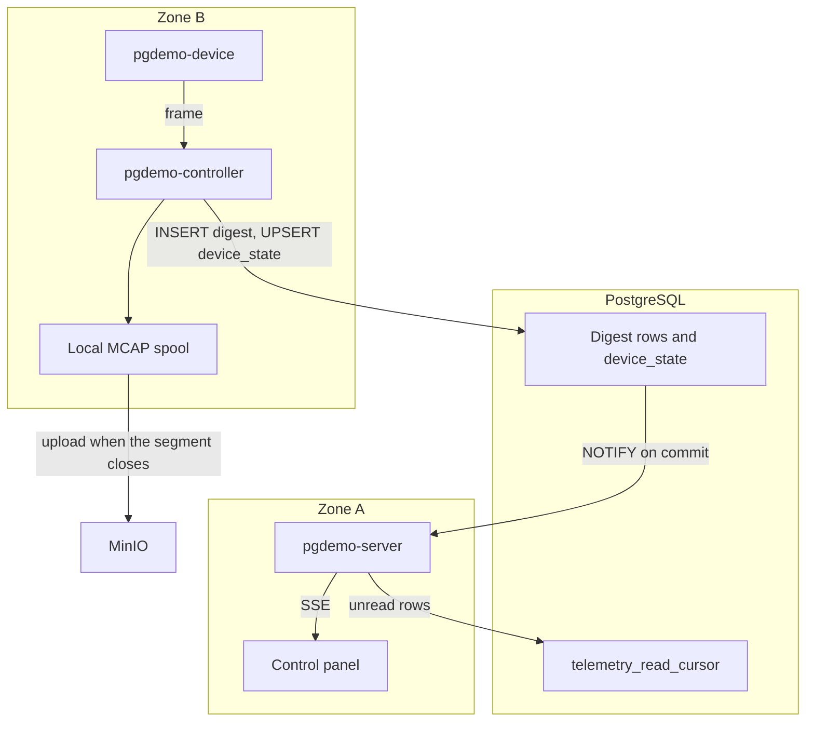
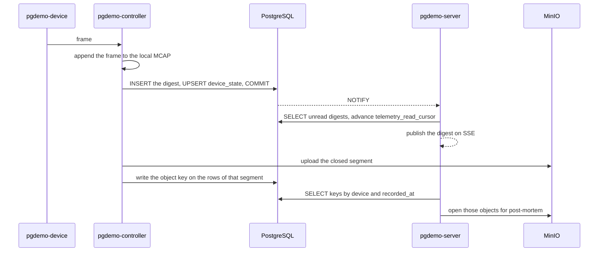

# Mass ingest

A fat sensor sample is split in two. The database stays the index and the wake-up. The blob stays out of the engine. Scalar, GPS, `xy` and `xyz` telemetry is unchanged. A digest row appears only when the sample would stop being a point.

This is one more sentence of the demo in [docs/ARCHITECTURE.md](docs/ARCHITECTURE.md), not a new store. The scaling limits of the current path are [sql/README.md](sql/README.md#scaling-notes).

## Digest and body

The **digest** follows the path the small samples already use. The controller writes one `INSERT` per batch, upserts `device_state` with the latest sample, and the statement trigger notifies once when the transaction commits. The server reads from `telemetry_read_cursor` and publishes the rows on the existing SSE stream. That is the live analysis.

A digest row carries `device_id`, `seq`, the sample time, and a few magnitudes: pose, point count, a box, an indicator. It also carries the object key once the segment has been uploaded. The key is empty while the segment is still open. Live analysis does not need it.

The **body** is the frame itself. The controller appends it to a local MCAP (rosbag2, already in ROS 2 Lyrical) and uploads that file to MinIO when the segment closes. PostgreSQL never sees those bytes, so they never enter the WAL. Post-mortem analysis queries by device and `recorded_at`, reads the keys, and opens those objects.

The notification carries the id, not the URL. A `NOTIFY` payload is limited to 8000 bytes, and the key is read from the row. Ids are `bigint`, as in the rest of the schema. The digest hangs off `device_id`. There is no parallel sensor registry.

On a failed upload the controller deletes the partial object, leaves the key empty, and marks the segment `FAILED`. The per-node queue already holds 256 samples and drops the one that just arrived past that cap, so a slow engine does not block the robot.

If the digest itself reached thousands of batches per second, the wake-up would move from `NOTIFY` to the logical decoding the scaling notes already name. The body does not enter that change.

## Out of scope

- A training store. FiftyOne, Lance, DVC, or WebDataset can read the MCAP later. This demo does not add frame indexes, embeddings, labelling queues, train/val splits, or a training format of its own.
- The cloud or the frame inside PostgreSQL (`bytea`, large objects, or a wide telemetry row).
- A data socket between `pgdemo-server` and `pgdemo-controller`. `zone_b` is `internal: true` in [docker/compose.yaml](docker/compose.yaml). The signal crosses as `NOTIFY`. The bytes go from the controller to MinIO. The day MinIO joins the compose file, it attaches to both zones the way PostgreSQL does. That is a shared service, not a socket between the two processes.
- A listening data port on the robot. A robot behind NAT cannot be dialled from outside either.
- A Python or JavaScript object-storage client. The server is C++20 and the controller is C++ with ROS 2.
- A `sensors` table beside `device`.

## Components

Two planes. The control plane is the one the demo already runs. The fat-data plane is the spool and MinIO. The server reads the digest and does not see the body.

## One segment

Live analysis is the SSE step. Post-mortem analysis is the last two steps. The key may still be empty during the first steps.

## Milestones

- [x] **The cut.** This file is the contract: digest in PostgreSQL, body in a MCAP on MinIO, and the out-of-scope list above.
- [ ] **The digest, with the rules of `telemetry_*`.** Monthly partitions, no foreign key to `device`, one `NOTIFY` per `INSERT`, and a read cursor. The body is the local MCAP and the MinIO upload when the segment closes. The upload writes the key. A failed upload deletes the partial object, leaves the key empty, and marks the segment `FAILED`.

  - [ ] **Schema.** A digest table partitioned by month on `recorded_at`, with no foreign key to `device`. Columns: `device_id`, `seq`, the sample time, pose, point count, a box, an indicator, a segment id, and an object key that stays empty until the upload. A statement trigger, its channel, a `telemetry_read_cursor` row, and the grants: the controller inserts the digest and later writes the key, the server reads and advances the cursor. One row in [sql/README.md](sql/README.md).
  - [ ] **MinIO.** The service attached to `zone_a` and `zone_b`, a bucket, and credentials from the environment, not committed. Still no TCP between `pgdemo-server` and `pgdemo-controller`.
  - [ ] **Record.** The controller appends the frame to the local MCAP and, on the current cadence (64 samples or 100 ms), inserts the digest and updates `device_state`. The queue of 256 still drops the sample that just arrived.
  - [ ] **Upload.** When the segment closes, a multipart upload, then the key written on the rows of that segment. On failure: delete the partial object, leave the key empty, and mark the segment `FAILED`.
  - [ ] **Live read.** The server `LISTEN`s on the new channel, reads the cursor, and publishes the digest on the SSE stream that already exists. A query by device and `recorded_at` returns the key.

- [ ] **The proof.** While a large frame is flowing, the telemetry tables do not grow by the size of that frame. The SSE stream shows the digest. A query for the segment returns a key whose object is intact in MinIO.

  - [ ] **Table size.** A fixture frame larger than the digest row, and the relation size does not grow by that frame.
  - [ ] **SSE.** The event carries the digest fields and does not carry the frame bytes.
  - [ ] **Object.** The key from the query opens an object in MinIO identical to the MCAP left on the spool.
