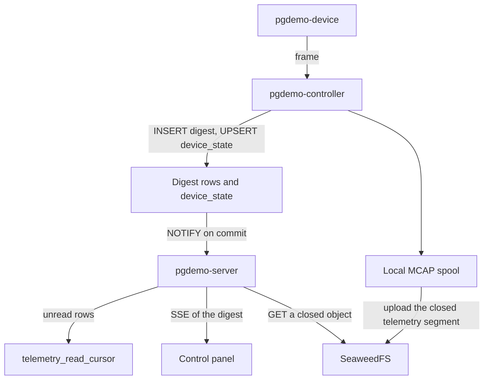
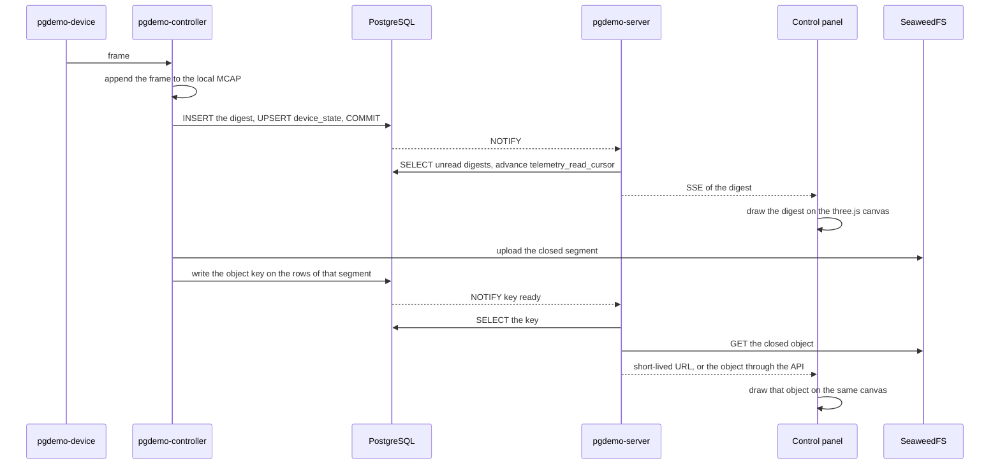
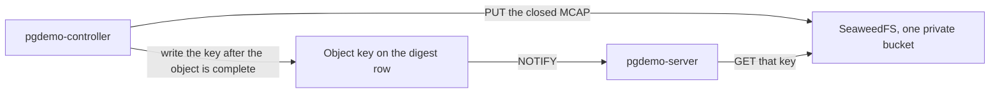
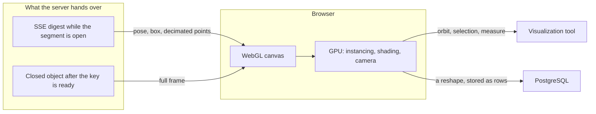
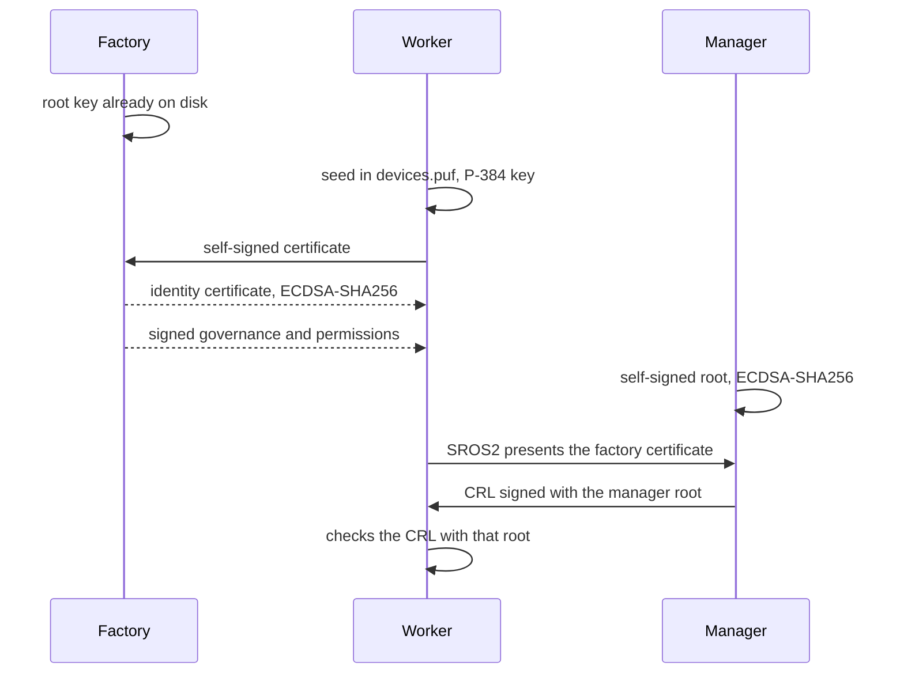

# Mass ingest

`pgdemo-controller` produces and `pgdemo-server` consumes. There is no socket between them. `zone_b` is `internal: true` in [docker/compose.yaml](docker/compose.yaml), and the signal crosses as `NOTIFY`.

The body of every telemetry sample, scalar, GPS, `xy`, `xyz` and a fat frame, is an MCAP segment in [SeaweedFS](https://github.com/seaweedfs/seaweedfs). PostgreSQL never sees those bytes, so they never enter the WAL.

PostgreSQL is both things at once. It is the atomic data clock: each tick is one commit, and `NOTIFY` fires with that commit, so the server never observes a half-written index row. The atom is that transaction. It is not a commit shared with SeaweedFS. An object already uploaded whose key is not committed does not exist for the server. It is the index of the store: the digest (`device_id`, time, `seq`, the magnitudes, a segment id, the object key), `device_state` with the latest sample, and PostGIS on the last fix and on the segment box. A query by device and time, or a spatial query, returns keys. Nobody lists the bucket.

The monthly `telemetry_*` tables are the path that runs today, described in [docs/ARCHITECTURE.md](docs/ARCHITECTURE.md). This file is the cut on which they stop being the archive. The scaling limits of that path are [sql/README.md](sql/README.md#scaling-notes).

## Digest and body

The **digest** follows the path the small samples already use. The controller writes one `INSERT` per batch, upserts `device_state` with the latest sample, and the statement trigger notifies once when the transaction commits. The server reads from `telemetry_read_cursor` and publishes the rows on the existing SSE stream. That is the live analysis.

A digest row carries `device_id`, `seq`, the sample time, and a few magnitudes: pose, point count, a box, an indicator. It also carries the object key once the segment has been uploaded. The key is empty while the segment is still open. Live analysis does not need it.

The **body** is the telemetry itself: scalar, GPS, `xy`, `xyz` and a fat frame. The controller appends it to a local MCAP (rosbag2, already in ROS 2 Lyrical) and uploads that file to SeaweedFS when the segment closes. PostgreSQL never sees those bytes, so they never enter the WAL. Post-mortem analysis queries by device and `recorded_at`, reads the keys, and opens those objects.

`ST_Project` builds the `gps_orbit` sample. It is the generator, not the archive. A real fix already carries latitude and longitude. PostGIS stays on the last point in `device_state` and on the box or simplified track of the segment. The GiST on every monthly sample leaves with those samples.

The notification carries the id, not the URL. A `NOTIFY` payload is limited to 8000 bytes, and the key is read from the row. Ids are `bigint`, as in the rest of the schema. The digest hangs off `device_id`. There is no parallel sensor registry.

On a failed upload the controller aborts the multipart upload, leaves the key empty, and marks the segment `FAILED`. The per-node queue already holds 256 samples and drops the one that just arrived past that cap, so a slow engine does not block the robot.

If the digest itself reached thousands of batches per second, the wake-up would move from `NOTIFY` to the logical decoding the scaling notes already name. The body does not enter that change.

## Out of scope

- A training store. FiftyOne, Lance, DVC, or WebDataset can read the MCAP later. This demo does not add frame indexes, embeddings, labelling queues, train/val splits, or a training format of its own.
- The cloud or the frame inside PostgreSQL (`bytea`, large objects, or a wide telemetry row).
- A data socket between `pgdemo-server` and `pgdemo-controller`. `zone_b` is `internal: true` in [docker/compose.yaml](docker/compose.yaml). The signal crosses as `NOTIFY`. The bytes go from the controller to SeaweedFS. The day SeaweedFS joins the compose file, it attaches to both zones the way PostgreSQL does. That is a shared service, not a socket between the two processes.
- Pointing the SeaweedFS filer at the demo database. The filer keeps its own object index. PostgreSQL is the atomic data clock and the index of the store, not the filer's store.
- Client-side encryption, and storing the data key in PostgreSQL. The bucket's SSE-S3 `AES256` is the encryption. The data key stays in SeaweedFS.
- A SeaweedFS volume cluster, erasure coding, or a cloud tier. This demo runs one `weed mini`.
- A listening data port on the robot. A robot behind NAT cannot be dialled from outside either.
- A Python or JavaScript object-storage client. The server is C++20 and the controller is C++ with ROS 2.
- A `sensors` table beside `device`.

## Components

Two planes. The control plane is the one the demo already runs. The telemetry body is the spool and SeaweedFS. While the segment is open the server reads the digest and does not see the body. After the key is written it reads that closed object from SeaweedFS. The panel talks only to the server. Where each process runs is [docker/operational/README.md](docker/operational/README.md). The spool is a file on the controller, not a container.

## One segment

While the segment is open, the canvas follows the SSE of the digest. The full frame is drawn only after the key exists. The browser does not talk to SeaweedFS.

## Producer and consumer

The controller produces the telemetry body and the server consumes it. PostgreSQL is the atomic data clock and the index of that store. The body never crosses a socket between the two processes. SeaweedFS is the store, attached to `zone_a` and `zone_b` the way PostgreSQL is, so each process uses the address of its own zone. One `weed mini` process is enough for this demo: master, volume server, filer and the S3 gateway on port 8333, path-style. The two processes speak S3 (`CreateMultipartUpload`, `UploadPart`, `CompleteMultipartUpload`, `AbortMultipartUpload`, and a presigned GET). The client stays C++. The private bucket stores every object under SSE-S3 `AES256`. SeaweedFS encrypts it with AES-256, and the `GET` decrypts it in the gateway for the read identity. The data key stays in SeaweedFS. PostgreSQL stores the object name, not the data key and not the ciphertext.

PostgreSQL is the clock. The tick is a commit, and `NOTIFY` publishes it. An object that already sits in SeaweedFS is not a tick. The consumer does not list the bucket and does not read the filer.

1. While the segment is open, the tick is the digest `INSERT` (the key still empty) and the `device_state` upsert. The server reads the cursor and publishes the digest on SSE. The canvas follows that. It does not ask for the body.
2. The producer completes the multipart upload, then writes the key on the rows of that segment and commits. That second tick says the object is closed and may be read.
3. The consumer selects that key and gets that key. An uploaded object whose key is not committed does not exist for it.
4. A failed upload aborts the multipart upload, leaves the key empty, and marks the segment `FAILED`. The clock does not advance to readable.

The filer keeps SeaweedFS's own object index. That index is not the demo's. The filer is not pointed at the `pgdemo` database. PostgreSQL never sees the bytes, so they never enter the WAL.

Two identities, both from the environment and neither committed. The controller's identity has `Write` on the private bucket, which covers the multipart upload and the delete of one it failed to finish. The server's identity has `Read`. The server cannot overwrite a recording, and the controller's secret never sits on the server. The panel receives neither identity. A short-lived URL, when the server mints one, is signed with the read credential and names one key. Reading the same key again is safe. The object is not replaced.

## Browser

The strong point of the view is that the graphics engine is the browser. three.js, through React Three Fiber, draws into a WebGL canvas in [frontend/src/components/point-cloud.tsx](frontend/src/components/point-cloud.tsx). The GPU of the machine that opened the panel does the instancing, the shading and the camera. The server hands over numbers and, once the segment has closed, one object. Rasterizing stays on that GPU, next to the person looking at the scene. three.js ships inside the panel bundle.

That split is what a point cloud, a reshape and a further view of the fleet all share. The canvas already places one instanced sphere per sample and orbits the camera around the origin, with the radius, the azimuth around Y and the polar angle read out every frame. A denser cloud stays on the same path: positions sit in a buffer the GPU draws, and the page keeps the interaction, an orbit, a selection or a measure. Reshaping an object is an edit on that canvas. The edit returns to PostgreSQL as rows, and the MCAP in SeaweedFS stays the recording that was uploaded. Another visualization tool for this system is another view on this canvas, still served with the panel and still talking only to the server.

The canvas has two inputs. While the segment is open it follows the digest SSE, pose, box and the decimated points, and the scene moves on the digest. When the key is ready the same canvas draws the closed object for the later look. SeaweedFS stays behind the server.

## Milestones

- [x] **The cut.** This file is the contract: PostgreSQL is the atomic data clock and the index, the telemetry body is an MCAP on SeaweedFS under SSE-S3 `AES256`, and the out-of-scope list is above.
- [ ] **The digest, with the rules of `telemetry_*`.** Monthly partitions, no foreign key to `device`, one `NOTIFY` per `INSERT`, and a read cursor. The body is the local MCAP and the SeaweedFS upload when the segment closes. The upload writes the key. A failed upload aborts the multipart upload, leaves the key empty, and marks the segment `FAILED`.

  - [ ] **Schema.** A digest table partitioned by month on `recorded_at`, with no foreign key to `device`. It indexes every telemetry segment. Columns: `device_id`, `seq`, the sample time, pose, point count, a box, an indicator, a segment id, and an object key that stays empty until the upload. PostGIS stays on the last fix in `device_state` and on the box of the segment. A statement trigger, its channel, a `telemetry_read_cursor` row, and the grants: the controller inserts the digest and later writes the key, the server reads and advances the cursor. One row in [sql/README.md](sql/README.md).
  - [ ] **SeaweedFS.** One `weed mini` attached to `zone_a` and `zone_b`, the S3 gateway on port 8333, a private bucket with SSE-S3 `AES256`, and two identities from the environment: the controller has `Write` (multipart and the delete of a failed upload), the server has `Read`. Neither secret is committed, and the data key stays in SeaweedFS. PostgreSQL is the atomic clock and the index: it stores the object name. The filer is not pointed at the `pgdemo` database. Still no TCP between `pgdemo-server` and `pgdemo-controller`.
  - [ ] **Record.** The controller appends the frame to the local MCAP and, on the current cadence (64 samples or 100 ms), inserts the digest and updates `device_state`. The queue of 256 still drops the sample that just arrived.
  - [ ] **Upload.** When the segment closes, a multipart upload (`CreateMultipartUpload`, `UploadPart`, `CompleteMultipartUpload`), then the key written on the rows of that segment. On failure: `AbortMultipartUpload`, leave the key empty, and mark the segment `FAILED`.
  - [ ] **Live read.** The server `LISTEN`s on the new channel, reads the cursor, and publishes the digest on the SSE stream that already exists. A query by device and `recorded_at` returns the key.

- [ ] **The panel.** The browser draws with the WebGL canvas in [frontend/src/components/point-cloud.tsx](frontend/src/components/point-cloud.tsx). three.js is bundled, and the GPU of that browser does the instancing, the shading and the camera. A full frame is not read from SeaweedFS while the segment is open: one notification per frame would bring back the load this cut avoids. The object appears when the segment closes.

  - [ ] **Live scene.** The open segment feeds the canvas from the digest SSE: pose, box, and the decimated points. The canvas does not ask for the body, and the browser does not talk to SeaweedFS.
  - [ ] **Key ready.** When the controller writes the key, a `NOTIFY` says the object can be read. The server checks the token, reads the key from the row, and gives the panel a short-lived URL or the object through the API. The bucket credentials stay on the server.
  - [ ] **Closed object.** The same canvas draws that object for the later look. A correction made in the scene is stored as rows in PostgreSQL. The MCAP is left as it was uploaded.

- [ ] **The proof.** While a large frame is flowing, the telemetry tables do not grow by the size of that frame. The SSE stream shows the digest. A query for the segment returns a key whose object is intact in SeaweedFS.

  - [ ] **Table size.** A fixture frame larger than the digest row, and the relation size does not grow by that frame.
  - [ ] **SSE.** The event carries the digest fields and does not carry the frame bytes.
  - [ ] **Object.** The key from the query opens an object in SeaweedFS identical to the MCAP left on the spool.

## Two trust models

Workers against the manager already have a trust model, written in [docs/DEVICE_PKI.md](docs/DEVICE_PKI.md). The factory is a second origin. The running demo keeps the first. `run/ca/ca.key` stays where that document puts it.

### The model that runs

`pgdemo-server` holds `run/ca/ca.key` and signs the CSR and the CRL. The controller verifies, and signing stays with the server. The worker generates an ECDSA P-384 key in software, publishes the CSR on ROS, and proves the key with the challenge in [section 5](docs/DEVICE_PKI.md#5-authentication): `pgdemo/manager/security/challenge` and `pgdemo/worker/security/proof`. Admission is that challenge. The CA key stays in zone A. In Docker the `ca-keys` volume is mounted by `init` and the server. When `run/factory/root.key` and `run/controller/manager.key` are absent, this is the whole of device identity.

### What the PoCFHE PKI contributes

From [pki/README.md](https://github.com/jgmatu/PoCFHE/blob/main/pki/README.md) this demo takes three ideas: a simulated PUF of 256 bits as the root of the worker's life, a factory CA that attests that origin, and authentication in both directions. The manager does not hold the worker's usage private key.

The 256-bit seed derives the usage private key, and that key stays ECDSA P-384. The factory is the root of this second model. The PoC keeps what is its own: FHE, `K_aes`, the session HKDF, the P-521 curve, the `authorized_cazas.json` list, and the TCP handshake. There the `master.key` derives the AES key and the ECDSA pair is born separately, and the factory CA is still absent.

The seed and the private key stay on the worker. The self-signed certificate is what travels to the factory. The factory returns a new certificate for the same public key.

### The factory model

[factory/README.md](factory/README.md) is the process. [device/README.md](device/README.md#simulated-puf) is the seed. The schema is in [sql/README.md](sql/README.md#device-identity).

- `scripts/gen-factory.sh` creates `run/factory/root.key` before `pgdemo-factory` starts. The process exits if the key is missing. `root.crt` is self-signed with ECDSA-SHA256 and is a `root_ca` row named `factory`. The private key is not stored. The key stays P-384. DDS-Security on Lyrical accepts `ecdsa-with-SHA256` and rejects SHA-384, so the identity certificates use that hash. The manager's CRL signature stays ECDSA-SHA384.
- A missing `device_id` in `devices.puf` is generated once and kept. The same id derives the same P-384 key. The worker sends a self-signed certificate. The factory signs the worker. The manager root is self-signed from `manager.key` and is not issued by the factory.
- The factory also signs two fixed documents: the governance template and the permissions template whose subject is `CN=<name>`. `identity_ca.cert.pem` is the factory root followed by the manager root. `permissions_ca.cert.pem` is the factory root. `root.key` is not copied into the keystore.
- The manager signs `manager_revocation` with its own root. That list is not the `crl` table and DDS does not consult it. It is published every second on `pgdemo/manager/security/crl`. Each worker holds a copy of that root and checks the signature. A serial on the list ends the worker, and a `hello` of that serial gets `bye` and no session, even when the certificate still chains to the factory.
- DDS-Security is the admission. Each process writes its enclave and exports `ROS_SECURITY_*` before `rclcpp::init`. The OpenSSL listener is not that proof. The challenge of the model that already runs stays when the factory files are absent, or when a worker's certificate does not chain and SROS2 stays off. A manager that already enforces SROS2 does not see that worker.

- [x] **The factory chain.** A `factory` directory, a simulated PUF, one signature from that root, and SROS2 when the files exist. The model in [docs/DEVICE_PKI.md](docs/DEVICE_PKI.md) keeps running when they do not.

  - [x] **Factory.** `pgdemo-factory`, and its certificate stored in `root_ca` under the name `factory`. It signs identities and the two policy templates.
  - [x] **Boot.** The worker reads or creates its seed in `devices.puf`, derives the P-384 key, and sends a self-signed certificate. The seed and the private key stay on the worker.
  - [x] **One signature.** The factory signs the worker and the manager with ECDSA-SHA256. The manager signs its own revocation list with ECDSA-SHA384.
  - [x] **Admission.** The worker presents the factory certificate through SROS2. The manager publishes the CRL, and the worker checks it with the manager certificate.
