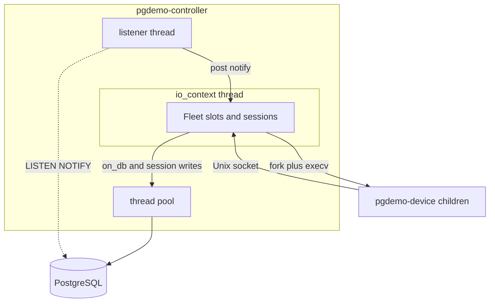
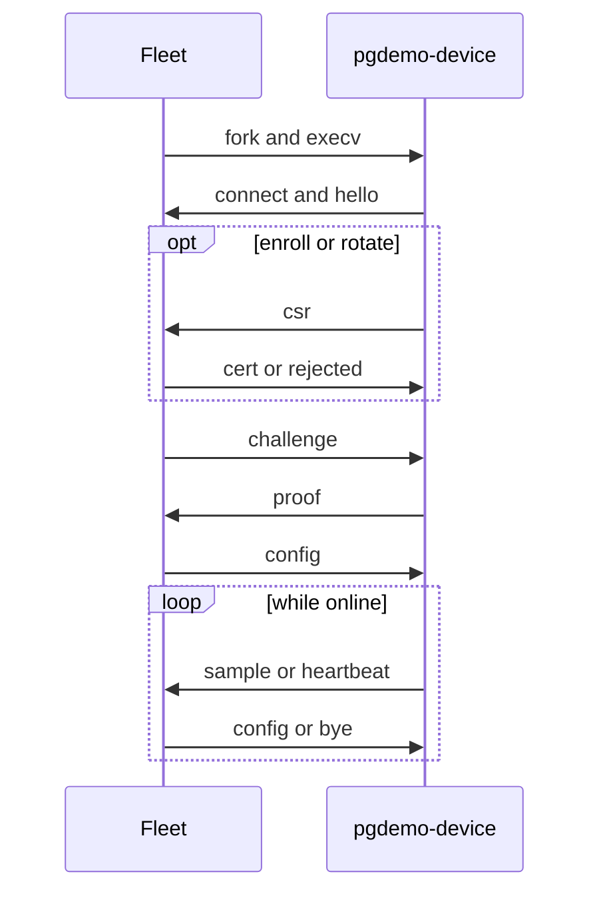

# pgdemo-controller

Zone B process. It supervises one `pgdemo-device` child per device and is the process that writes samples and applied configuration. PostgreSQL is the only channel to `pgdemo-server`: the controller has no address for it. Device identity, the internal CA and the certificate checks live in [docs/DEVICE_PKI.md](../docs/DEVICE_PKI.md). The tables, channels and the queue are the contract in [sql/README.md](../sql/README.md) and [docs/ARCHITECTURE.md](../docs/ARCHITECTURE.md).

Sources:

| File | Role |
|---|---|
| [`src/main.cpp`](src/main.cpp) | Options, signal mask, database, listener, then the fleet |
| [`src/Fleet.hpp`](src/Fleet.hpp), [`src/Fleet.cpp`](src/Fleet.cpp) | Process table, sessions, restarts, queue |
| [`src/Spawn.cpp`](src/Spawn.cpp) | `fork` + `execv`, and `SO_PEERCRED` |

## Startup

`main` blocks `SIGINT`, `SIGTERM` and `SIGCHLD` before any thread exists, so the pool and the listener inherit the mask. Children start with an empty mask (`spawn_process`). `SIGPIPE` is ignored.

It then connects as `pgdemo-controller`, creates the current and upcoming history partitions, builds the fleet and binds the Unix socket. The four channels are registered and the listener loop starts **before** `Fleet::start()`. `boot()` therefore reads devices and open enrollments while `LISTEN` is already active: a commit in between is either in that read or arrives as a notification.

`Fleet::start()` spawns six coroutines on the `io_context` and `main` unblocks the signals so Asio's `signal_set` can receive them. `io.run()` returns when shutdown has finished. Queued database work is joined, the listener stops, and the process exits with `Fleet::exit_code()`: `0` after a signal, `1` when the listener connection was lost (a supervisor can restart it). A bad option exits `2`.

## Threads

The `io_context` runs with one thread. That thread owns the process table, the slots and the sessions, so none of them takes a lock. The libpqxx listener thread only posts into `notify()`. Database calls block, so a coroutine `co_await`s `on_db()` on the thread pool and resumes on the io thread with the result. Writes of `device_session` go through the `writes_` strand, which keeps their order; shutdown resets sessions on that same strand, after every state already queued.



## Command line

```text
pgdemo-controller [--conninfo STR] [--pool-size N] [--max-devices N]
                  [--device-bin PATH] [--devices-dir DIR] [--socket PATH]
                  [--enrollment-timeout-s N] [--pending-max-age-s N]
                  [--maintenance-interval-s N]
```

| Option | Default | Effect |
|---|---|---|
| `--conninfo` | `PG*` environment | libpq connection string |
| `--pool-size` | 8 | Query connections and database threads |
| `--max-devices` | 16 | Device processes run at once; the rest are `UNMANAGED` |
| `--device-bin` | Beside this binary, else `../device/pgdemo-device` | `pgdemo-device` executable. It must be executable |
| `--devices-dir` | `run/devices` | One key directory per device, mode `0700` |
| `--socket` | `DIR/.controller.sock` | Socket the devices connect to, mode `0600` |
| `--enrollment-timeout-s` | 120 | Open enrollments older than this become `EXPIRED` |
| `--pending-max-age-s` | 600 | `PENDING` configuration older than this becomes `TIMEOUT` |
| `--maintenance-interval-s` | 3600 | How often partition maintenance runs |

Device names cannot start with a dot, so the socket file never clashes with a key directory.

`open_socket()` probes an existing socket path first. A controller that answers there is left alone and this process exits: rebinding would orphan its children and start a second copy of every device. A socket left by a killed controller refuses the probe and is replaced.

## Process table

One `Slot` per device name, or per enrollment that has no device row yet. The interesting fields:

| Field | Meaning |
|---|---|
| `next`, `next_request` | How the next process starts: `Run`, `Enroll` or `Rotate`, and the enrollment id when it is not `Run` |
| `pid`, `running`, `running_request` | The live process, how it was started, and the enrollment it is still waiting on |
| `session` | Its accepted connection, once `hello` has matched |
| `wanted` | Cleared after `AUTH_FAILED`, until the identity changes |
| `stopping` | This controller asked the process to exit |
| `removed` | The device was deleted; the slot goes away with the process |
| `failures` | Consecutive exits this controller did not request, for the backoff |

`reconcile()` starts a process when the slot is wanted, has no pid, has no restart already scheduled, and the fleet is under `--max-devices`. A `Run` with no device row, or with an identity that is not `ACTIVE`, stays down (`DISABLED` in the second case). A slot that would pass the limit is written as `UNMANAGED`. An enrollment that would not fit fails with `CAPACITY` and, when there is no device yet, the slot is forgotten.

`reconcile_all()` walks slots by `device_id` (enrollments with no id last), so the oldest devices take the free slots first.

## Starting a process

`start_process()` creates `devices-dir/<name>` at mode `0700` and execs:

```text
pgdemo-device --name NAME --type TYPE --payload scalar|gps --socket PATH --dir DIR
              [--enroll REQUEST_ID | --rotate REQUEST_ID]
```

`spawn_process()` builds `argv` before the fork. Between `fork` and `execv` the child only calls async-signal-safe functions: it restores default dispositions for `SIGINT`, `SIGTERM`, `SIGCHLD` and `SIGPIPE`, clears the signal mask, asks for `SIGTERM` when the forking thread dies (`PR_SET_PDEATHSIG`), exits `127` if that parent is already gone, closes every descriptor above stderr, then `execv`. The death signal is tied to the thread that forked, which is the io thread, the one that lives as long as the children.

The pid is recorded before the child can connect. `set_state` writes `STARTING`.

## A connection

`accept_loop()` spawns `device_session()` per accepted socket. Frames are a 4-byte big-endian length and a JSON object; the full list is in [docs/DEVICE_PKI.md](../docs/DEVICE_PKI.md#frames).

1. `SO_PEERCRED` must report this process's uid and a pid in the table. The session is bound to the name that pid was started with.
2. `hello` must arrive within 5 s, name that device, and name the mode the process was started with (`run`, `enroll` or `rotate`). A second connection from the same process is refused.
3. `Enroll` and `Rotate` then wait up to 30 s for a `csr`, store it with `submit_csr`, and wait on the session's decision channel for up to `--enrollment-timeout-s`. `enrollment_events` delivers the outcome into that channel. `ISSUED` is forwarded as `cert` and the process continues as `Run`; anything else is forwarded as `rejected` and the session ends. A process that exits before the certificate is delivered fails the enrollment with `DEVICE_EXITED`.
4. Challenge-response, 5 s for the proof. The controller re-reads the device, the active roots and the CRL, so a revocation committed a moment ago counts. The checks themselves are [docs/DEVICE_PKI.md](../docs/DEVICE_PKI.md#5-authentication). An identity that is not `ACTIVE` ends the session as `DISABLED`. A failed proof ends it as `AUTH_FAILED` and clears `wanted`: the process is left down until the identity changes.
5. `serve()` marks the session online **before** reading the applied configuration, so a configuration committed from here on is queued behind the initial `config` frame. It writes `ONLINE` and runs `read_samples()` and `write_frames()` together. The first one to finish stops the other.

`read_samples()` stores each `sample` (scalar value, or a GPS origin, radius and bearing that the INSERT projects with `ST_Project`) and refreshes `last_frame` on every frame, including `heartbeat`. `write_frames()` is the only writer toward the device: configuration updates and `bye`. The outbox holds 64 frames; a frame that does not fit is dropped.

When the session ends for any reason, the slot drops it, writes `OFFLINE` if it was `ONLINE` or `STARTING`, and sends `SIGTERM`. A process without its session has nothing to do.



## Supervision

`reap_loop()` waits on `SIGCHLD` and collects every exited child with `waitpid(-1, WNOHANG)`.

An exit the controller did not request, while the next launch is `Run`, waits `1 << min(failures, 5)` seconds before the next start, and never more than 30 s. The first such exit waits 1 s. A process that stayed online for 60 s resets the count. A stop this controller requested (`stopping`, set by `stop_process`) is reconciled at once, which is how a rotation or a lifted hold replaces the process without waiting. `AUTH_FAILED` leaves `wanted` false, so the restart is not scheduled. `DISABLED` is reconciled back into the same state.

`stop_process()` sets `stopping`, queues a `bye` with the reason, and sends `SIGTERM`.

`heartbeat_loop()` runs every 10 s. An online device with no frame for 30 s (the device heartbeats every 5 s while paused) is `SIGKILL`ed and then reaped like any other exit. Devices that spoke are touched in `device_session.last_seen`.

`maintenance_loop()` runs every 30 s. It expires enrollments older than `--enrollment-timeout-s`, sweeps (re-reads every device and every pending enrollment, drops slots whose device row is gone, reconciles), and, every `--maintenance-interval-s`, creates the upcoming history partitions. The sweep is what notices a certificate that expired without a write. If `listener_alive()` is false it shuts down with exit code 1.

Shutdown, from `SIGINT` or `SIGTERM`, closes the acceptor, sends `bye` and `SIGTERM` to every child, waits up to 5 s, and `SIGKILL`s whoever is left. It removes the socket, resets every session on the write strand, and stops the `io_context`.

## What changes the fleet

`notify()` reads `{"channel", "payload"}` and spawns one coroutine:

| Channel | What the fleet does |
|---|---|
| `enrollment_requested` | Load the `PENDING` row. `ENROLL` creates a slot and sets `next` to `Enroll`. `ROTATE` requires a slot that already has a device. A running process is stopped so the next one starts in the new mode. |
| `enrollment_events` | If that process is waiting in `obtain_certificate()`, the outcome is delivered on its decision channel. A refusal that arrived earlier stops the process, or forgets a slot that never had a device. |
| `device_events` | `DELETE` marks the slot removed, stops the process, and `forget()` deletes `devices-dir/<name>`. `INSERT`, `ROTATED`, `REVOKED` and `UNREVOKED` reload the device. An identity that is not `ACTIVE` stops a `Run` process and writes `DISABLED`. `ACTIVE` again, or a new fingerprint, sets `wanted` and starts the process when it is down. |
| `config_requested` | `drain()` takes every `PENDING` row (`FOR UPDATE SKIP LOCKED`), validates `rate_ms` in `[50, 10000]` and `amplitude` in `(0, 1000]`, and commits `SUCCESS`, `ERROR` or `TIMEOUT`. Each applied configuration is sent as a `config` frame to that device's online session. The same drain runs once from `boot()`. |

Session states written to `device_session`, and shown by `GET /api/devices/NAME` as `session` and `process`:

| State | When |
|---|---|
| `STARTING` | Process spawned, not online yet |
| `ONLINE` | Authenticated and streaming |
| `OFFLINE` | Session ended, or the process could not be spawned |
| `UNMANAGED` | Wanted, but `--max-devices` is already full |
| `AUTH_FAILED` | `hello` or the proof was rejected; stays down until the identity changes |
| `DISABLED` | The identity is not `ACTIVE` (revoked, held, or expired) |
