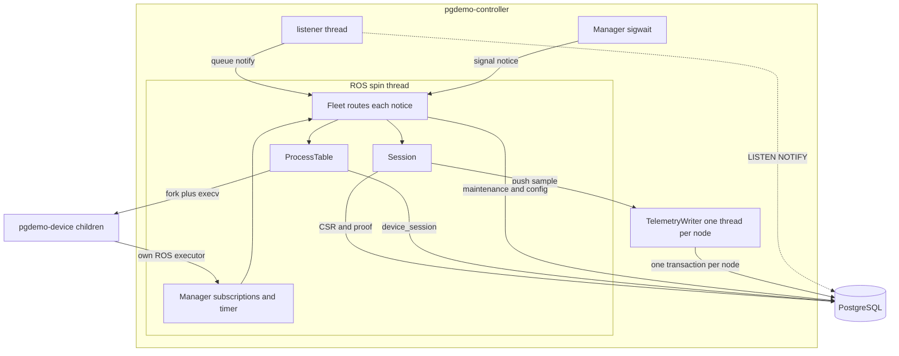
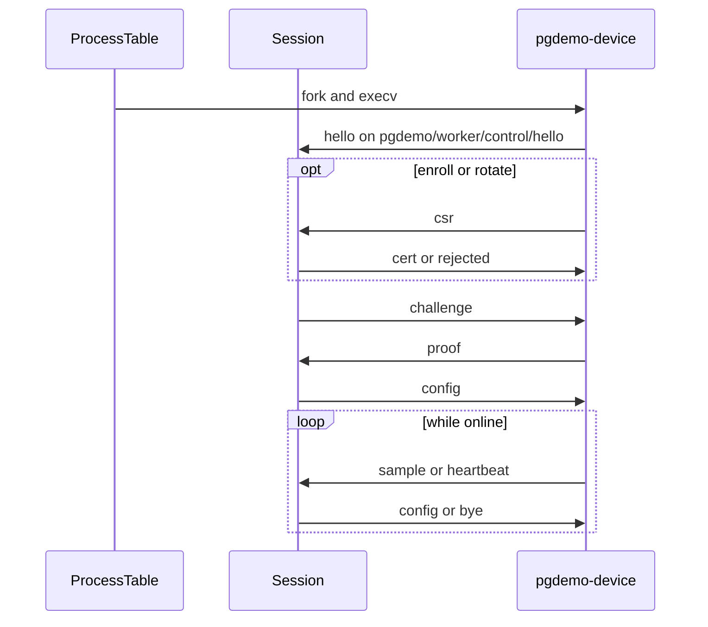
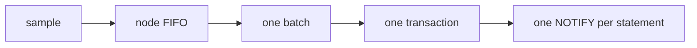

# pgdemo-controller

Zone B process. It supervises one `pgdemo-device` child per device and is the process that writes samples and applied configuration. PostgreSQL is the only channel to `pgdemo-server`: the controller has no address for it. Device identity, the internal CA and the certificate checks live in [docs/DEVICE_PKI.md](../docs/DEVICE_PKI.md). The tables, channels and the queue are the contract in [sql/README.md](../sql/README.md) and [docs/ARCHITECTURE.md](../docs/ARCHITECTURE.md).

Sources:

| File | Role |
|---|---|
| [`src/main.cpp`](src/main.cpp) | Options, signal mask, database, listener, ROS spin |
| [`src/Manager.hpp`](src/Manager.hpp), [`src/Manager.cpp`](src/Manager.cpp) | Node `pgdemo_controller`: topics, the 100 ms timer, sigwait |
| [`src/Fleet.hpp`](src/Fleet.hpp), [`src/Fleet.cpp`](src/Fleet.cpp) | `tick`, the `LISTEN` queue, maintenance, shutdown |
| [`src/ProcessTable.hpp`](src/ProcessTable.hpp), [`src/ProcessTable.cpp`](src/ProcessTable.cpp) | Slots, fork, reap, backoff, the lock |
| [`src/Session.hpp`](src/Session.hpp), [`src/Session.cpp`](src/Session.cpp) | Handshake of one worker, then online samples |
| [`src/TelemetryWriter.hpp`](src/TelemetryWriter.hpp), [`src/TelemetryWriter.cpp`](src/TelemetryWriter.cpp) | One sample queue and one thread per node |
| [`src/Spawn.cpp`](src/Spawn.cpp) | `fork` + `execv` of `pgdemo-device` |

## Startup

`main` blocks `SIGINT`, `SIGTERM` and `SIGCHLD` before any thread exists, so the listener, the ROS spin and the queue threads inherit the mask. A `sigwait` thread is the only one that receives them. Children start with an empty mask (`spawn_process`). `SIGPIPE` is ignored.

It then connects as `pgdemo-controller` with `--max-devices + 1` query connections, creates the current and upcoming history partitions, builds the `pgdemo_controller` node and the fleet, subscribes, and takes `devices-dir/.controller.lock`. The four channels are registered, the subscriptions to `pgdemo/worker/` are active, and the listener loop starts **before** `Fleet::boot()`. `boot()` therefore reads devices and open enrollments while both `LISTEN` and the topics are already active: a commit or a `hello` in between is either in that read or arrives as an event.

`boot()` runs on the main thread, and `rclcpp::spin` continues on that same thread. A wall timer calls `tick()` every 100 ms. `spin` returns when shutdown has finished. The listener then stops, and the process exits with `Fleet::exit_code()`: `0` after a signal, `1` when the listener connection was lost (a supervisor can restart it). A bad option exits `2`.

## Threads

ROS 2 is the fleet's executor. `rclcpp::spin` runs on the main thread. `Fleet::tick` hands an enrollment or a `device_events` notice to `ProcessTable`, and an uplink to that worker's `Session`, so the table and the sessions still take no lock. Subscriptions call `on_hello()` and `on_uplink()` directly. `tick()` reaps children, enforces handshake deadlines, and runs the heartbeat and the maintenance. Each device process has its own ROS executor for `pgdemo/worker/` and `pgdemo/manager/`.

[`TelemetryWriter`](src/TelemetryWriter.hpp) is the only class that inserts samples. A node gets one FIFO and one POSIX thread. That thread checks a connection out of the pool, writes one transaction, and returns it. The spin thread keeps one connection free for a CSR, a proof or a session write, which still happen at once. The `LISTEN` connection is separate: its callback only queues the JSON object. Workers never see a connection: they have no connection string, and `close_range` between `fork` and `execv` drops every descriptor the pool holds.



## Command line

```text
pgdemo-controller [--conninfo STR] [--max-devices N]
                  [--device-bin PATH] [--devices-dir DIR]
                  [--enrollment-timeout-s N] [--pending-max-age-s N]
                  [--maintenance-interval-s N]
```

| Option | Default | Effect |
|---|---|---|
| `--conninfo` | `PG*` environment | libpq connection string. `--max-devices + 1` query connections are opened; the listener connection is separate |
| `--max-devices` | 16 | Device processes run at once; the rest are `UNMANAGED` |
| `--device-bin` | Beside this binary, else `../device/pgdemo-device` | `pgdemo-device` executable. It must be executable |
| `--devices-dir` | `run/devices` | One key directory per device, mode `0700`. The lock file is `DIR/.controller.lock` |
| `--enrollment-timeout-s` | 120 | Open enrollments older than this become `EXPIRED` |
| `--pending-max-age-s` | 600 | `PENDING` configuration older than this becomes `TIMEOUT` |
| `--maintenance-interval-s` | 3600 | How often partition maintenance runs |

Device names cannot start with a dot, so `.controller.lock` never clashes with a key directory.

`ProcessTable::acquire_lock()` takes an exclusive `fcntl` lock on that file. A second controller on this machine exits. The lock is per process and is not inherited across `fork`, so a device child does not release it. One ROS domain runs one controller.

## Process table

`ProcessTable` keeps one `Slot` per device name, or per enrollment that has no device row yet. The interesting fields:

| Field | Meaning |
|---|---|
| `next`, `next_request` | How the next process starts: `Run`, `Enroll` or `Rotate`, and the enrollment id when it is not `Run` |
| `pid`, `running`, `running_request` | The live process, how it was started, and the enrollment it is still waiting on |
| `session` | The worker's session, once `hello` has matched |
| `wanted` | Cleared after `AUTH_FAILED`, until the identity changes |
| `stopping` | This controller asked the process to exit |
| `removed` | The device was deleted; the slot goes away with the process |
| `failures` | Consecutive exits this controller did not request, for the backoff |

`reconcile()` starts a process when the slot is wanted, has no pid, has no restart already scheduled, and the fleet is under `--max-devices`. A `Run` with no device row, or with an identity that is not `ACTIVE`, stays down (`DISABLED` in the second case). A slot that would pass the limit is written as `UNMANAGED`. An enrollment that would not fit fails with `CAPACITY` and, when there is no device yet, the slot is forgotten.

`reconcile_all()` walks slots by `device_id` (enrollments with no id last), so the oldest devices take the free slots first.

## Starting a process

`start_process()` creates `devices-dir/<name>` at mode `0700` and execs:

```text
pgdemo-device --name NAME --type TYPE --payload scalar|gps|xy|xyz --dir DIR
              [--enroll REQUEST_ID | --rotate REQUEST_ID]
```

`spawn_process()` builds `argv` before the fork. Between `fork` and `execv` the child only calls async-signal-safe functions: it restores default dispositions for `SIGINT`, `SIGTERM`, `SIGCHLD` and `SIGPIPE`, clears the signal mask, asks for `SIGTERM` when the forking thread dies (`PR_SET_PDEATHSIG`), exits `127` if that parent is already gone, closes every descriptor above stderr, then `execv`. The child is a new ROS node (`pgdemo_device_<name>`); it inherits the parent's ROS environment and nothing of its DDS participant, because `execv` replaces the image. The death signal is tied to the thread that forked, which is the spin thread.

The pid is recorded before the child can publish. `set_state` writes `STARTING`. If no `hello` arrives within 5 s the child is killed.

## A connection

`Session` is the handshake of one worker. The phase (`WaitCsr`, `WaitCert`, `WaitProof`, `Online`) decides which uplink is valid. `Fleet` routes `on_hello()` and `on_uplink()` to the session of that name. The fields are the structs in [msgs/README.md](../msgs/README.md). A `hello` opens the session. Anything else for a name with no session is kept until that `hello`, then delivered. Appearing in the ROS graph is not admission: only the manager accepts a `hello`, and a worker cannot supervise another worker.

1. The `hello` names a wanted slot and the mode that slot expects (`run`, `enroll` or `rotate`). A slot with no process yet takes this node and is not forked. A `hello` repeated while the handshake is in progress is ignored. A `hello` after the device is online gets `bye`.
2. A child that was just forked has 5 s to publish that `hello`.
3. `Enroll` and `Rotate` then wait up to 30 s for a `csr`, store it with `submit_csr`, and wait up to `--enrollment-timeout-s` for the certificate. `enrollment_events` delivers the outcome. One that arrives before the CSR is stored is kept until then. `ISSUED` is forwarded as `cert` and the process continues as `Run`; anything else is forwarded as `rejected` and the session ends. A process that exits before the certificate is delivered fails the enrollment with `DEVICE_EXITED`.
4. Challenge-response, 5 s for the proof. The controller re-reads the device, the active roots and the CRL, so a revocation committed a moment ago counts. The checks themselves are [docs/DEVICE_PKI.md](../docs/DEVICE_PKI.md#5-authentication). An identity that is not `ACTIVE` ends the session as `DISABLED`. A failed proof ends it as `AUTH_FAILED` and clears `wanted`: the process is left down until the identity changes.
5. The session is marked online **before** reading the applied configuration, so a configuration committed from here on is published after the initial `pgdemo/manager/config`. It writes `ONLINE` and pushes samples until the session closes.

The online phase refreshes `last_frame` on every message, including `heartbeat`, and pushes samples onto that node's queue. It does not open a database session. The manager publishes `pgdemo/manager/` (`config`, `bye`, the handshake) with the device name stamped on it. While the session waits for the CA, the inbox holds 64 uplink messages; one that does not fit is dropped.

When the session ends, the slot drops it and writes `OFFLINE` if it was `ONLINE` or `STARTING`. A child is then sent `SIGTERM`. A node this controller did not fork only gets `bye`.



## Supervision

`Fleet::tick()`, every 100 ms, clears the `SIGCHLD` notice and `ProcessTable::reap()` collects every exited child with `waitpid(-1, WNOHANG)`. The notice is not what collects them: the timer reaps on every beat.

An exit the controller did not request, while the next launch is `Run`, waits `1 << min(failures, 5)` seconds before the next start, and never more than 30 s. The first such exit waits 1 s. A process that stayed online for 60 s resets the count. A stop this controller requested (`stopping`, set by `stop_process`) is reconciled at once, which is how a rotation or a lifted hold replaces the process without waiting. `AUTH_FAILED` leaves `wanted` false, so the restart is not scheduled. `DISABLED` is reconciled back into the same state.

`ProcessTable::stop_process()` publishes `bye` with the reason. A child is then sent `SIGTERM` (`stopping` is set, so the reaper starts the next one at once). A node this controller did not create is released.

`Fleet::heartbeat()` runs every 10 s. An online device with no message for 30 s (the device heartbeats every 5 s while paused) is `SIGKILL`ed when it is a child, and only released when it is not. Devices that spoke are touched in `device_session.last_seen`.

`Fleet::maintain()` runs every 30 s. It expires enrollments older than `--enrollment-timeout-s`, sweeps (re-reads every device and every pending enrollment, drops slots whose device row is gone, reconciles), and, every `--maintenance-interval-s`, creates the upcoming history partitions. The sweep is what notices a certificate that expired without a write. If `listener_alive()` is false it shuts down with exit code 1.

Shutdown, from `SIGINT` or `SIGTERM`, publishes `bye` and sends `SIGTERM` to every child, waits up to 5 s, and `SIGKILL`s whoever is left. It flushes every sample queue, releases the lock, resets every session, and `rclcpp::shutdown()` returns from `spin`.

## Telemetry queues

Samples reach PostgreSQL through a FIFO batch, one queue per device node, owned by [`TelemetryWriter`](src/TelemetryWriter.hpp). The spin thread calls `push()`, which appends at the back. That node's thread pops from the front, so the order of publication is kept. A node publishes one payload, so the queue holds that payload's samples. A `heartbeat`, a CSR, a proof and a session write stay off this queue: those write at once, on the spin thread.

The node's thread flushes when 64 of its samples are waiting, or 100 ms have passed. One flush is one transaction for that node: one `INSERT` into `telemetry_scalar`, `telemetry_gps`, `telemetry_xy` or `telemetry_xyz`, and one upsert of `device_state` with the highest `seq`. Nodes flush at the same time, each on its own pool connection. The history trigger is `FOR EACH STATEMENT` ([sql/04_triggers.sql](../sql/04_triggers.sql)), so `LISTEN` wakes the server once per statement. The server reads what it has not consumed yet and advances `telemetry_read_cursor` in that same read. Writing each sample in its own transaction would commit and notify once per row; the batch is what cuts those round trips and those wake-ups.

A queue holds 256 samples. Past that, the sample that just arrived is dropped and counted, and `push()` returns. The cap keeps a stuck database from growing the queue, and it keeps one flush from turning a burst into an unbounded transaction. Forgetting a slot inserts what that queue still holds and joins its thread. A flush that fails is logged and those samples are not retried. The insert runs on the queue's thread, so the spin thread keeps reaping children. Shutdown flushes whatever remains after the workers have been closed, before it resets `device_session`.



## What changes the fleet

`tick()` reads each queued `{"channel", "payload"}`:

| Channel | What the fleet does |
|---|---|
| `enrollment_requested` | Load the `PENDING` row. `ENROLL` creates a slot and sets `next` to `Enroll`. `ROTATE` requires a slot that already has a device. A running process is stopped so the next one starts in the new mode. |
| `enrollment_events` | If the session phase is `WaitCert`, the outcome is applied there: `ISSUED` is published as `cert` and the process continues as `Run`; anything else is published as `rejected` and the session ends. An outcome that arrives before the CSR is stored is kept in `pending_outcome` and applied when `submit_csr` returns. A refusal that arrives before the process is that far stops it, or forgets a slot that never had a device. |
| `device_events` | `DELETE` marks the slot removed, stops the process, and `forget()` deletes `devices-dir/<name>`. `INSERT`, `ROTATED`, `REVOKED` and `UNREVOKED` reload the device. An identity that is not `ACTIVE` stops a `Run` process and writes `DISABLED`. `ACTIVE` again, or a new fingerprint, sets `wanted` and starts the process when it is down. |
| `config_requested` | `drain()` takes every `PENDING` row (`FOR UPDATE SKIP LOCKED`), validates `rate_ms` in `[50, 10000]` and `amplitude` in `(0, 1000]`, and commits `SUCCESS`, `ERROR` or `TIMEOUT`. Each applied configuration is published on `pgdemo/manager/config` to that device's online session. The same drain runs once from `boot()`. |

Session states written to `device_session`, and shown by `GET /api/devices/NAME` as `session` and `process`:

| State | When |
|---|---|
| `STARTING` | Process spawned, not online yet |
| `ONLINE` | Authenticated and streaming |
| `OFFLINE` | Session ended, or the process could not be spawned |
| `UNMANAGED` | Wanted, but `--max-devices` is already full |
| `AUTH_FAILED` | `hello` or the proof was rejected; stays down until the identity changes |
| `DISABLED` | The identity is not `ACTIVE` (revoked, held, or expired) |
