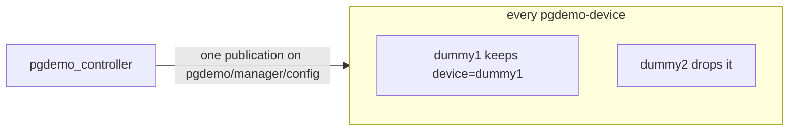

# pgdemo-device

One simulated device, one process, one ROS 2 node (`pgdemo_device_<name>`). It has no database login. The manager starts it with `fork` + `execv`, or it is started by hand on another host in the same ROS domain. The structs and the full topic list are [msgs/README.md](../msgs/README.md). How the manager admits, reaps and restarts it is [controller/README.md](../controller/README.md). The certificate and the proof are [docs/DEVICE_PKI.md](../docs/DEVICE_PKI.md).

## Shared topics

There is one topic per kind of message, not one topic per device. Every worker subscribes to the same five manager topics: `pgdemo/manager/control/bye`, `pgdemo/manager/security/challenge`, `pgdemo/manager/security/certificate`, `pgdemo/manager/security/rejected` and `pgdemo/manager/config`. A publication on any of them is delivered to every subscriber.

The worker keeps a message only when its `device` field equals `--name`. [`DeviceNode::mine`](src/main.cpp) does that comparison and drops the rest. The field is the device name, the same string that is the certificate's CN.

`device_id` is not that selector. `bye`, `challenge`, `certificate` and `rejected` do not carry it. Only `config` does. After the name has matched, the worker uses `device_id` to offset its generator: `(device_id mod 8)·π/4` ([`phase_for`](src/Generators.hpp)). A `config` whose name is this worker's is applied even if the `device_id` belongs to someone else. A `config` whose name is someone else's is ignored even when the `device_id` is this worker's.

| Topic | What selects the worker |
|---|---|
| `pgdemo/manager/control/bye` | `device` |
| `pgdemo/manager/security/challenge` | `device` |
| `pgdemo/manager/security/certificate` | `device` |
| `pgdemo/manager/security/rejected` | `device` |
| `pgdemo/manager/config` | `device`. `device_id` sets the generator phase after that |



The other direction uses the same contract. Workers publish on the shared `pgdemo/worker/` topics, each message stamped with the same `device` name, and the manager routes by that name. `hello` is the only transient-local topic (reliable, depth 1), repeated once a second until the challenge. Everything else is reliable and volatile, depth 16.

## Why every worker may hear the manager

Two different checks, and neither of them is a private topic.

The worker does not act on a message whose name is not its own, so a configuration, a certificate or a `bye` for `dummy2` does nothing inside `dummy1`.

The worker also cannot take another device's place. The manager admits a session only when the proof verifies with the certificate of that name. Hearing another device's challenge is not enough: the signature needs that device's private key, which stays in its own `key.pem`. The certificate does not filter the topic. It decides who is allowed online.

## The process

```text
pgdemo-device --name NAME --type TYPE --payload scalar|gps|xy|xyz --dir DIR
              [--enroll REQUEST_ID | --rotate REQUEST_ID]
```

`--name` is the device name and the certificate CN. `--type` selects the generator. `--payload` is `scalar`, `gps`, `xy` or `xyz`, and the process publishes only that telemetry topic. `--dir` holds `key.pem` and `cert.pem`, mode `0700`. `--enroll` and `--rotate` generate a key, publish a CSR and store the issued certificate; `--rotate` replaces the key only once the new certificate arrives.

The node name replaces `.` and `-` in the device name with `_`.

1. `hello` until the manager sends `challenge`.
2. For `--enroll` and `--rotate`, a CSR, then `certificate` or `rejected`.
3. The proof: the certificate and the signature of the nonce.
4. `config`. The worker accepts `rate_ms` in `[50, 10000]` and `amplitude` in `(0, 1000]`. It applies an accepted one at once and publishes `pgdemo/worker/config/applied` with `ok`. A refusal keeps the previous configuration and publishes `INVALID_RATE` or `INVALID_AMPLITUDE`.
5. While active, one sample per `rate_ms`. While paused, a heartbeat every 5 s. `bye`, SIGINT or SIGTERM ends the process.

| Exit | When |
|---|---|
| 0 | `bye`, or SIGINT or SIGTERM |
| 1 | Protocol or I/O error |
| 2 | Bad arguments |
| 3 | The CA refused the enrollment |
| 4 | No key or certificate on disk |
