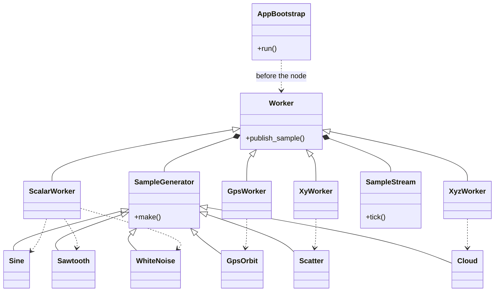
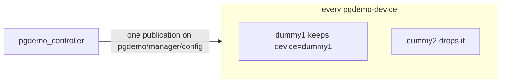
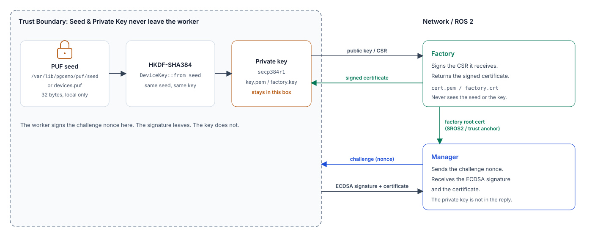

# pgdemo-device

One simulated device, one process, one ROS 2 node (`pgdemo_device_<name>`). It has no database login. The manager starts it with `fork` + `execve`, or it is started by hand on another host in the same ROS domain. The child does not inherit `ROS_SECURITY_*`. The structs and the full topic list are [msgs/README.md](../msgs/README.md). How the manager admits, reaps and restarts it is [controller/README.md](../controller/README.md). The certificate and the proof of the enrollment that already runs are [docs/DEVICE_PKI.md](../docs/DEVICE_PKI.md). The factory that signs a second certificate, from a key derived from a simulated PUF, is [factory/README.md](../factory/README.md).

## A generic sensor worker

`pgdemo-device` is one template for every physical sensor the demo pretends to be. The ROS lifecycle, the security handshake and the shared topics are not copied per payload.

[`AppBootstrap`](src/AppBootstrap.hpp) runs before `rclcpp::init`. It prepares the identity and does not open a node. [`Worker`](src/Worker.hpp) is that node. It owns the handshake, the publishers and subscribers every payload shares (`pgdemo/manager/*` and `pgdemo/worker/*`), and the [`SampleStream`](src/Stream.hpp) clock. `ScalarWorker`, `GpsWorker`, `XyWorker` and `XyzWorker` each add one telemetry publisher. The generators only compute the sample: `Sine`, `Sawtooth` and `WhiteNoise` for a scalar, `GpsOrbit` for a track, `Scatter` for a plane, `Cloud` for a volume. `ScalarWorker` is given one of the three scalar generators. The other three workers construct their own.



### Shared topics

There is one topic per kind of message, not one topic per device. Every worker subscribes to the same five manager topics: `pgdemo/manager/control/bye`, `pgdemo/manager/security/challenge`, `pgdemo/manager/security/certificate`, `pgdemo/manager/security/rejected` and `pgdemo/manager/config`. A publication on any of them is delivered to every subscriber.

The worker keeps a message only when its `device` field equals `--name`. [`Worker`](src/Worker.hpp) does that comparison and drops the rest. The field is the device name, the same string that is the certificate's CN.

`device_id` is not that selector. `bye`, `challenge`, `certificate` and `rejected` do not carry it. Only `config` does. After the name has matched, the worker uses `device_id` to offset its generator: `(device_id mod 8)·π/4` ([`phase_for`](src/Generators.hpp)). A `config` whose name is this worker's is applied even if the `device_id` belongs to someone else. A `config` whose name is someone else's is ignored even when the `device_id` is this worker's.

| Topic | What selects the worker |
|---|---|
| `pgdemo/manager/control/bye` | `device` |
| `pgdemo/manager/security/challenge` | `device` |
| `pgdemo/manager/security/certificate` | `device` |
| `pgdemo/manager/security/rejected` | `device` |
| `pgdemo/manager/config` | `device`. `device_id` sets the generator phase after that |



The other direction uses the same contract. Workers publish on the shared `pgdemo/worker/` topics, each message stamped with the same `device` name, and the manager routes by that name. `hello` is the only transient-local topic (reliable, depth 1), repeated once a second until the challenge. Everything else is reliable and volatile, depth 16.

Hearing a message is not the same as acting for that device. The worker ignores a name that is not its own, so a configuration, a certificate or a `bye` for `dummy2` does nothing inside `dummy1`. The manager admits a session only when the proof verifies with the certificate of that name. The signature needs that device's private key, which never leaves the worker. The certificate does not filter the topic. It decides who is allowed online.

## Running the process

```text
pgdemo-device --name NAME --type TYPE --payload scalar|gps|xy|xyz --dir DIR
              [--enroll REQUEST_ID | --rotate REQUEST_ID]
              [--device-id ID --puf PATH] [--puf-dir DIR]
              [--factory HOST:PORT] [--factory-root PATH] [--manager-cert PATH]
```

`--name` is the device name and the certificate CN. The node name replaces `.` and `-` in it with `_`. `--type` selects the generator. `--payload` is `scalar`, `gps`, `xy` or `xyz`, and the process publishes only that telemetry topic. `--dir` holds `key.pem` and `cert.pem`. `--enroll` and `--rotate` publish a CSR and store the issued certificate. `--rotate` replaces the key only once the new certificate arrives. `--device-id` and `--puf` name the fork-path seed table. `--puf-dir` is the container seed directory. `--factory`, `--factory-root` and `--manager-cert` name the factory origin.

1. `hello` until the manager sends `challenge`.
2. For `--enroll` and `--rotate`, a CSR, then `certificate` or `rejected`.
3. The proof: the certificate and the signature of the nonce.
4. `config`. The worker accepts `rate_ms` in `[50, 10000]` and `amplitude` in `(0, 1000]`. It applies an accepted one at once and publishes `pgdemo/worker/config/applied` with `ok`. A refusal keeps the previous configuration and publishes `INVALID_RATE` or `INVALID_AMPLITUDE`.
5. While active, one sample per `rate_ms`. While paused, a heartbeat every 5 s. `bye`, SIGINT or SIGTERM ends the process.

| Exit | When |
|---|---|
| 0 | `bye`, or SIGINT or SIGTERM |
| 1 | Protocol or I/O error |
| 2 | Bad arguments |
| 3 | The CA refused the enrollment |
| 4 | No key or certificate on disk |

## Simulated PUF

Each worker is an isolated sensor. It needs a cryptographic identity that is fixed to that sensor before the ROS node exists. `AppBootstrap` does that work. The manager and the factory never see the seed or the private key.

A container keeps one seed file, `seed`, at `/var/lib/pgdemo/puf/seed`. The first start writes 32 random bytes. A later start reads them. A forked worker uses one line of `devices.puf` instead, selected by `--device-id`. The end-to-end stack uses that table. It has no per-worker volume.

[`DeviceKey::from_seed`](../libs/pki/src/DeviceKey.cpp) expands those 32 bytes with HKDF-SHA384, info `pgdemo/worker-key/v1`, to 64 bytes. The integer modulo `n - 1`, plus one, is the secp384r1 scalar. The same seed is the same P-384 key. The ECDSA nonce stays random. On the container path the derived key is stored as `factory.key`. On the fork path it is stored as `key.pem`.

What crosses the trust boundary is public. The worker sends the public key and a CSR. The factory returns a signed certificate (`cert.pem` or `factory.crt`). At run time the manager sends a challenge nonce. The worker answers with the ECDSA signature and the certificate. A later CRL that lists this certificate's serial, and whose signature checks, ends the process with exit `1`.


