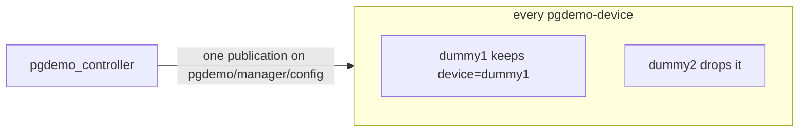
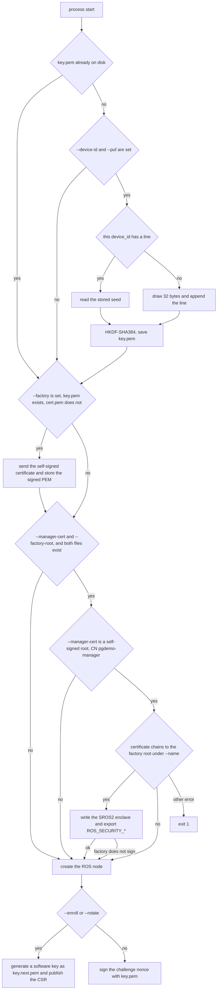

# pgdemo-device

One simulated device, one process, one ROS 2 node (`pgdemo_device_<name>`). It has no database login. The manager starts it with `fork` + `execve`, or it is started by hand on another host in the same ROS domain. The child does not inherit `ROS_SECURITY_*`. The structs and the full topic list are [msgs/README.md](../msgs/README.md). How the manager admits, reaps and restarts it is [controller/README.md](../controller/README.md). The certificate and the proof of the enrollment that already runs are [docs/DEVICE_PKI.md](../docs/DEVICE_PKI.md). The factory that signs a second certificate, from a key derived from a simulated PUF, is [factory/README.md](../factory/README.md).

## Shared topics

There is one topic per kind of message, not one topic per device. Every worker subscribes to the same five manager topics: `pgdemo/manager/control/bye`, `pgdemo/manager/security/challenge`, `pgdemo/manager/security/certificate`, `pgdemo/manager/security/rejected` and `pgdemo/manager/config`. A publication on any of them is delivered to every subscriber.

The worker keeps a message only when its `device` field equals `--name`. [`DeviceNode::mine`](src/main.cpp) does that comparison and drops the rest. The field is the device name, the same string that is the certificate's CN.

`device_id` is not that selector. `bye`, `challenge`, `certificate` and `rejected` do not carry it. Only `config` does. After the name has matched, the worker uses `device_id` to offset its generator: `(device_id mod 8)·π/4` ([`phase_for`](src/Generators.hpp)). A `config` whose name is this worker's is applied even if the `device_id` belongs to someone else. A `config` whose name is someone else's is ignored even when the `device_id` is this worker's.

| Topic | What selects the worker |
|---|---|
| `pgdemo/manager/control/bye` | `device` |
| `pgdemo/manager/security/challenge` | `device` |
| `pgdemo/manager/security/certificate` | `device` |
| `pgdemo/manager/security/rejected` | `device` |
| `pgdemo/manager/config` | `device`. `device_id` sets the generator phase after that |



The other direction uses the same contract. Workers publish on the shared `pgdemo/worker/` topics, each message stamped with the same `device` name, and the manager routes by that name. `hello` is the only transient-local topic (reliable, depth 1), repeated once a second until the challenge. Everything else is reliable and volatile, depth 16.

## Why every worker may hear the manager

Two different checks, and neither of them is a private topic.

The worker does not act on a message whose name is not its own, so a configuration, a certificate or a `bye` for `dummy2` does nothing inside `dummy1`.

The worker also cannot take another device's place. The manager admits a session only when the proof verifies with the certificate of that name. Hearing another device's challenge is not enough: the signature needs that device's private key, which stays in its own `key.pem`. The certificate does not filter the topic. It decides who is allowed online.

## The process

```text
pgdemo-device --name NAME --type TYPE --payload scalar|gps|xy|xyz --dir DIR
              [--enroll REQUEST_ID | --rotate REQUEST_ID]
              [--device-id ID --puf PATH]
              [--factory HOST:PORT] [--factory-root PATH] [--manager-cert PATH]
```

`--name` is the device name and the certificate CN. `--type` selects the generator. `--payload` is `scalar`, `gps`, `xy` or `xyz`, and the process publishes only that telemetry topic. `--dir` holds `key.pem` and `cert.pem`, mode `0700`. `--enroll` and `--rotate` generate a key, publish a CSR and store the issued certificate; `--rotate` replaces the key only once the new certificate arrives.

`--device-id` and `--puf` are the simulated PUF, described below. `--factory` is where a missing `cert.pem` is sent for signature. `--factory-root` is that root's certificate. `--manager-cert` is the manager's public certificate, used to verify the CRL the manager publishes. The controller passes them only while the factory origin is up. Without them the process is the enrollment in [docs/DEVICE_PKI.md](../docs/DEVICE_PKI.md).

The node name replaces `.` and `-` in the device name with `_`.

1. `hello` until the manager sends `challenge`.
2. For `--enroll` and `--rotate`, a CSR, then `certificate` or `rejected`.
3. The proof: the certificate and the signature of the nonce.
4. `config`. The worker accepts `rate_ms` in `[50, 10000]` and `amplitude` in `(0, 1000]`. It applies an accepted one at once and publishes `pgdemo/worker/config/applied` with `ok`. A refusal keeps the previous configuration and publishes `INVALID_RATE` or `INVALID_AMPLITUDE`.
5. While active, one sample per `rate_ms`. While paused, a heartbeat every 5 s. `bye`, SIGINT or SIGTERM ends the process.

| Exit | When |
|---|---|
| 0 | `bye`, or SIGINT or SIGTERM |
| 1 | Protocol or I/O error |
| 2 | Bad arguments |
| 3 | The CA refused the enrollment |
| 4 | No key or certificate on disk |

## Simulated PUF

A worker started as a container (`--puf-dir`) keeps a single seed file, `seed`, mode 0600, in that directory. The operational mount is `/var/lib/pgdemo/puf`, so the file is `/var/lib/pgdemo/puf/seed`. The first start writes 32 random bytes. A later start reads them. The factory and the controller do not mount the volume and do not learn the seed or the private key. What they receive is the certificate.

`devices.puf` remains the table used when the controller forks a worker and passes `--device-id` and `--puf`. The controller's default path is `run/devices/devices.puf`. A line is a `device_id` and 32 bytes of seed in hexadecimal. Writers take an exclusive lock. A `device_id` with no line yet gets a seed, and that line is kept. The end-to-end stack uses this path. It has no factory and no per-worker volume.

`DeviceKey::from_seed` expands the seed with HKDF-SHA384, info `pgdemo/worker-key/v1`, to 64 bytes. The integer modulo `n - 1`, plus one, is the secp384r1 scalar, so the same seed is the same P-384 key. The ECDSA nonce stays random.

Before the ROS node exists, and only when the flags are set:

1. `--puf-dir`, and no `factory.key`: create or read `seed`, derive the key and save it as `factory.key`, mode 0600. `factory.crt` is the certificate the factory signs from that key. The demo CA enrollment still writes `key.pem` and `cert.pem`, and a later start leaves the factory pair in place so SROS2 stays on.
2. Otherwise `--device-id` and `--puf`, and no `key.pem`: derive the key from that table. A `key.pem` already on disk is left alone, so a device enrolled with a CSR keeps that key.
3. `--factory`, a key, and no `cert.pem`, on the path without `--puf-dir`: send the self-signed certificate and store the one the factory returns. The seed does not travel.
4. `--manager-cert` and `--factory-root`, and a certificate that chains to the factory root under this device's name (`factory.crt` when the container has one, otherwise `cert.pem`): write the SROS2 enclave and export `ROS_SECURITY_*` before the node is created. `--manager-cert` must be the manager's own root: self-signed, `CA:TRUE`, CN `pgdemo-manager`, ECDSA-SHA256. `identity_ca.cert.pem` is the factory root followed by that root. `permissions_ca.cert.pem` is the factory root. A demo CA certificate with no factory pair does not chain. SROS2 stays off and the challenge continues, and a manager that already enforces SROS2 does not see that worker. If the factory is down while signing the governance and permissions, SROS2 stays off and the process continues.

The controller adds `--device-id` and `--puf` on a forked `Run` of a device that already has a row. A container launch passes `--puf-dir` instead, including enrollments, so the key exists before the node. `--factory`, `--factory-root` and `--manager-cert` go on every launch while the origin is up. The signed PEM is published on `hello` so the controller can register it without reading the worker's volume. An enrollment still publishes the CSR afterwards, which is how the demo CA path completes. A forked child does not inherit the manager's `ROS_SECURITY_*`; it writes its own enclave. A container does the same inside its own filesystem.

Once the node is up, `pgdemo/manager/security/crl` carries the list the manager signs. The message has no device name. The worker checks the signature with `--manager-cert`. Its own serial on that list exits `1`.


