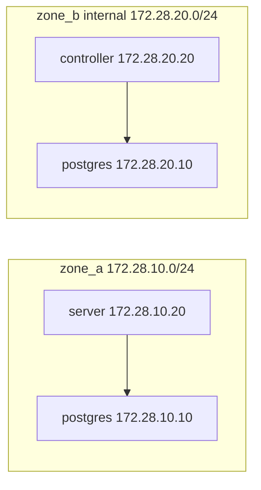

# Virtualization

Three containers run the demo. PostgreSQL is the only path between the server and the controller. Compose is the supervisor: each process is the container's main program, and a stop sends `SIGTERM` to that program.

[`compose.yaml`](compose.yaml) is the shared definition. Two projects include it and name themselves:

| Project | File | Name | What happens to the volumes |
|---|---|---|---|
| Operational | [`operational/compose.yaml`](operational/compose.yaml) | `pgdemo` | `stop` keeps them. `down -v` removes them |
| End to end | [`e2e/compose.yaml`](e2e/compose.yaml) | `pgdemo-e2e` | the suite's `down -v` removes only the `pgdemo-e2e_` volumes |

They cannot run at the same time. Both publish `127.0.0.1:8080` and both use `172.28.10.0/24` and `172.28.20.0/24`.

## Services

[`Dockerfile`](Dockerfile) builds one image, `pgdemo:latest`. The controller forks `pgdemo-device`, so that binary lives in the same image. PostgreSQL is `postgis/postgis:18-3.7`, not this image.

| Service | Role | Stays up |
|---|---|---|
| `postgres` | The database, attached to both zones | yes |
| `init` | [`scripts/db-init.sh`](../scripts/db-init.sh): schema, device CA, admin user, `run/demo.env` | no, it exits |
| `server` | `pgdemo-server` on HTTPS port 8443 | yes, `restart: unless-stopped` |
| `controller` | `pgdemo-controller` and one device process per enrolled device | yes, `restart: unless-stopped` |

[`entrypoint.sh`](entrypoint.sh) is the command of `server` and of `controller`. It reads `run/demo.env`, the server generates the JWT key and the TLS certificate, and then the script `exec`s the binary. Tini is pid 1 (`init: true`) and forwards the signal to that process. `init` does not use the entrypoint: its command is `scripts/db-init.sh`.

The factory is not in this stack. The cycle that starts is the demo CA.

## Networks



`zone_b` is `internal: true`, so the controller has no route out and none to `zone_a`. Device traffic stays inside the controller container: the children publish on its ROS domain. The host publishes one port, bound to loopback: `127.0.0.1:8080` forwards to the server's 8443. The end-to-end suite checks that the controller cannot open a TCP connection to the server and that it can open one to PostgreSQL on `172.28.20.10:5432`.

## Volumes

The project name prefixes every volume. `pgdemo_pgdata` belongs to the operational stack. `pgdemo-e2e_pgdata` belongs to a test run.

| Volume | Mounted by | Contents |
|---|---|---|
| `pgdata` | `postgres` | the database |
| `demo-run` | `init`, `server`, `controller` | `run/demo.env`, JWT keys, the TLS certificate |
| `ca-keys` | `init`, `server` | the device CA. The controller never sees the key |
| `device-keys` | `controller` | one directory per device, and the controller lock |

## Operational stack

Fill `webroot/` before the first build. The image copies it, and the entrypoint passes `--webroot` only when `index.html` is there.

```bash
cp docker/operational/.env.example docker/operational/.env   # set both passwords
scripts/run-all.sh                 # postgres, server and controller
scripts/run-all.sh server          # the API, plus the database and init
scripts/run-all.sh controller      # the manager, plus the database and init
scripts/stop-all.sh                # stop the project; volumes stay
scripts/stop-all.sh server         # only the server (also: controller)
```

`docker/operational/.env` is gitignored. `POSTGRES_PASSWORD` is the database superuser. `DEMO_ADMIN_PASSWORD` is the API user `admin`. The role passwords of `demo_server` and `demo_controller` are generated by `init` and stay in the `demo-run` volume.

The client talks to the published port. Copy the certificate out of the server container:

```bash
mkdir -p run
docker compose -f docker/operational/compose.yaml --env-file docker/operational/.env \
    cp server:/app/run/keys/tls.crt run/docker-tls.crt
export PGDEMO_URL=https://127.0.0.1:8080 PGDEMO_CA=run/docker-tls.crt
. docker/operational/.env
PGDEMO_PASSWORD="$DEMO_ADMIN_PASSWORD" client/pgdemo.sh login admin
```

Logs are `docker compose -f docker/operational/compose.yaml logs`. Ctrl-C on `scripts/run-all.sh` stops the containers that are attached.

## End to end

[tests/e2e/README.md](../tests/e2e/README.md) drives `docker/e2e/compose.yaml` as project `pgdemo-e2e`. Stop the operational stack first (`scripts/stop-all.sh`): the port and the subnets collide. A build in either project replaces the local `pgdemo:latest` image the other one would start.

`down -v` removes `pgdemo-e2e_pgdata`, `pgdemo-e2e_demo-run`, `pgdemo-e2e_ca-keys` and `pgdemo-e2e_device-keys`. The `pgdemo_` volumes stay.
