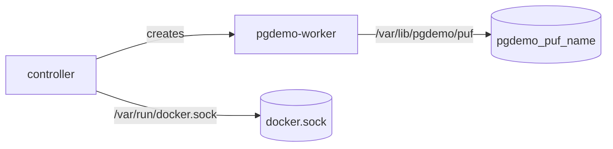

# Virtualization

Two projects include [`compose.yaml`](compose.yaml), each for a different use. They cannot run at the same time: both publish `127.0.0.1:8080` and both use `172.28.10.0/24` and `172.28.20.0/24`.

| Project | File | Name | Use |
|---|---|---|---|
| Operational | [`operational/compose.yaml`](operational/compose.yaml) | `pgdemo` | Development. External volumes survive `stop`, `down` and `down -v` |
| End to end | [`e2e/compose.yaml`](e2e/compose.yaml) | `pgdemo-e2e` | Stateless tests. Each run starts empty; `down -v` removes only the `pgdemo-e2e_` volumes |

The operational project is the one that stays. It runs five containers: PostgreSQL, SeaweedFS, the server, the controller and the factory. PostgreSQL is the only path between the server and the controller. SeaweedFS is the second shared service, on the same two bridges, and the two processes do not meet there. The factory is on a network of its own. Compose is the supervisor: each process is the container's main program, and a stop sends `SIGTERM` to that program. The end-to-end project does not start the factory or SeaweedFS.

## Services

[`Dockerfile`](Dockerfile) builds one image, `pgdemo:latest`. The controller forks `pgdemo-device`, so that binary lives in the same image. PostgreSQL is `postgis/postgis:18-3.7`, not this image. SeaweedFS is `chrislusf/seaweedfs`, not this image and not the PostgreSQL image.

| Service | Role | Stays up |
|---|---|---|
| `postgres` | The database, attached to both zones | yes |
| `seaweed` | `weed mini`, the object store, attached to both zones. S3 on port 8333, not published | yes, `restart: unless-stopped` |
| `init` | [`scripts/db-init.sh`](../scripts/db-init.sh): schema, device CA, admin user, `run/demo.env` | no, it exits |
| `server` | `pgdemo-server` on HTTPS port 8443 | yes, `restart: unless-stopped` |
| `controller` | `pgdemo-controller` and one device process per enrolled device | yes, `restart: unless-stopped` |
| `factory` | `pgdemo-factory`, operational project only | yes, `restart: unless-stopped` |
| `worker` | declared so Compose follows the containers the controller creates; `scale: 0`, no container of its own | no |

[`entrypoint.sh`](entrypoint.sh) is the command of `server`, `controller` and `factory`. The server and the controller read `run/demo.env`. The server generates the JWT key and the TLS certificate. The factory generates its root and copies only `root.crt` out. Each one then `exec`s its binary. Tini is pid 1 (`init: true`) and forwards the signal to that process. `init` does not use the entrypoint: its command is `scripts/db-init.sh`. `seaweed` does not use it either: the image starts `weed mini`.

The end-to-end project does not define `factory` or `seaweed`, so the workers there still enroll with the demo CA.

## Networks

The bridges, the namespaces and the private keys are [`operational/README.md`](operational/README.md). PostgreSQL and SeaweedFS sit on both zone bridges, and a container with two interfaces does not open a route between the zones. SeaweedFS listens on port 8333, and that port is not published. The end-to-end project does not define this service.

`zone_b` and `zone_factory` are `internal: true`. The controller has no route to `zone_a`. The factory is not on `zone_a` or `zone_b`, and its port is not published, so the server and the host cannot open it. The process binds `0.0.0.0` inside that one network. When `PGDEMO_DOCKER_SPAWN` is set, each worker is its own container on `zone_b` and `zone_factory`. It publishes on the ROS domain and asks the factory at `172.28.30.10:9443`. The bridge does not carry DDS multicast, so the worker lists the controller (`172.28.20.20`) as a static peer. The end-to-end project does not set that variable: its workers stay children of the controller. The host publishes one port, bound to loopback: `127.0.0.1:8080` forwards to the server's 8443. The end-to-end suite checks that the controller cannot open a TCP connection to the server and that it can open one to PostgreSQL on `172.28.20.10:5432`. The end-to-end project has no `zone_factory`.

## Volumes

Operational volumes are external and named `pgdemo_pgdata`, `pgdemo_seaweed`, `pgdemo_demo-run`, `pgdemo_ca-keys`, `pgdemo_device-keys`, `pgdemo_factory-key`, `pgdemo_factory-cert` and `pgdemo_manager-keys`. `scripts/run-all.sh` creates any that are missing. Compose does not delete them. A test run uses its own `pgdemo-e2e_` volumes, and those do go away with `down -v`.

Project `pgdemo` is the persistent virtual environment. Which container mounts which volume is [operational/README.md](operational/README.md#container-namespaces). `stop`, `down` and `down -v` leave the volumes. `ca-keys` covers `/app/run/ca` on top of `demo-run`. The factory writes `factory-cert` and the controller mounts it read only. Private keys are [operational/README.md](operational/README.md#private-keys).

| Volume | Mounted by | Contents |
|---|---|---|
| `pgdata` | `postgres` | the database |
| `seaweed` | `seaweed` | the object store, mounted at `/data` |
| `demo-run` | `init`, `server`, `controller` | `run/demo.env`, JWT keys, the TLS certificate |
| `ca-keys` | `init`, `server` | the device CA. The controller never sees the key |
| `device-keys` | `controller` | one directory per device, and the controller lock |
| `factory-key` | `factory` | `root.key`. Nothing else mounts it |
| `factory-cert` | `factory` writes it, `controller` reads it | `root.crt` only |
| `manager-keys` | `controller` | the manager's own key and self-signed root |

The operational file declares `worker` with `scale: 0` and `network_mode: none`. Compose does not create a container for it. The controller creates one when an enrollment arrives, through the Docker Engine API on `/var/run/docker.sock`. Only the controller service mounts that socket. If the create fails with permission denied, set `DOCKER_GID` to the group of the socket (`stat -c %g /var/run/docker.sock`) and start again. The controller does not change the socket's owner. The container is named `pgdemo-worker-<name>` and labelled as service `worker` of project `pgdemo`, with `container-number` equal to the device name. It carries no `com.docker.compose.config-hash`, so Compose does not adopt it and the next `up` does not remove it. An attached `docker compose up`, or `docker compose logs -f` started before that container starts, prints each new line as `worker-<name>` in the next colour of Compose's palette. `docker compose logs` without `--follow`, and a follow attached while the worker is already running, do not show it. Restarting the stack, or recreating the worker, shows the lines that begin after the follow is attached.

Each worker gets a volume `pgdemo_puf_<name>`, mounted only in that container at `/var/lib/pgdemo/puf`. The factory and the controller do not mount it. The seed file in that directory is written once by the worker. Stopping or recreating the container leaves the volume. The container also mounts the factory certificate and `manager.crt`, both read only. It does not receive `manager.key`.



## Operational stack

Fill `webroot/` before the first build. The image copies it, and the entrypoint passes `--webroot` only when `index.html` is there.

```bash
cp docker/operational/.env.example docker/operational/.env   # set both passwords
scripts/run-all.sh                 # postgres, seaweed, server, controller and factory
scripts/run-all.sh server          # the API, plus the database and init
scripts/run-all.sh controller      # the manager and the factory, plus the database and init
scripts/run-all.sh --factory-reset # drop and recreate the pgdemo database; volumes stay
scripts/stop-all.sh                # stop the project; the external volumes stay
scripts/stop-all.sh server         # only the server (also: controller)
```

`docker/operational/.env` is gitignored. It is not `run/demo.env`. `POSTGRES_PASSWORD` is the container's database superuser. `DEMO_ADMIN_PASSWORD` is the API user `admin`. The role passwords of `demo_server` and `demo_controller` are generated by `init` and stay in the `demo-run` volume.

`scripts/run-all.sh` with no arguments starts SeaweedFS with the rest. `scripts/run-all.sh server` does not start it, because nothing depends on it yet.

`--factory-reset` stops the server and the controller, then runs [`scripts/db-init.sh --reset`](../scripts/db-init.sh). That drops the `pgdemo` database and loads the schema again, including the `dummy1`, `dummy2` and `dummy3` enrollments, and seeds `admin`. No volume is removed: the cluster, `run/demo.env`, the device CA, device directories, the factory key and certificate, the manager key and the SeaweedFS data stay. A later enrollment can fail when a device directory from the previous database is still on `device-keys`. The factory and SeaweedFS keep running. The server and the controller then start again, without a rebuild. A normal `up` does not run `init` again, because Compose treats the exited container as finished; the reset uses `compose run`.

The client talks to the published port. Copy the certificate out of the server container:

```bash
mkdir -p run
docker compose -f docker/operational/compose.yaml --env-file docker/operational/.env \
    cp server:/app/run/keys/tls.crt run/docker-tls.crt
export PGDEMO_URL=https://127.0.0.1:8080 PGDEMO_CA=run/docker-tls.crt
. docker/operational/.env
PGDEMO_PASSWORD="$DEMO_ADMIN_PASSWORD" client/pgdemo.sh login admin
```

Logs are `docker compose -f docker/operational/compose.yaml logs`. Ctrl-C on `scripts/run-all.sh` stops the containers that are attached.

## End to end

[`e2e/compose.yaml`](e2e/compose.yaml) is the stateless stack the Robot suite creates and destroys. The project name is `pgdemo-e2e`. Setup runs `down -v` and teardown runs it again, so every execution starts with an empty database, a new device CA and no device keys. The factory is not defined, and neither is `seaweed`. Enrollment stays on the demo CA. The volumes removed are `pgdemo-e2e_pgdata`, `pgdemo-e2e_demo-run`, `pgdemo-e2e_ca-keys` and `pgdemo-e2e_device-keys`. The operational `pgdemo_` volumes stay, including `pgdemo_seaweed`.

Stop the operational stack first (`scripts/stop-all.sh`): the port and the subnets collide. A build in either project replaces the local `pgdemo:latest` image the other one would start.

[tests/e2e/README.md](../tests/e2e/README.md) is the suite.
