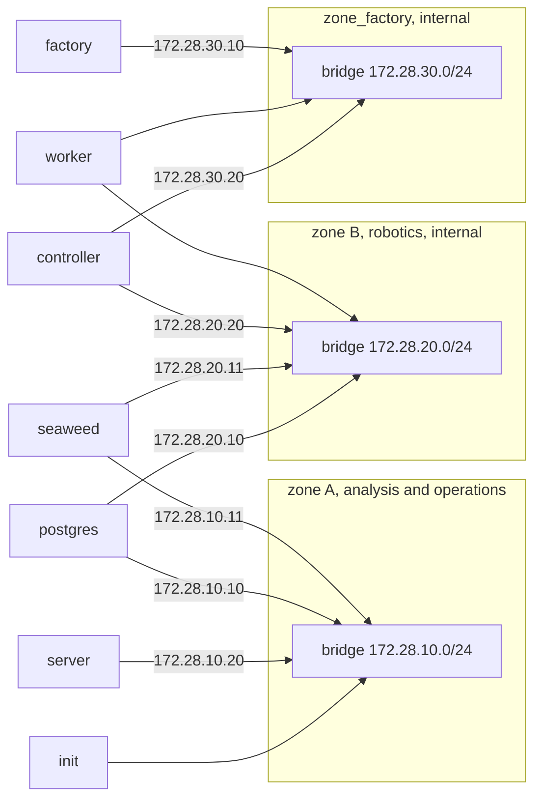
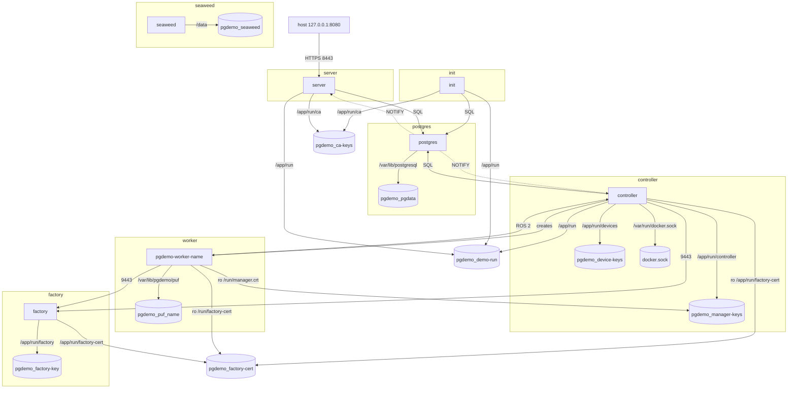

# Operational network

Project `pgdemo` is the stack that stays. [docker/README.md](../README.md) is the virtualization of both projects. This file is the network scheme of this one.

PostgreSQL is one container. SeaweedFS is one container. Both are shared by zone A and zone B: each store has one volume and two addresses, one on each bridge. The server, in analysis and operations, uses the zone A address. The controller, in robotics, uses the zone B address. They open the same process and the same files. A worker is its own container. It joins the robotics bridge and the factory bridge, and it mounts its own PUF volume. It does not mount the database or the object store.

Three bridges, and no new one for the object store. `zone_a` and `zone_b` are declared in [`compose.yaml`](../compose.yaml). `zone_factory` is declared in [`compose.yaml`](compose.yaml).

## Network isolation

A box here is a bridge. The only node inside the box is that bridge. Every container is drawn once, outside the boxes, and an edge is the address of one of its interfaces. Two edges from `postgres` are two addresses of that one container. Two edges from `seaweed` are the same. `zone_b` and `zone_factory` are `internal: true`. `zone_b` has no route to `zone_a`. A second interface does not forward a neighbor's packets, so the server has no route to `172.28.20.0/24` and the controller has no route to `172.28.10.0/24`. Neither store is a gateway.

| Container | Where it attaches |
|---|---|
| `postgres` | `172.28.10.10` on zone A and `172.28.20.10` on zone B. One database. |
| `seaweed` | `172.28.10.11` on zone A and `172.28.20.11` on zone B. One object store. |
| `server` | `172.28.10.20` on zone A |
| `init` | zone A, then it exits |
| `controller` | `172.28.20.20` on zone B and `172.28.30.20` on `zone_factory` |
| `worker` | zone B and `zone_factory`. One container per device, `pgdemo-worker-<name>`, with no fixed address |
| `factory` | `172.28.30.10` on `zone_factory` |

On each bridge the name `postgres` resolves to the address of that bridge, and the name `seaweed` does the same. The server uses the zone A addresses. The controller uses the zone B addresses. The host publishes one port, `127.0.0.1:8080`, to the server's 8443. SeaweedFS listens on port 8333 inside the bridges. That port is not published. The end-to-end project does not include this file, so it has no factory, no SeaweedFS and no `zone_factory`.

## Container namespaces

A box here is one container: its own namespaces, its own process, and the volumes mounted only there. `postgres` and `seaweed` are the shared stores, each in its own box, and the server and the controller both call the one database. A worker is not part of the controller's box. Its PUF volume sits in the worker box. Volumes mounted by more than one container stay outside the boxes.

The host reaches analysis through the published port. `init` loads the schema into the one database and exits. The server and the controller meet in the commits of that database. A dotted edge is the `NOTIFY` of a commit. The controller reads it from `172.28.20.10`. The server reads it from `172.28.10.10`.

On zone B the worker publishes ROS 2 to the controller at `172.28.20.20`. On `zone_factory` the worker and the controller ask the factory at `172.28.30.10:9443`. The controller creates the worker through the engine socket. `docker.sock` is that socket, mounted only in the controller.

`pgdemo_pgdata` is the database volume, mounted only in `postgres`. `pgdemo_seaweed` is the object store, mounted only in `seaweed` at `/data`. The filer keeps its index there and is not pointed at the `pgdemo` database. No process opens port 8333 yet. Each worker mounts only its own `pgdemo_puf_<name>` at `/var/lib/pgdemo/puf`, plus `root.crt` and `manager.crt` read only. `manager.key` stays in the controller, on `pgdemo_manager-keys`.
