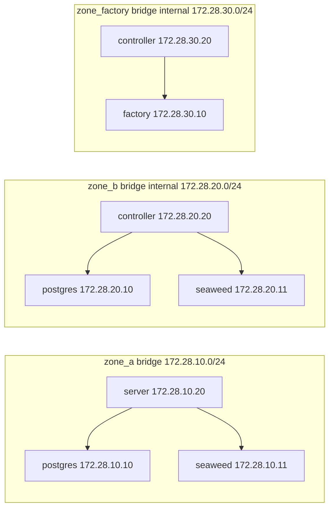

# Operational network

Project `pgdemo` is the stack that stays. [docker/README.md](../README.md) is the virtualization of both projects. This file is the network scheme of this one.

Three bridges, and no new one for the object store. `zone_a` and `zone_b` are declared in [`compose.yaml`](../compose.yaml). `zone_factory` is declared in [`compose.yaml`](compose.yaml). PostgreSQL and SeaweedFS join both zone bridges. Each store is one container with two interfaces.

`pgA` and `pgB` are the same database. `swA` and `swB` are the same `weed mini`. There is no edge between the bridges, and no edge between the two stores.

## Addresses

| Address | Bridge |
|---|---|
| `postgres` `172.28.10.10` | `zone_a` |
| `seaweed` `172.28.10.11` | `zone_a` |
| `server` `172.28.10.20` | `zone_a` |
| `postgres` `172.28.20.10` | `zone_b` |
| `seaweed` `172.28.20.11` | `zone_b` |
| `controller` `172.28.20.20` | `zone_b` |
| `factory` `172.28.30.10` | `zone_factory` |
| `controller` `172.28.30.20` | `zone_factory` |

The name `postgres` resolves, on each bridge, to the address of that bridge. The name `seaweed` does the same. The server uses the addresses on `zone_a`. The controller uses the addresses on `zone_b`.

## Isolation

`zone_b` and `zone_factory` are `internal: true`. `zone_b` has no route to `zone_a`. A container with two interfaces does not forward packets from its neighbors, so the server has no route to `172.28.20.0/24` and the controller has no route to `172.28.10.0/24`. Neither store is a gateway.

PostgreSQL is the path between the server and the controller. SeaweedFS is the object store on those same bridges. Its S3 gateway listens on port 8333. That port is not published. The host publishes one port, `127.0.0.1:8080`, to the server's 8443.

The filer keeps SeaweedFS's own index in the volume `pgdemo_seaweed`, mounted at `/data` in that container only. The filer is not pointed at the `pgdemo` database.

Workers the controller creates join `zone_b` and `zone_factory`. They are not on `zone_a`. The end-to-end project does not include this file, so it has no factory, no SeaweedFS and no `zone_factory`.
