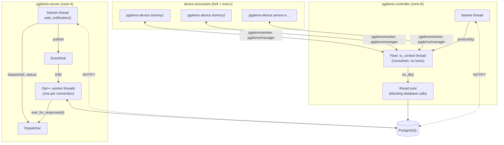
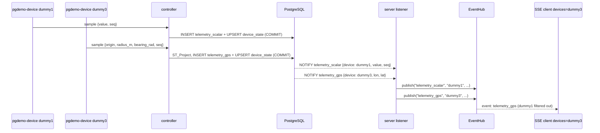
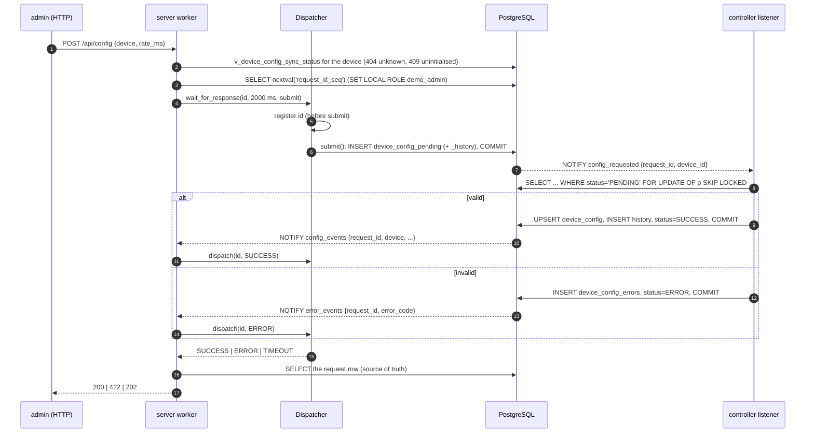
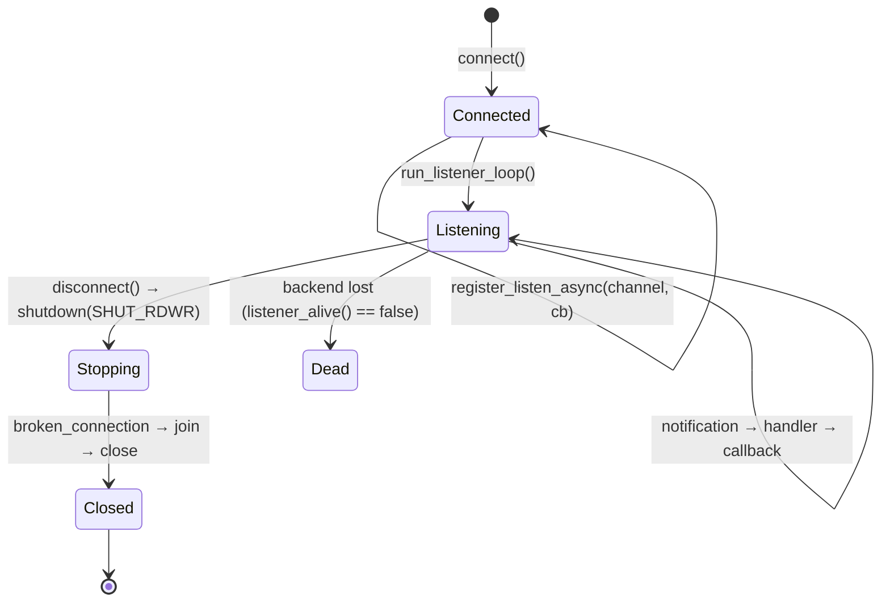
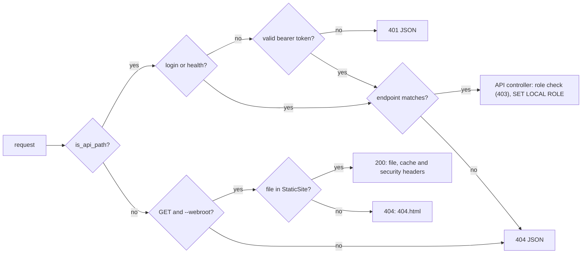

# Architecture

This document explains how two processes that never talk to each other run a reactive, transactional exchange through PostgreSQL alone, and how the same database enforces authentication and authorization. Device identity (the internal CA, enrollment, certificates, the CRL and how the controller authenticates its device processes) has its own document, [DEVICE_PKI.md](DEVICE_PKI.md).

1. [Processes and zones](#1-processes-and-zones)
2. [Data plane: devices as rows, one channel per payload](#2-data-plane-devices-as-rows-one-channel-per-payload)
3. [Control plane: desired vs applied configuration](#3-control-plane-desired-vs-applied-configuration)
4. [The Dispatcher](#4-the-dispatcher)
5. [Listener lifecycle in `libs/db`](#5-listener-lifecycle-in-libsdb)
6. [Monthly partitioning](#6-monthly-partitioning)
7. [Security](#7-security)
8. [Failure semantics](#8-failure-semantics)

## 1. Processes and zones

| Process | Zone | PostgreSQL login | Writes | Listens to |
|---|---|---|---|---|
| `pgdemo-server` | A | `demo_server` (NOINHERIT) | `device_enrollment` (enroll, rotate), `device` and `device_certificate` (issue through `issue_device_certificate()`, remove), `crl`, `device_config_pending`, `app_users` | `telemetry_scalar`, `telemetry_gps`, `device_events`, `enrollment_csr`, `enrollment_events`, `config_events`, `error_events` |
| `pgdemo-controller` | B | `demo_controller` | `device_enrollment` (CSR, status), `device_session`, `device_state`, `telemetry_scalar`, `telemetry_gps`, `device_config`, `device_config_errors` | `enrollment_requested`, `enrollment_events`, `device_events`, `config_requested` |
| `pgdemo-device` | B | none | samples on `pgdemo/worker/` (telemetry, hello, proof) | `pgdemo/manager/`: challenge, certificate, configuration, bye |
| `client/pgdemo.sh` | host | none | over HTTPS (8443) or, with `--http`, plain HTTP (8080) | SSE `/api/stream` |
| control panel ([`frontend/`](../frontend)) | browser | none | `/api` with a bearer token, on the server's own origin | SSE `/api/stream`, read with `fetch()` |

Neither process knows the other's address, port or existence. Each owns its side of the contract: the server owns *desired* state and the certificate authority, and the controller owns *applied* state, the device processes and the data. The device processes are children of the controller (`fork` + `execv`) and talk only to it; they have no database login. The schema in [`sql/`](../sql) is the interface between them; [sql/README.md](../sql/README.md) describes every table, view, function and channel.

The HTTP listener is TLS 1.3 on port 8443 (`scripts/run-all.sh --http` serves plain HTTP on 8080 instead). oatpp-openssl creates the context; [`server/openssl-oqs.cnf`](../server/openssl-oqs.cnf), loaded from beside the executable, activates OpenSSL's default provider and `oqsprovider`. Ordinary clients use `X25519MLKEM768`. liboqs groups in that file are accepted when the client offers them. The TLS certificate is not the JWT key.

Each process holds a pool of query connections plus one listener connection:

- **query pool.** A fixed set of connections opened at `connect()` (8 by default, `--pool-size`). Every transaction checks one out and returns it when the transaction ends. The pool mutex guards only the free list; the connection itself is used by one thread until the checkout ends. Callers block when the pool is exhausted.
- **listener connection.** Only `LISTEN` and a thread blocked on its socket. It is not part of the pool: `LISTEN` state and `wait_notification()` belong to one session.



## 2. Data plane: devices as rows, one channel per payload

A device is a row of `device`, typed by `device_type`. The type fixes the *payload* (`scalar` or `gps`), the device's generator and the default configuration. Tables and channels exist per payload, never per device, so adding a device needs no `CREATE TABLE`, no new `LISTEN` and no rebuild.

| Table | Rows | Written by |
|---|---|---|
| `device_type` | `sine`, `sawtooth` (scalar), `gps_orbit` (gps) | install |
| `device` | one per device, created with its first certificate; `dummy1`, `dummy2`, `dummy3` are enrolled at the first controller start | server, through `issue_device_certificate()` |
| `device_state` | the last sample of each device (`value` or `position`, never both) | controller |
| `telemetry_scalar`, `telemetry_gps` | every sample, monthly-partitioned, no foreign key to `device` | controller |

One trigger on `device_state` publishes each sample on the channel of its payload, with the device in the payload:

| Channel | Payload |
|---|---|
| `telemetry_scalar` | `{device_id, device, action, value, seq, ts}` |
| `telemetry_gps` | `{device_id, device, action, lon, lat, seq, ts}` |
| `device_events` | `{action, device_id, device, ...}`: `INSERT`, `DELETE`, `ROTATED`, `REVOKED`, `UNREVOKED`, and each session state (`ONLINE`, `OFFLINE`, `AUTH_FAILED`, ...) |

GPS positions are `geography(Point, 4326)`, installed with PostGIS in the `extensions` schema. The device does not compute latitude and longitude itself. It sends a fixed origin (Madrid), a radius (`amplitude`, metres) and a bearing, and the controller's INSERT calls `ST_Project`. GiST indexes cover `device_state` and every monthly partition of `telemetry_gps`.

Each device is a `pgdemo-device` worker, started by the controller (the manager) with `fork` + `execv`, or started on another host in the same ROS domain. Workers publish `pgdemo/worker/` and subscribe to `pgdemo/manager/`. The structs are [msgs/README.md](../msgs/README.md). ROS 2 discovers the nodes as peers; that discovery is not authority. The manager admits, challenges, configures and stops. Workers do not talk to each other and have no database login. After a worker has proved its identity (challenge-response with its private key; see [DEVICE_PKI.md](DEVICE_PKI.md#5-authentication)), it streams samples from a generator chosen by `type_id`, with a phase derived from `device_id`, at the configured rate. The manager runs every session, the child reaper, the heartbeat, the telemetry flush and the maintenance loops on one `io_context` thread, so its process table needs no lock; the ROS executor only posts each worker message onto that thread. Database calls block (libpqxx), so `on_db()` checks a connection out of [`ConnectionPool`](../libs/db/include/db/ConnectionPool.hpp) on a thread pool and the coroutine resumes with the result. Samples are queued and written in batches, one lease per flush. A node the manager did not fork is admitted by the same `hello` and is not signaled when it goes silent: the session is released. The lifecycle is [controller/README.md](../controller/README.md).

The controller appends a batch of samples in one `INSERT` per payload and UPSERTs `device_state` with the latest `seq` of each device. The trigger fires on `device_state`, and PostgreSQL delivers the notification **only when the transaction commits**, so a listener never sees a value that was rolled back.

The fleet changes at run time. The controller listens to `enrollment_requested` (start a process with `--enroll` to generate a key and a CSR, or replace the running one with a `--rotate` process), `enrollment_events` (deliver the issued certificate to that same process, which then authenticates and streams) and `device_events` (stop the process on `DELETE` or a revocation of the current certificate, start it again when a hold is lifted). At start-up it does the same for every device and every open enrollment, after `LISTEN` is active, so nothing falls between the two; every 30 s it reconciles again, which catches a certificate that expired. The listener thread only posts each notification to the `io_context` thread. A process that exits is restarted with a backoff (1 s, doubling to 30 s), and `--max-devices` bounds how many run; the rest are `UNMANAGED`.

On the server, one listener connection subscribes to every channel. libpqxx keeps a handler per channel and calls the right one for each notification. The server republishes them on the `EventHub` as the SSE events `telemetry_scalar`, `telemetry_gps`, `device`, `enrollment`, `config` and `error`, each tagged with its device name. Subscribers filter by `?channels=` and, optionally, by `?devices=`.



`EventHub::publish` never blocks the listener thread. Each subscriber has a bounded queue, and a slow client loses its oldest events rather than stalling notification delivery for everybody.

Each `device_state` write notifies its channel. Commits that call `pg_notify` serialize on a cluster-wide lock, so a large fleet needs batched wake-ups, logical decoding or a broker; [sql/README.md](../sql/README.md#scaling-notes) lists the options.

## 3. Control plane: desired vs applied configuration

| Table | Owner of the rows | Meaning |
|---|---|---|
| `device_config` | controller | **Applied** configuration, one row per device, with the `request_id` that produced it (none for the type defaults) |
| `device_config_pending` | server inserts, controller updates `status` | **Desired** configuration: the queue. Status `PENDING → SUCCESS \| ERROR \| TIMEOUT` |
| `device_config_errors` | controller | Why a request was rejected (`INVALID_RATE`, `INVALID_AMPLITUDE`, `EXPIRED`, …) |
| `device_config_history` | controller | Every applied configuration |
| `device_config_pending_history` | server | Every desired configuration, as submitted |
| `request_id_seq` | server | The single cross-process ID authority |

All of them are keyed by `device_id`. Removing a device cascades to its applied state, its queue and its errors; both audits stay.

`v_device_config_sync_status` joins them per device. It shows the applied values, the latest desired request, its status, the latest error, and a summary `sync` column with the value `SYNC`, `PENDING`, `ERROR` or `UNINITIALISED` (registered, but the controller has not written its defaults yet).



Properties of this loop:

- **The queue is durable and notifications are not.** `NOTIFY` is a wake-up call, never the data. The controller drains every `PENDING` row each time it is woken, and once at start-up after `LISTEN` is active. A request made while the controller was down is applied when it comes back.
- **Several controllers can share the queue.** Each row is taken with `FOR UPDATE SKIP LOCKED`, so two workers never process the same request.
- **Stale requests do not apply.** A request older than `--pending-max-age-s` (600 s by default) becomes `TIMEOUT` with error `EXPIRED`, so an old intent does not overwrite a newer reality.
- **Validation belongs to the zone that executes.** The server checks types and the role; the controller decides whether the values are acceptable. The answer travels back through the database like any other state.
- **Partial updates.** Fields left out of the POST body are taken from the applied configuration. A device the controller has not initialised yet has none, so the server answers `409`.
- **Devices react immediately.** After the commit, the controller sends a `config` frame to that device's process. Its producer coroutine is waiting on a timer, which the frame cancels, so a new rate takes effect without waiting out the old period. A process that starts later receives the applied configuration right after it authenticates.

## 4. The Dispatcher

[`server/src/dispatcher`](../server/src/dispatcher) correlates a blocked HTTP worker thread with a completion that arrives later on the listener thread, keyed by `request_id`.

```cpp
const auto status = dispatcher->wait_for_response(id, timeout_ms, [&] {
    db->add_pending_config(role, request);   // runs after the waiter is registered
});
```

- **Register, then submit.** The waiter enters the map before the INSERT. A completion that arrives before the worker reaches `condition_variable::wait_for` sets `ready` under the same mutex, and the predicate sees it. No wake-up is lost, however fast the controller is. A unit test calls `dispatch` from inside `submit` to prove it.
- **The context lives on the stack.** Each waiter's `RequestContext` (condition variable, status, `ready`) is on its own stack. The map only points to it while the waiter is inside `wait_for_response`, and `dispatch` only touches it under the map mutex.
- **Bounded.** With 500 waiters already registered, new requests get `SYSTEM_FULL` (HTTP 503) and nothing is enqueued.
- **A failed submit cleans up.** If the INSERT throws, the registration is removed and the caller gets `DB_ERROR`. The server rethrows the captured exception and maps it by SQLSTATE.
- **A timeout is not a failure.** On `TIMEOUT`, the server reads the request row. If it shows `SUCCESS` or `ERROR`, that is the answer (the notification was missed). If it is still `PENDING`, the server replies `202 Accepted` with a `Location` header for polling.

## 5. Listener lifecycle in `libs/db`

`DatabaseManager` keeps the threading rules of libpqxx explicit. A `pqxx::connection` is not thread-safe, which is why query connections are checked out of a pool instead of shared, and why the listener connection has a strict lifecycle:

1. **Registration** (single-threaded). `register_listen_async(channel, callback)` runs `LISTEN "<channel>"` (quoted), stores the callback, and installs a libpqxx handler for the channel. The handler parses the payload as JSON and calls the callback inside `try/catch`, so a throwing callback is logged and does not kill the listener. Call it once per channel.
2. **Activation.** `run_listener_loop()` sets `listening_` and starts one `std::jthread` that loops on `connection::wait_notification()`. Registering after this point throws `std::logic_error`, because the handler table must not change while another thread reads it.
3. **Shutdown.** `disconnect()` requests the stop and calls `shutdown(fd, SHUT_RDWR)` on the listener socket. `poll()` returns, the read hits EOF, and libpqxx throws `pqxx::broken_connection`, which the thread treats as its exit signal. The thread is joined, and only then are the listener connection and every pooled query connection closed. The socket is never `close()`d from another thread while `poll()` uses it.



`wait_notification()` comes from [`patches/libpqxx.patch.full`](../patches/README.md). Upstream `await_notification()` wakes up every second by default. The patched call blocks in `poll(fd, -1)`, so an idle listener costs nothing.

A query checkout is a `Lease`: `acquire()` blocks until a connection is free, and the destructor returns it, including when the transaction throws. `SET LOCAL ROLE` is transaction-scoped, so a role cannot leak into the next checkout of that connection. `disconnect()` joins the listener first, then waits until every lease is back before closing the sockets.

Callbacks run on the listener thread. They may call query methods (that thread does not already hold a lease) and must stay short: the server's `dispatch` + `publish` are bounded, and the controller's callback only posts the notification to its `io_context` thread, which drains the queue through `on_db()`. `drain_pending` holds its lease across `decide` and `on_applied`; those two callbacks must not call back into `DatabaseManager`.

## 6. Monthly partitioning

`telemetry_scalar` and `telemetry_gps` are `PARTITION BY RANGE (recorded_at)`, with one partition per UTC month plus a `DEFAULT` partition. Every device of the same payload shares them; the `(device_id, recorded_at DESC)` index narrows a partition to one device.

```text
telemetry_scalar
├── telemetry_scalar_y2026m11   [2026-11-01 00:00Z, 2026-12-01 00:00Z)
├── telemetry_scalar_y2026m12   [2026-12-01 00:00Z, 2027-01-01 00:00Z)
├── telemetry_scalar_y2027m01   ...
└── telemetry_scalar_default    anything not covered above
```

- **Partitions are created ahead.** `ensure_monthly_partitions(parent, from_month, months_ahead)` creates the current month and the next `months_ahead` months. The controller calls it at start-up and every `--maintenance-interval-s` (1 h by default).
- **Rows parked in DEFAULT are moved.** If rows for a month landed in `DEFAULT` before its partition existed, the function moves them into the new partition in the same transaction. PostgreSQL would otherwise refuse to create the partition.
- **Pruning.** A query with a `recorded_at` range scans only the matching partitions. Use UTC bounds, because month boundaries are UTC.
- **Retention without DELETE.** `drop_monthly_partitions_before(parent, cutoff)` drops whole months, which avoids a long `DELETE` and the vacuum that follows.
- **Safe to call from the controller.** Both functions are `SECURITY DEFINER` (they run as `demo_owner`), whitelist their parent table, and pin `search_path` and `TimeZone`. They take an advisory lock so that concurrent callers do not race. The controller needs only `EXECUTE` and never owns a table.

Each row returned by `/api/devices/{name}/history` carries its partition name (`tableoid::regclass`), so routing is visible from the client.

## 7. Security

### Authentication

- **Passwords.** Argon2id hashes in PHC format (`$argon2id$v=19$m=65536,t=3,p=1$…`) with a 16-byte random salt, produced by Botan. The parameters travel inside the string, so they can change without breaking stored hashes. A `CHECK` constraint rejects anything that is not an Argon2id string.
- **No user enumeration.** When the username does not exist, the server verifies the password against a fixed dummy hash anyway, so response time does not reveal whether a user exists. Both failures return the same `401` body.
- **Login lookup without table access.** `demo_server` has no privilege on `app_users`. It calls `auth_fetch_user(username)`, a `SECURITY DEFINER` function that returns one hash and one role, and nothing else.
- **Tokens.** JWT signed with ES384 (ECDSA P-384, SHA-384, raw `r‖s` signature, RFC 7518 §3.4). The signing key is a PKCS#8 file and verification uses the public key of an X.509 certificate, both generated by `scripts/gen-jwt-keys.sh` into `run/keys/`. Verification pins `alg` to ES384, so `none` and algorithm confusion are rejected. It also checks the issuer, the expiry, and that `sub` and `role` are present.
- **Workers against the manager.** A worker holds an ECDSA P-384 key that never leaves its directory (`run/devices/<name>/key.pem`, mode 0600) and a certificate signed by the internal root CA, whose key only the server reads (`run/ca/`). It has no database login and does not inherit the manager's sockets: between `fork` and `execv` the child closes every descriptor above stderr. It publishes only `pgdemo/worker/` and ignores manager messages for another name. The manager admits a node whose `hello` names a slot it wants, then requires that node to sign a fresh challenge with the key of the device's current, unrevoked certificate. Membership of the ROS graph is not that proof. [DEVICE_PKI.md](DEVICE_PKI.md) has the details.
- **Manager against the database.** The manager logs in as `demo_controller` and is the only process of the fleet that appears in `pg_stat_activity`. Query work goes through a fixed [`ConnectionPool`](../libs/db/include/db/ConnectionPool.hpp) (`--pool-size`, 8 by default). Each `on_db()` holds one `Lease` for one transaction and returns it afterwards; the pool mutex covers only the free list. The `LISTEN` connection is not in the pool. Telemetry does not take a lease per sample: one shared queue is flushed as a batch. CSR, proof and session state still write immediately.
- **Default-deny routing.** The server answers two kinds of path, and `http::is_api_path()` ([`server/src/http/Paths.hpp`](../server/src/http/Paths.hpp)) decides which one a request is: it percent-decodes the path, folds case and collapses leading slashes, so `/api/x`, `/API/x`, `/%61pi/x` and `//api/x` are all `/api`.
  - **`/api` and everything under it.** `AuthInterceptor` requires a valid bearer token on every such path except `POST /api/auth/login` and `GET /api/health`, whether an endpoint matches it or not. A route added later is protected by default, and an unknown one answers a JSON `404` only after the token check.
  - **Everything else: the control panel.** With `--webroot`, `PanelController` registers `GET *` after every API controller. Oat++ takes the first route that matches, so it only receives paths no endpoint claimed. It serves the static export of `frontend/` from memory (`http::StaticSite`, loaded once at start): `index.html` per route, `404.html` with status `404` for anything else, a JSON `404` for an `/api` path that reached it. A path with `..`, a NUL or no leading `/` matches nothing, so nothing outside `webroot/` can be read. Hashed bundles under `/_next/static/` are cached `immutable`, everything else `no-cache`, and every file carries `X-Content-Type-Options: nosniff`, `X-Frame-Options: DENY`, `Referrer-Policy: no-referrer` and a `Content-Security-Policy` that allows only the origin. The panel's files are public and hold no data; the role is enforced on each `/api` call it makes, so hiding the administration panel from a normal user is presentation, not a control.
  - Any other method on a path no endpoint matches (a `POST` to a page, say) is a JSON `404`.



### Authorization, twice

The JWT `role` claim selects a PostgreSQL group for the duration of one transaction:

```sql
BEGIN;
SET LOCAL ROLE demo_admin;      -- or demo_normal
-- the request's statements
COMMIT;                         -- the role reverts here
```

`demo_server` is `NOINHERIT` and holds `demo_admin` and `demo_normal` with `INHERIT FALSE, SET TRUE`. On its own it can do nothing but call `auth_fetch_user()`. It gets privileges only by switching role explicitly, and only for one transaction. The HTTP layer rejects a normal user's admin request with `403`. If that check were missing, PostgreSQL would still refuse the statement with SQLSTATE `42501`, which the server also maps to `403`. The database tests check the second layer directly.

| Object | `demo_normal` | `demo_admin` | `demo_controller` | `demo_server` |
|---|---|---|---|---|
| `device_type` | SELECT | SELECT | SELECT | – |
| `device`, `device_certificate` | SELECT | SELECT, DELETE | SELECT | – |
| `crl` | SELECT | SELECT, INSERT, UPDATE, DELETE (limited by `protect_crl`) | SELECT | – |
| `device_enrollment` | SELECT | SELECT, INSERT | SELECT, UPDATE of status and CSR | SELECT of the CSR columns |
| `device_session` | SELECT | SELECT | SELECT, INSERT, UPDATE | – |
| `root_ca` | SELECT | SELECT | SELECT | SELECT |
| `device_state` | SELECT | SELECT | SELECT, INSERT, UPDATE | – |
| `telemetry_scalar`, `telemetry_gps` | SELECT | SELECT | INSERT | – |
| `device_config` | SELECT | SELECT | SELECT, INSERT, UPDATE | – |
| `device_config_pending` | SELECT | SELECT, INSERT | SELECT, UPDATE | – |
| `device_config_errors`, `_history` | SELECT | SELECT | INSERT | – |
| `request_id_seq` | – | USAGE | – | – |
| `app_users` | – | non-secret columns; INSERT, UPDATE `password_hash`/`role`, DELETE | – | – |
| `auth_fetch_user()` | – | – | – | EXECUTE |
| `issue_device_certificate()`, `reject_enrollment()` | – | – | – | EXECUTE |
| `ensure_monthly_partitions()` | – | – | EXECUTE | – |

No role can insert into `device` or `device_certificate`: a certificate enters the database only through `issue_device_certificate()`, which only the server's base role may call, after it has verified and signed the CSR. An admin enrolls, revokes and removes; the CA issues.

The full matrix is in [sql/README.md](../sql/README.md#roles-and-privileges) and in [`sql/05_views.sql`](../sql/05_views.sql). Two more rules live in the schema:

- **The last admin cannot be removed.** The `protect_last_admin` trigger blocks deleting or demoting the last admin, which surfaces as `422`.
- **The admin role cannot read password hashes.** `demo_admin` may write `password_hash` but has no `SELECT` on it.

### Identifiers and inputs

- **No SQL identifier comes from user input.** Table and channel names come from a fixed whitelist (`db::Payload`), and values travel as bind parameters. Device names are values, not identifiers; the server also checks them against the `device.name` format (`db::valid_device_name`) and answers `400` before querying.
- **Secrets stay out of argv and git.** `db-init.sh` generates the login passwords and the first admin password into `run/demo.env` (mode 0600, gitignored), and passes passwords to `psql` as variables, never on the command line. The client stores the token as a 0600 header file and sends it with `curl -H @file`, so neither the token nor a password shows up in a process listing.

## 8. Failure semantics

| Situation | What happens |
|---|---|
| Controller down, admin posts a configuration | Request stored as `PENDING`. API answers `202` after the timeout. Applied at controller start-up (or `EXPIRED` if too old). |
| Controller rejects a value | `device_config_errors` row, status `ERROR`, `error_events` wakes the waiter. API answers `422` with `error_code`. |
| Device enrolled while the controller is down | Enrollment stored as `PENDING`; `POST /api/devices` answers `202`. At start-up the controller starts the process, which submits its CSR; the server signs it and the device appears. |
| Device removed | Certificates, session, state, configuration and queued requests cascade away; telemetry, the CRL and audits stay. The controller stops the process on `device_events DELETE` and removes its key directory. |
| Current certificate revoked or held | `crl` row; the device stays. The controller stops the process (`DISABLED`). A lifted hold starts it again. See [DEVICE_PKI.md](DEVICE_PKI.md#6-revocation-and-deletion). |
| Device process crashes or hangs | `SIGCHLD`; the controller marks it `OFFLINE` and restarts it with a backoff. A process silent for 30 s is killed. A process that fails authentication is `AUTH_FAILED` and is not restarted until its identity changes. |
| More devices than `--max-devices` | The extra devices are `UNMANAGED`, and a new enrollment is rejected with `CAPACITY` (`422`). |
| Notification missed (listener restarted between commit and wait) | Dispatcher times out. The server reads the row and answers from it. |
| Listener connection lost | `listener_alive()` turns false, the process exits with status 1, and the supervisor restarts it. On restart the controller reads every device and every open enrollment and drains the queue again; the server signs any CSR left `CSR_SUBMITTED`. |
| Duplicate device name | Unique violation `23505`, mapped to `409`. Unknown device type: `400`. |
| A second controller on the same host | It exits at start-up: another controller holds `run/devices/.controller.lock`. One ROS domain has one controller. (The configuration queue itself is `SKIP LOCKED`, so each request is still applied once.) |
| Duplicate username | Unique violation `23505`, mapped to `409`. |
| Invalid username format, last-admin removal | `CHECK` or trigger (`23514`), mapped to `422`. |
| Too many concurrent configuration requests | 500 waiters: `503`, nothing enqueued. |
| Slow SSE client | Its oldest events are dropped. Other clients and the listener are unaffected. |
