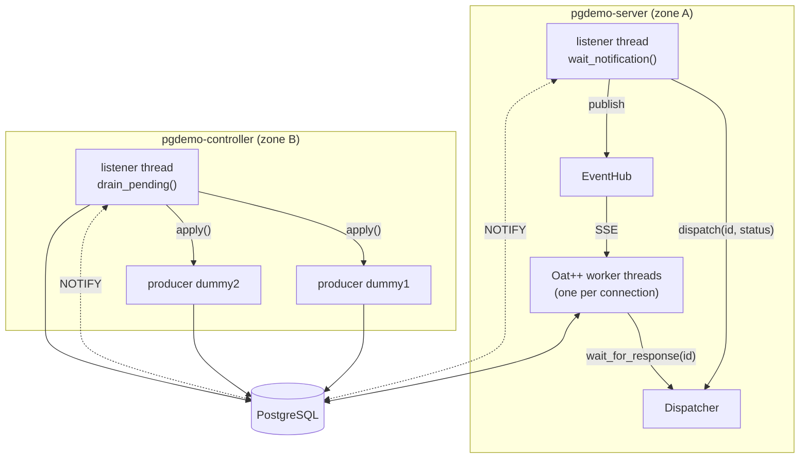
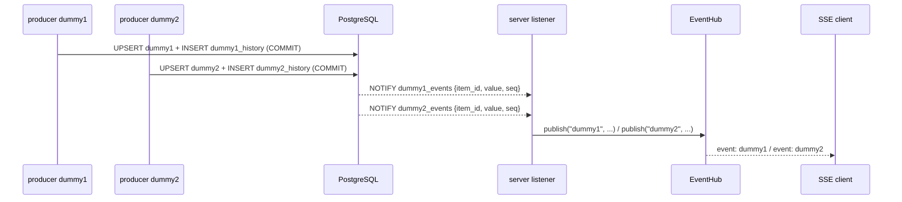
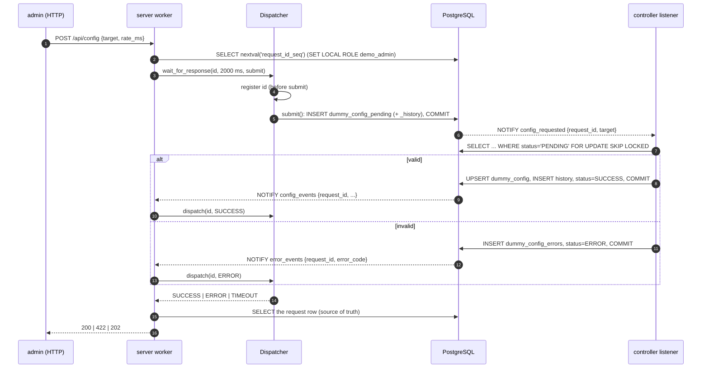
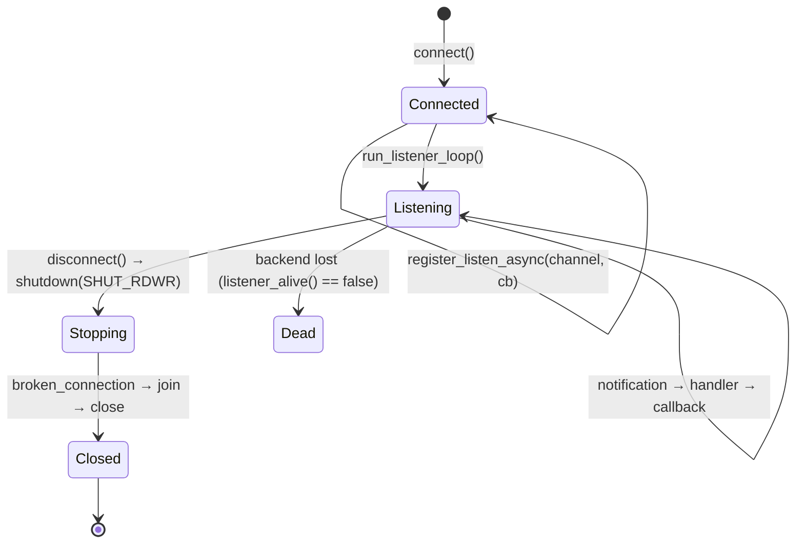

# Architecture

This document explains how two processes that never talk to each other run a reactive, transactional exchange through PostgreSQL alone, and how the same database enforces authentication and authorization.

1. [Processes and zones](#1-processes-and-zones)
2. [Data plane: two tables, one listener](#2-data-plane-two-tables-one-listener)
3. [Control plane: desired vs applied configuration](#3-control-plane-desired-vs-applied-configuration)
4. [The Dispatcher](#4-the-dispatcher)
5. [Listener lifecycle in `libs/db`](#5-listener-lifecycle-in-libsdb)
6. [Monthly partitioning](#6-monthly-partitioning)
7. [Security](#7-security)
8. [Failure semantics](#8-failure-semantics)

## 1. Processes and zones

| Process | Zone | PostgreSQL login | Writes | Listens to |
|---|---|---|---|---|
| `pgdemo-server` | A | `demo_server` (NOINHERIT) | `dummy_config_pending`, `app_users` | `dummy1_events`, `dummy2_events`, `config_events`, `error_events` |
| `pgdemo-controller` | B | `demo_controller` | `dummy1`, `dummy2`, histories, `dummy_config`, `dummy_config_errors` | `config_requested` |
| `client/pgdemo.sh` | host | none | over HTTP only | SSE `/api/stream` |

Neither process knows the other's address, port or existence. Each owns its side of the contract: the server owns *desired* state, and the controller owns *applied* state and the data. The schema in [`sql/`](../sql) is the interface between them.

Each process holds two connections:

- **query connection.** Every transaction, guarded by a mutex.
- **listener connection.** Only `LISTEN` and a thread blocked on its socket.



## 2. Data plane: two tables, one listener

`dummy1` and `dummy2` are separate tables, each with its own `AFTER INSERT OR UPDATE` trigger and its own channel:

| Table | Trigger function | Channel | Payload |
|---|---|---|---|
| `dummy1` | `notify_dummy1_change()` | `dummy1_events` | `{table, action, item_id, value, seq, ts}` |
| `dummy2` | `notify_dummy2_change()` | `dummy2_events` | same shape |

The controller runs one `std::jthread` per table. Every tick writes one statement: a CTE that UPSERTs the live row and appends the same sample to the history table in one transaction. The trigger fires on the live row, and PostgreSQL delivers the notification **only when the transaction commits**, so a listener never sees a value that was rolled back.

On the server, one listener connection subscribes to all four channels. libpqxx keeps a handler per channel and calls the right one for each notification. The server forwards both data channels to the `EventHub`, which fans them out to SSE subscribers filtered by `?channels=`.



`EventHub::publish` never blocks the listener thread. Each subscriber has a bounded queue, and a slow client loses its oldest events rather than stalling notification delivery for everybody.

## 3. Control plane: desired vs applied configuration

| Table | Owner of the rows | Meaning |
|---|---|---|
| `dummy_config` | controller | **Applied** configuration, one row per target, with the `request_id` that produced it |
| `dummy_config_pending` | server inserts, controller updates `status` | **Desired** configuration: the queue. Status `PENDING → SUCCESS \| ERROR \| TIMEOUT` |
| `dummy_config_errors` | controller | Why a request was rejected (`INVALID_RATE`, `INVALID_AMPLITUDE`, `EXPIRED`, …) |
| `dummy_config_history` | controller | Every applied configuration |
| `dummy_config_pending_history` | server | Every desired configuration, as submitted |
| `request_id_seq` | server | The single cross-process ID authority |

`v_dummy_config_sync_status` joins them per target. It shows the applied values, the latest desired request, its status, the latest error, and a summary `sync` column with the value `SYNC`, `PENDING` or `ERROR`.



Properties of this loop:

- **The queue is durable and notifications are not.** `NOTIFY` is a wake-up call, never the data. The controller drains every `PENDING` row each time it is woken, and once at start-up after `LISTEN` is active. A request made while the controller was down is applied when it comes back.
- **Several controllers can share the queue.** Each row is taken with `FOR UPDATE SKIP LOCKED`, so two workers never process the same request.
- **Stale requests do not apply.** A request older than `--pending-max-age-s` (600 s by default) becomes `TIMEOUT` with error `EXPIRED`, so an old intent does not overwrite a newer reality.
- **Validation belongs to the zone that executes.** The server checks types and the role; the controller decides whether the values are acceptable. The answer travels back through the database like any other state.
- **Partial updates.** Fields left out of the POST body are taken from the applied configuration.
- **Producers react immediately.** After the commit, the controller calls `Producer::apply()`, which updates atomics and wakes the producer from its sleep, so a new rate takes effect without waiting out the old period.

## 4. The Dispatcher

[`server/src/dispatcher`](../server/src/dispatcher) correlates a blocked HTTP worker thread with a completion that arrives later on the listener thread, keyed by `request_id`.

```cpp
const auto status = dispatcher->wait_for_response(id, timeout_ms, [&] {
    db->add_pending_config(role, request);   // runs after the waiter is registered
});
```

- **Register, then submit.** The waiter enters the map before the INSERT. A completion that arrives before the worker reaches `condition_variable::wait_for` sets `ready` under the same mutex, and the predicate sees it. No wake-up is lost, however fast the controller is. A unit test calls `dispatch` from inside `submit` to prove it.
- **The context lives on the stack.** Each waiter's `RequestContext` (condition variable, status, `ready`) is on its own stack. The map only points to it while the waiter is inside `wait_for_response`, and `dispatch` only touches it under the map mutex.
- **Bounded.** With 500 waiters already registered, new requests get `SYSTEM_FULL` (HTTP 503) and nothing is enqueued.
- **A failed submit cleans up.** If the INSERT throws, the registration is removed and the caller gets `DB_ERROR`. The server rethrows the captured exception and maps it by SQLSTATE.
- **A timeout is not a failure.** On `TIMEOUT`, the server reads the request row. If it shows `SUCCESS` or `ERROR`, that is the answer (the notification was missed). If it is still `PENDING`, the server replies `202 Accepted` with a `Location` header for polling.

## 5. Listener lifecycle in `libs/db`

`DatabaseManager` keeps the threading rules of libpqxx explicit. A `pqxx::connection` is not thread-safe, so the listener connection has a strict lifecycle:

1. **Registration** (single-threaded). `register_listen_async(channel, callback)` runs `LISTEN "<channel>"` (quoted), stores the callback, and installs a libpqxx handler for the channel. The handler parses the payload as JSON and calls the callback inside `try/catch`, so a throwing callback is logged and does not kill the listener. Call it once per channel.
2. **Activation.** `run_listener_loop()` sets `listening_` and starts one `std::jthread` that loops on `connection::wait_notification()`. Registering after this point throws `std::logic_error`, because the handler table must not change while another thread reads it.
3. **Shutdown.** `disconnect()` requests the stop and calls `shutdown(fd, SHUT_RDWR)` on the listener socket. `poll()` returns, the read hits EOF, and libpqxx throws `pqxx::broken_connection`, which the thread treats as its exit signal. The thread is joined, and only then are both connections closed. The socket is never `close()`d from another thread while `poll()` uses it.



`wait_notification()` comes from [`patches/libpqxx.patch.full`](../patches/README.md). Upstream `await_notification()` wakes up every second by default. The patched call blocks in `poll(fd, -1)`, so an idle listener costs nothing.

Callbacks run on the listener thread. They may use the query connection (the listener never holds its mutex), and must stay short: the controller's queue drain and the server's `dispatch` + `publish` are both bounded.

## 6. Monthly partitioning

`dummy1_history` and `dummy2_history` are `PARTITION BY RANGE (recorded_at)`, with one partition per UTC month plus a `DEFAULT` partition:

```text
dummy1_history
├── dummy1_history_y2026m11   [2026-11-01 00:00Z, 2026-12-01 00:00Z)
├── dummy1_history_y2026m12   [2026-12-01 00:00Z, 2027-01-01 00:00Z)
├── dummy1_history_y2027m01   ...
└── dummy1_history_default    anything not covered above
```

- **Partitions are created ahead.** `ensure_monthly_partitions(parent, from_month, months_ahead)` creates the current month and the next `months_ahead` months. The controller calls it at start-up and every `--maintenance-interval-s` (1 h by default).
- **Rows parked in DEFAULT are moved.** If rows for a month landed in `DEFAULT` before its partition existed, the function moves them into the new partition in the same transaction. PostgreSQL would otherwise refuse to create the partition.
- **Pruning.** A query with a `recorded_at` range scans only the matching partitions. Use UTC bounds, because month boundaries are UTC.
- **Retention without DELETE.** `drop_monthly_partitions_before(parent, cutoff)` drops whole months, which avoids a long `DELETE` and the vacuum that follows.
- **Safe to call from the controller.** Both functions are `SECURITY DEFINER` (they run as `demo_owner`), whitelist their parent table, and pin `search_path` and `TimeZone`. They take an advisory lock so that concurrent callers do not race. The controller needs only `EXECUTE` and never owns a table.

Each history row returned by `/api/history` carries its partition name (`tableoid::regclass`), so routing is visible from the client.

## 7. Security

### Authentication

- **Passwords.** Argon2id hashes in PHC format (`$argon2id$v=19$m=65536,t=3,p=1$…`) with a 16-byte random salt, produced by Botan. The parameters travel inside the string, so they can change without breaking stored hashes. A `CHECK` constraint rejects anything that is not an Argon2id string.
- **No user enumeration.** When the username does not exist, the server verifies the password against a fixed dummy hash anyway, so response time does not reveal whether a user exists. Both failures return the same `401` body.
- **Login lookup without table access.** `demo_server` has no privilege on `app_users`. It calls `auth_fetch_user(username)`, a `SECURITY DEFINER` function that returns one hash and one role, and nothing else.
- **Tokens.** JWT signed with ES384 (ECDSA P-384, SHA-384, raw `r‖s` signature, RFC 7518 §3.4). The signing key is a PKCS#8 file and verification uses the public key of an X.509 certificate, both generated by `scripts/gen-jwt-keys.sh` into `run/keys/`. Verification pins `alg` to ES384, so `none` and algorithm confusion are rejected. It also checks the issuer, the expiry, and that `sub` and `role` are present.
- **Default-deny routing.** `AuthInterceptor` requires a valid bearer token on every route except `POST /api/auth/login` and `GET /api/health`. A route added later is protected by default.

### Authorization, twice

The JWT `role` claim selects a PostgreSQL group for the duration of one transaction:

```sql
BEGIN;
SET LOCAL ROLE demo_admin;      -- or demo_normal
-- the request's statements
COMMIT;                         -- the role reverts here
```

`demo_server` is `NOINHERIT` and holds `demo_admin` and `demo_normal` with `INHERIT FALSE, SET TRUE`. On its own it can do nothing but call `auth_fetch_user()`. It gets privileges only by switching role explicitly, and only for one transaction. The HTTP layer rejects a normal user's admin request with `403`. If that check were missing, PostgreSQL would still refuse the statement with SQLSTATE `42501`, which the server also maps to `403`. The database tests check the second layer directly.

| Object | `demo_normal` | `demo_admin` | `demo_controller` | `demo_server` |
|---|---|---|---|---|
| `dummy1`, `dummy2`, histories | SELECT | SELECT | SELECT, INSERT, UPDATE | – |
| `dummy_config` | SELECT | SELECT | SELECT, INSERT, UPDATE | – |
| `dummy_config_pending` | SELECT | SELECT, INSERT | SELECT, UPDATE | – |
| `dummy_config_errors`, `_history` | SELECT | SELECT | INSERT | – |
| `request_id_seq` | – | USAGE | – | – |
| `app_users` | – | non-secret columns; INSERT, UPDATE `password_hash`/`role`, DELETE | – | – |
| `auth_fetch_user()` | – | – | – | EXECUTE |
| `ensure_monthly_partitions()` | – | – | EXECUTE | – |

The full matrix is in [`sql/05_views.sql`](../sql/05_views.sql). Two more rules live in the schema:

- **The last admin cannot be removed.** The `protect_last_admin` trigger blocks deleting or demoting the last admin, which surfaces as `422`.
- **The admin role cannot read password hashes.** `demo_admin` may write `password_hash` but has no `SELECT` on it.

### Identifiers and inputs

- **No SQL identifier comes from user input.** Table and channel names come from a fixed whitelist (`db::DummyTable`), and values travel as bind parameters.
- **Secrets stay out of argv and git.** `db-init.sh` generates the login passwords and the first admin password into `run/demo.env` (mode 0600, gitignored), and passes passwords to `psql` as variables, never on the command line. The client stores the token as a 0600 header file and sends it with `curl -H @file`, so neither the token nor a password shows up in a process listing.

## 8. Failure semantics

| Situation | What happens |
|---|---|
| Controller down, admin posts a configuration | Request stored as `PENDING`. API answers `202` after the timeout. Applied at controller start-up (or `EXPIRED` if too old). |
| Controller rejects a value | `dummy_config_errors` row, status `ERROR`, `error_events` wakes the waiter. API answers `422` with `error_code`. |
| Notification missed (listener restarted between commit and wait) | Dispatcher times out. The server reads the row and answers from it. |
| Listener connection lost | `listener_alive()` turns false, the process exits with status 1, and the supervisor restarts it. On restart the controller drains the queue again. |
| Two controllers running | `SKIP LOCKED`: each request is processed exactly once. Both producers write, so in practice run one. |
| Duplicate username | Unique violation `23505`, mapped to `409`. |
| Invalid username format, last-admin removal | `CHECK` or trigger (`23514`), mapped to `422`. |
| Too many concurrent configuration requests | 500 waiters: `503`, nothing enqueued. |
| Slow SSE client | Its oldest events are dropped. Other clients and the listener are unaffected. |
