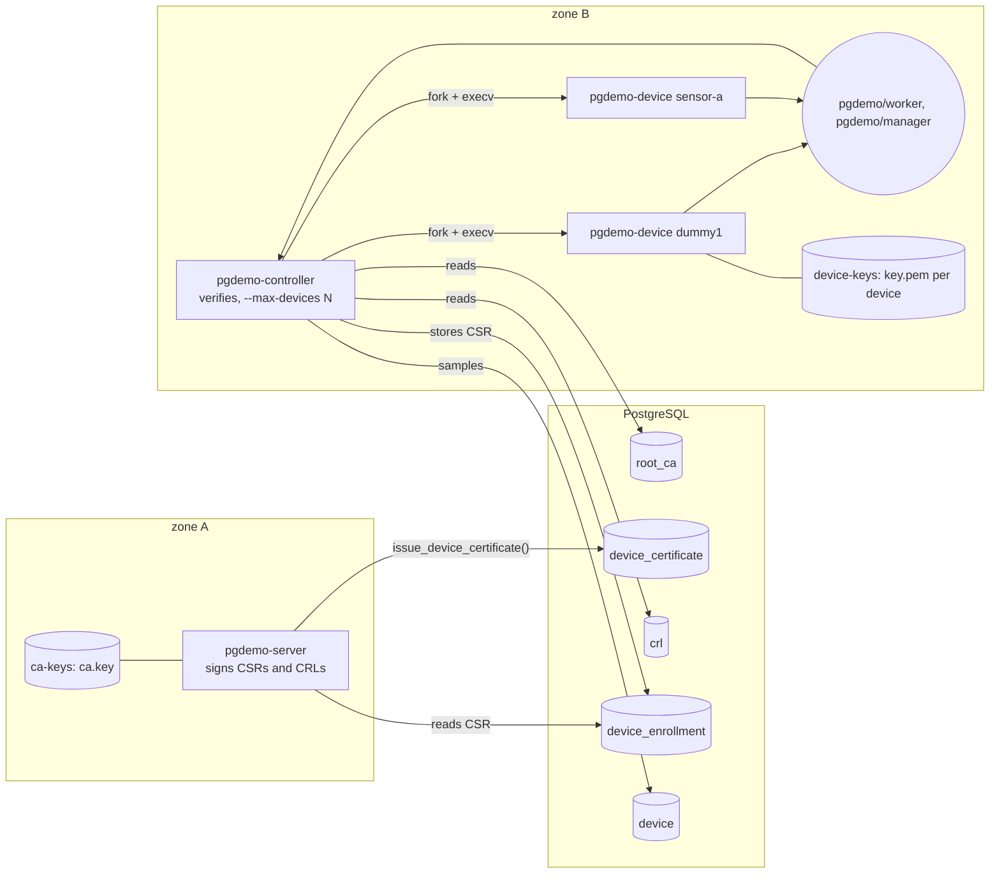
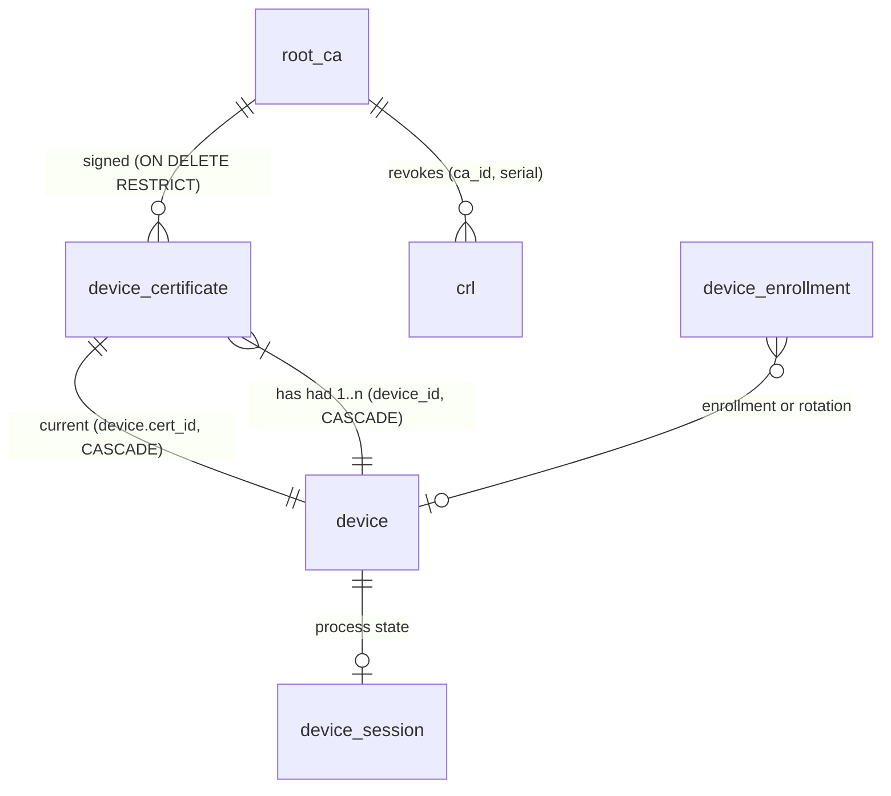
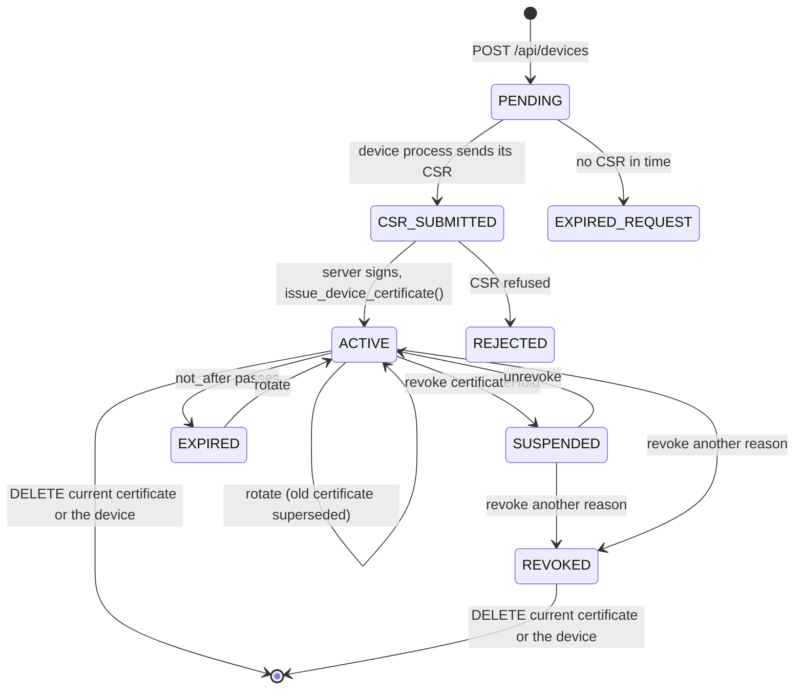
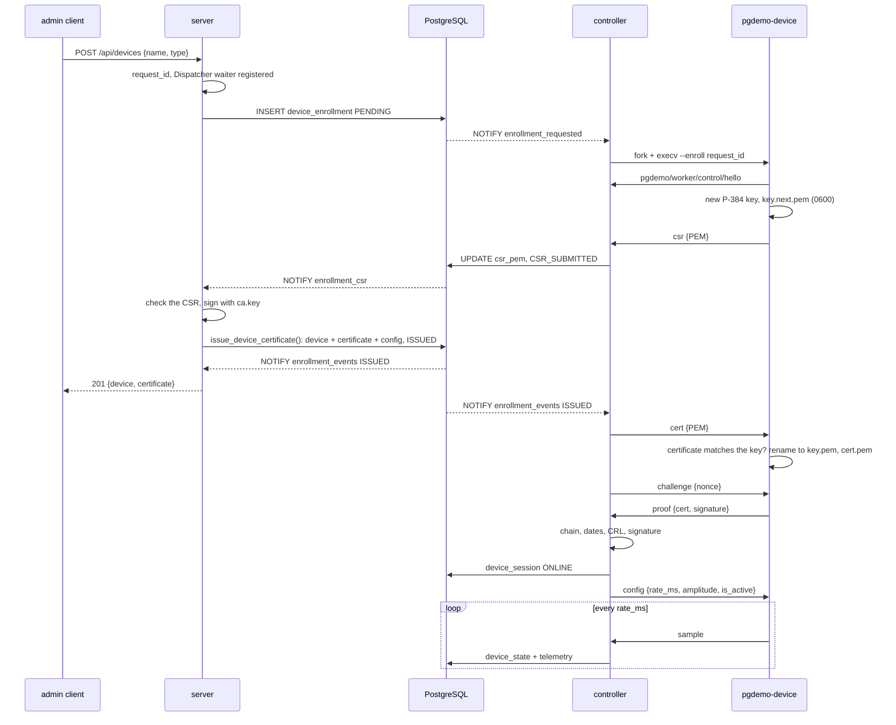
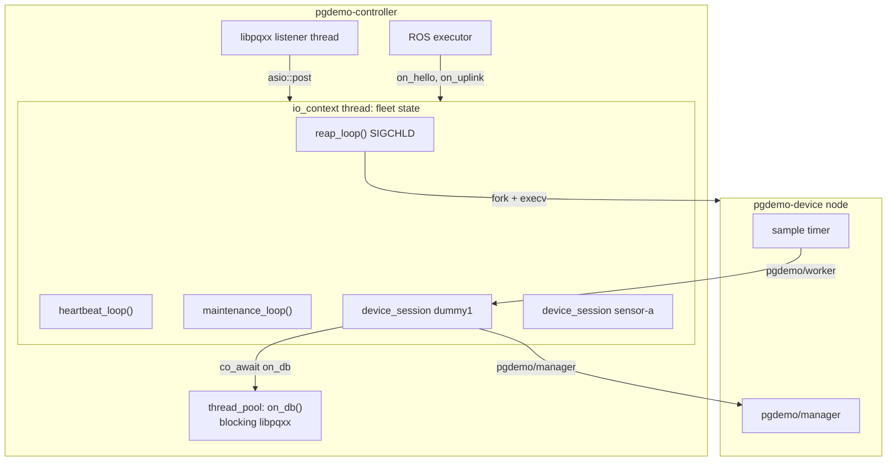

# Device identity: X.509 certificates, ECDSA P-384

Every device has an X.509 certificate issued by an internal root CA. Its process proves, each time it connects, that it holds the matching private key. This document covers the trust model, the schema behind it, the enrollment and rotation flows, how the controller runs and authenticates device processes, and what revoking or deleting a certificate does.

1. [Trust model](#1-trust-model)
2. [Schema](#2-schema)
3. [Enrollment and rotation](#3-enrollment-and-rotation)
4. [Device processes](#4-device-processes)
5. [Authentication](#5-authentication)
6. [Revocation and deletion](#6-revocation-and-deletion)
7. [API and client](#7-api-and-client)
8. [Files, volumes and operations](#8-files-volumes-and-operations)
9. [Failure semantics](#9-failure-semantics)

## 1. Trust model

| Secret | Where it lives | Who can read it |
|---|---|---|
| Root CA private key | `run/ca/ca.key` (0600, PKCS#8, P-384). In Docker, the `ca-keys` volume. | `pgdemo-server` (zone A), which signs CSRs and CRLs with it; `init` creates it |
| Root CA certificate | `run/ca/ca.crt` and the `root_ca` table | everyone |
| Device private key | `run/devices/NAME/key.pem` (0600) in a 0700 directory. In Docker, the `device-keys` volume. | that device's process, started by `pgdemo-controller` (zone B) |
| Device certificate | `run/devices/NAME/cert.pem` and `device_certificate` | everyone |

- **The server signs, it never verifies a device.** It checks the CSR (self-signature, ECDSA P-384, `CN` equal to the device name, no CA request) and then issues a certificate with a fixed profile, whatever the CSR asked for: subject `CN=NAME` only, `basicConstraints CA:FALSE` (critical), `keyUsage digitalSignature` (critical), `extendedKeyUsage clientAuth`, subject and authority key identifiers, a random 128-bit serial, ECDSA-SHA384, `--cert-validity-days` (365) of validity.
- **The controller verifies, it never signs.** It checks the chain against the active `root_ca` rows, the validity dates, the CRL, and that the process holds the key (challenge-response, [section 5](#5-authentication)).
- **No key crosses a zone.** The CA key stays in zone A, device keys in zone B. Only CSRs, certificates and the CRL travel, through PostgreSQL.



## 2. Schema

[`sql/03_identity.sql`](../sql/03_identity.sql) holds the tables and functions; [sql/README.md](../sql/README.md#device-identity) lists every column.



The requirements map onto foreign keys, not application code:

| Requirement | How the schema enforces it |
|---|---|
| A device is bound to an X.509 certificate | `device.cert_id NOT NULL UNIQUE`, with the composite foreign key `(cert_id, device_id)` to `device_certificate (cert_id, device_id)`: the current certificate exists and belongs to this device |
| A device may have had several certificates | `device_certificate.device_id` references `device`; `device.cert_id` marks the current one |
| Deleting the current certificate deletes the device | `device_current_cert_fk ... ON DELETE CASCADE`; the device takes its state, configuration, queue and session with it |
| Deleting an old certificate deletes nothing else | that certificate is not referenced by `device.cert_id` |
| Deleting a device deletes its certificates | `device_certificate_device_fk ... ON DELETE CASCADE` |
| A revoked certificate means out of service, not deleted | revocation is a `crl` row; the device row stays, and `v_device_identity` turns it `REVOKED` or `SUSPENDED` |
| A revocation outlives the certificate | `crl` has no foreign key to `device_certificate`, and keeps the PEM so the CRL can still be signed |
| Only a hold can be undone | `trg_crl_protect` refuses `DELETE` and `UPDATE` of every row whose reason is not `certificateHold` |

Both foreign keys between `device` and `device_certificate` are `DEFERRABLE INITIALLY DEFERRED`: the first certificate and its device reference each other, so `issue_device_certificate()` inserts both in one transaction and the check runs at commit. Referential actions (`CASCADE`) are never deferred, so deletion behaves as above.

Nobody writes `device` or `device_certificate` directly. `demo_admin` may only `DELETE` them; a device comes into existence only through `issue_device_certificate()`, a `SECURITY DEFINER` function the server may `EXECUTE`. That function checks again what the server checked: the request is `CSR_SUBMITTED`, the `CN` is the requested name, the issuer is an active `root_ca`. A trigger on `device_certificate` also refuses a `subject_cn` that is not the device's name.

### Identity of a device

`v_device_identity` derives one value per device from its current certificate. Only `ACTIVE` devices get a process.

| `identity` | Meaning |
|---|---|
| `ACTIVE` | valid dates, not in the CRL, CA active |
| `SUSPENDED` | current certificate in the CRL with `certificateHold`; reversible |
| `REVOKED` | current certificate in the CRL with any other reason |
| `EXPIRED` | outside `not_before`..`not_after` |
| `CA_INACTIVE` | issuing `root_ca` disabled or expired |



`PENDING`, `CSR_SUBMITTED`, `REJECTED` and `EXPIRED_REQUEST` are states of the `device_enrollment` row (its `EXPIRED`); the device row does not exist yet. A revoked device cannot be rotated back to `ACTIVE`: the API answers `409`, and the way back is a new enrollment under another name.

### Process state

`device_session` is written by the controller only: `STARTING`, `ONLINE`, `OFFLINE`, `UNMANAGED` (over `--max-devices`), `AUTH_FAILED` and `DISABLED` (identity not `ACTIVE`), with the pid, `connected_at`, `last_seen` and the last error. `GET /api/devices/NAME` shows it as `session` and `process`.

### Channels

| Channel | When | Listener |
|---|---|---|
| `enrollment_requested` | `device_enrollment` INSERT | controller: start a process to enroll or rotate |
| `enrollment_csr` | status becomes `CSR_SUBMITTED` | server: sign the CSR |
| `enrollment_events` | status becomes `ISSUED`, `REJECTED` or `EXPIRED` | controller (deliver the certificate), server (Dispatcher, SSE `enrollment`) |
| `device_events` | `INSERT`, `DELETE`, `ROTATED` (`device.cert_id`), `REVOKED`, `UNREVOKED` (`crl`), and each `device_session` state | controller, server |
| `error_events` | `device_session` becomes `AUTH_FAILED` | server |

## 3. Enrollment and rotation

An enrollment request is a row, so it survives a controller that is down: the seeds `dummy1`–`dummy3` are three `PENDING` rows written by `db-init.sh`, and they enroll the way any device does when the controller first starts.



- **The HTTP request waits for the certificate** through the same Dispatcher as `POST /api/config`, for up to `--enroll-timeout-ms` (5000). `201` means issued; `202` means still in progress (the controller may be down, the request stays `PENDING`); `422` means refused, with `error_code` (`CSR_SUBJECT`, `CSR_KEY`, `CAPACITY`, `DEVICE_EXITED`, ...).
- **A rotation** (`POST /api/devices/NAME/rotate`) is the same flow with `--rotate`: the controller stops the running process, starts one that generates a new key, and `issue_device_certificate()` adds the certificate, makes it current and revokes the previous one as `superseded`, in one transaction. The new key replaces `key.pem` only after the device has checked that the issued certificate carries it; until then the old pair stays on disk.
- **Requests expire.** A request with no outcome after `--enrollment-timeout-s` (120) becomes `EXPIRED`. The partial unique index on `name` allows one open request per name.
- **Restart safety.** At start-up the server signs every request left in `CSR_SUBMITTED`, and the controller picks up every `PENDING` one.

## 4. Device processes

`pgdemo-device` ([`device/src/main.cpp`](../device/src/main.cpp)) is one worker and one ROS 2 node. It has no database access. It publishes `pgdemo/worker/` and subscribes to `pgdemo/manager/`. The manager starts it with:

```text
pgdemo-device --name NAME --type TYPE --payload scalar|gps --dir run/devices/NAME
              [--enroll REQUEST_ID | --rotate REQUEST_ID]
```

The same binary, started on another host in the same ROS domain, is admitted when its `hello` names a slot the controller wants and no session is attached yet. Exit codes: `0` bye or signal, `1` protocol or I/O error, `2` usage, `3` enrollment refused, `4` no key or certificate on disk.

`hello` is published transient-local and repeated once a second until the challenge, so a controller that starts while the node is waiting still sees it. After authentication, [`device/src/Stream.hpp`](../device/src/Stream.hpp) emits a `sample` every `rate_ms` while active and a `heartbeat` every 5 s while paused. A `pgdemo/manager/config` message applies at once and the timer is re-armed at the new rate. `bye`, SIGINT or SIGTERM ends the process.

### Messages

The envelope is [msgs/README.md](../msgs/README.md): one struct per topic. Workers publish `pgdemo/worker/` (`hello`, `heartbeat`, `error`, `csr`, `proof`, telemetry). The manager publishes `pgdemo/manager/` (`bye`, `challenge`, `certificate`, `rejected`, `config`). The nonce is 32 raw bytes and the proof signature is 96 raw bytes (ECDSA P-384, `r‖s`). A worker ignores a manager message whose `device` is not its name. The process lifecycle is [controller/README.md](../controller/README.md).

### Supervision in the controller

`pgdemo-controller` ([`controller/src/Fleet.hpp`](../controller/src/Fleet.hpp)) runs the fleet on one `io_context` thread, which alone owns the process table, the slots and the sessions, so none of them needs a lock. libpqxx blocks, so every database call runs on a thread pool through `co_await on_db(...)`, and the coroutine resumes on the io thread. The listener thread and the ROS executor only `post` onto that thread.



- **Starting a process.** `argv` is built before `fork()`. Between `fork()` and `execv()` the child only makes async-signal-safe calls: default signal dispositions, an empty signal mask, `prctl(PR_SET_PDEATHSIG, SIGTERM)` (plus a `getppid()` check for a parent that died first), and `close_range(3, ...)` so that no descriptor of the controller (sockets, libpq connections) leaks into the device.
- **Signals.** SIGINT, SIGTERM and SIGCHLD are blocked before any thread exists, so the pool and the listener inherit the mask, and only the io thread receives them through `signal_set`.
- **Reaping and restarts.** `reap_loop()` calls `waitpid(-1, WNOHANG)` on each SIGCHLD. A process that ends while its device is still `ACTIVE` is restarted after an exponential backoff of 1 s to 30 s, reset once a process has stayed online for 60 s. `AUTH_FAILED` and `DISABLED` are not retried until the identity changes (rotation, lifted hold).
- **Stuck processes.** A device that sends nothing for 30 s (it heartbeats every 5 s) is killed and restarted when this controller forked it. A node started elsewhere is released; there is no pid to signal.
- **Capacity.** `--max-devices N` (16) bounds the number of processes. Devices over the limit are `UNMANAGED` and take the next free slot; an enrollment that finds no slot is refused with `CAPACITY`.
- **Shutdown.** `bye` and SIGTERM to every process, up to 5 s for them to be reaped, SIGKILL for the rest, then every session goes `OFFLINE`.

## 5. Authentication

There is no Unix socket and no `SO_PEERCRED`. Any participant in the ROS domain can publish. Admission is the `hello`, and possession of the key is the challenge that follows.

The process proves possession of the key of its certificate:

1. `hello` names the device and the mode it was started with (`run`, `enroll` or `rotate`). A repeated `hello` during the handshake is the retransmission; a `hello` after the device is online is refused with `bye`.
2. The controller sends 32 random bytes, `challenge.nonce`, valid for this connection only, with a 5 s deadline.
3. The device signs, with ECDSA P-384 and SHA-384:

   ```text
   "pgdemo-device-auth-v1" || 0x00 || nonce || 0x00 || name || 0x00 || certificate SHA-256 fingerprint
   ```

   The name and the fingerprint stop a proof from being replayed for another device or another certificate; the nonce stops it from being replayed at all.
4. The controller re-reads the device from the database (so a revocation committed a moment ago counts) and checks the certificate (`CertVerifier`, [`libs/pki`](../libs/pki/include/pki/CertVerifier.hpp)):
   - it is the device's current certificate (same fingerprint as `device.cert_id`);
   - `CN` equals the name, and its serial is not in `crl`;
   - the chain verifies against the active `root_ca` certificates, with `extendedKeyUsage clientAuth`, inside its validity dates;
   - the signature verifies with the certificate's public key.

A failure sets `device_session.state = AUTH_FAILED` with the reason (`BAD_HELLO`, `BAD_PROOF`, `CERT_NOT_CURRENT`, `CERT_REVOKED`, `CERT_CHAIN`, `CERT_SUBJECT`), raises an `error_events` notification, and closes the connection. The process is not restarted: a tampered or stale key cannot be fixed by retrying. A rotation gives the device a new key and certificate and clears the state.

## 6. Revocation and deletion

| Action | Database | Controller | Device row |
|---|---|---|---|
| `revoke NAME certificateHold` | `crl` row, `identity = SUSPENDED` | `bye`, SIGTERM; `DISABLED` | kept |
| `unrevoke NAME` | the hold row deleted, `ACTIVE` | process started again | kept |
| `revoke NAME keyCompromise` (or `unspecified`, `affiliationChanged`, `cessationOfOperation`) | `crl` row, permanent, `REVOKED`; a hold may be turned into this | stopped, `DISABLED` | kept, with its telemetry |
| `rotate NAME` | new current certificate; the old one `superseded` in `crl` | process restarted with `--rotate`, then proves the new key | kept |
| `delcert NAME SERIAL` (an old certificate) | that certificate row only; its `crl` row stays | nothing | kept |
| `delcert NAME SERIAL` (the current one) | `ON DELETE CASCADE`: device, state, configuration, queue, session | process stopped, `run/devices/NAME` removed | deleted; telemetry kept |
| `devices del NAME` | device and all its certificates; `crl` rows stay | process stopped, key directory removed | deleted; telemetry kept |

`superseded` is reserved for rotations: the API refuses it as a reason. A permanent revocation also blocks `rotate` and `unrevoke` (`409`), so a compromised device cannot be brought back under its old name.

The controller hears all of this through `device_events` (`REVOKED`, `UNREVOKED`, `ROTATED`, `DELETE`). A maintenance sweep every 30 s re-reads every identity as well, which also catches certificates that expire without any write.

## 7. API and client

| Method and path | Role | `client/pgdemo.sh` |
|---|---|---|
| `POST /api/devices` `{name, type}` | admin | `devices add NAME TYPE` |
| `GET /api/devices/NAME/certificates` | any | `devices certs NAME` |
| `POST /api/devices/NAME/revoke` `{reason}` | admin | `devices revoke NAME REASON` |
| `DELETE /api/devices/NAME/revoke` | admin | `devices unrevoke NAME` |
| `POST /api/devices/NAME/rotate` | admin | `devices rotate NAME` |
| `DELETE /api/devices/NAME/certificates/SERIAL` | admin | `devices delcert NAME SERIAL` |
| `GET /api/enrollments?device=&limit=`, `GET /api/enrollments/ID` | any | `devices enrollments [NAME]` |
| `GET /api/pki/ca` | any | `pki ca`: root CAs, the signing fingerprint, the revoked serials |
| `GET /api/pki/crl` | any | `pki crl`: an X.509 CRL in PEM, signed when requested |

The SSE stream carries an `enrollment` event for each request that is queued, submitted or decided. `GET /api/devices/NAME` includes `identity`, `certificate` (serial, fingerprint, CA, dates, revocation) and `process` (state, pid, `last_seen`, last error).

```bash
client/pgdemo.sh devices add sensor-a sine           # 201 once the certificate is issued
client/pgdemo.sh devices certs sensor-a
client/pgdemo.sh devices revoke sensor-a certificateHold
client/pgdemo.sh devices unrevoke sensor-a
client/pgdemo.sh devices rotate sensor-a              # two certificates, the old one superseded
client/pgdemo.sh pki crl | openssl crl -noout -text   # the superseded serial is listed
```

## 8. Files, volumes and operations

`scripts/db-init.sh` runs [`scripts/gen-device-ca.sh`](../scripts/gen-device-ca.sh) when `run/ca/` has no CA: a P-384 key and a self-signed certificate with `basicConstraints=critical,CA:TRUE,pathlen:0` and `keyUsage=critical,keyCertSign,cRLSign`, valid ten years. It then inserts the certificate into `root_ca`. `PGDEMO_CA_DIR` moves the directory.

`scripts/run-all.sh` passes `--ca-key run/ca/ca.key --ca-cert run/ca/ca.crt` to the server, which warns at start-up if that CA is not an active `root_ca`. The controller gets `--device-bin build/device/pgdemo-device --devices-dir run/devices --max-devices ${PGDEMO_MAX_DEVICES:-16}`.

| Path | Contents |
|---|---|
| `run/ca/ca.key`, `run/ca/ca.crt` | the root CA (directory 0700, key 0600) |
| `run/devices/.controller.lock` | an exclusive `fcntl` lock. A second controller on this machine exits instead of taking the fleet over |
| `run/devices/NAME/key.pem`, `cert.pem` | one device's identity (directory 0700, key 0600) |
| `run/devices/NAME/key.next.pem`, `cert.next.pem` | only while a rotation is in progress |

In Docker, `ca-keys` is mounted at `/app/run/ca` by `init` and `server`, and `device-keys` at `/app/run/devices` by `controller` only. Neither container can read the other's secrets.

Inspecting:

```bash
openssl x509 -in run/devices/dummy1/cert.pem -noout -text     # the issued profile
openssl verify -CAfile run/ca/ca.crt run/devices/dummy1/cert.pem
client/pgdemo.sh pki crl > /tmp/devices.crl && openssl crl -in /tmp/devices.crl -CAfile run/ca/ca.crt -noout -text
psql -h /var/run/postgresql -d pgdemo -c 'SELECT device, identity, session, serial FROM v_device_identity'
```

## 9. Failure semantics

| Situation | What happens |
|---|---|
| Controller down, admin enrolls a device | `202`, the request stays `PENDING`. The controller enrolls it at start-up, or it expires after `--enrollment-timeout-s`. |
| Server down while a CSR waits | The request stays `CSR_SUBMITTED`; the server signs it at start-up. |
| CSR with another `CN`, an RSA or P-256 key, a bad signature or a CA request | `REJECTED` with `CSR_SUBJECT`, `CSR_KEY`, `CSR_SIGNATURE` or `CSR_CA`; the device exits with code 3 and nothing is created. |
| Device process dies during enrollment | `REJECTED` with `DEVICE_EXITED`; the new key is discarded. |
| Device key replaced or corrupted on disk | `AUTH_FAILED` (`BAD_PROOF`), not retried. `rotate` recovers it. |
| A node the controller did not start publishes `hello` | Admitted when that name is a wanted slot with no session yet, then challenged like a child. A second `hello` once the device is online gets `bye`. |
| Certificate revoked while the device is online | `device_events REVOKED`: `bye`, SIGTERM, `DISABLED`. The next handshake would fail anyway (`CERT_REVOKED`). |
| Certificate expires | The maintenance sweep marks it `EXPIRED` and stops the process; `rotate` issues a new one. |
| Controller stopped or crashed | Devices get `bye` and SIGTERM, or `PR_SET_PDEATHSIG` if the controller died. At start-up every `STARTING` or `ONLINE` session is reset to `OFFLINE` and the processes start again. |
| More devices than `--max-devices` | The rest are `UNMANAGED`; new enrollments are refused with `CAPACITY`. |
