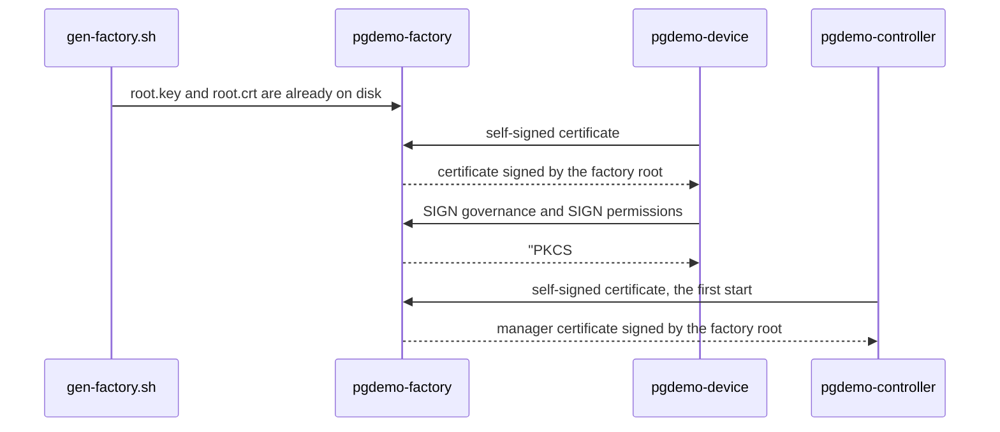

# pgdemo-factory

Zone A process. It holds the root of the simulation: one P-384 key that signs the manager certificate, each worker certificate, and the two SROS2 policy documents. It does not replace the device CA in `run/ca/`. That CA, the CSR and the challenge stay the enrollment in [docs/DEVICE_PKI.md](../docs/DEVICE_PKI.md). `scripts/db-init.sh` does not call the script below. The worker side of the seed is [device/README.md](../device/README.md). The controller asks for its own certificate the first time, then asks for the signed governance and permissions.

## The key

[`scripts/gen-factory.sh`](../scripts/gen-factory.sh) writes the key and the certificate before this process starts.

```text
scripts/gen-factory.sh [--force] [DIR]
```

`DIR` defaults to `run/factory`. The directory is mode `0700`. `root.key` is unencrypted PKCS#8, ECDSA P-384, mode `0600`. `root.crt` is self-signed with ECDSA-SHA256, `CA:TRUE`, `pathlen:0`, `keyCertSign` and `cRLSign`, mode `0644`. The hash is SHA-256 because DDS-Security's authentication plugin accepts `ecdsa-with-SHA256` and rejects SHA-384. The key stays P-384. Both files sit under `run/` and are not committed. `--force` replaces them.

`pgdemo-factory` exits `1` when either file is missing. It does not generate a key.

## What it signs

A client connects to `127.0.0.1` and sends one request:

```text
SIGN worker NAME
-----BEGIN CERTIFICATE-----
...
-----END CERTIFICATE-----
.
```

`manager` in place of `worker` is the manager's first start. `NAME` is the subject CN. The certificate must be self-signed by an ECDSA P-384 key and must not be a CA. That signature is the proof of possession. The process issues a new certificate for the same public key:

| Role | Profile |
|---|---|
| `worker` | `CA:FALSE`, `digitalSignature`, `clientAuth`, ECDSA-SHA256 |
| `manager` | `CA:FALSE`, `digitalSignature`, `serverAuth`, ECDSA-SHA256 |

The reply is a line `OK`, the PEM, and a line `.`. A refusal is one line `ERR` and the reason. The private key does not leave the process, and the process opens no database.

Two more requests sign a fixed document, not a certificate. `SIGN governance` and `SIGN permissions NAME` carry the XML and end with a line `.`. The body must be exactly the governance template, or the permissions template whose subject is `CN=NAME`. Anything else is refused. The reply is `OK`, the PKCS#7 detached SMIME that SROS2 stores as `governance.p7s` or `permissions.p7s`, and a line `.`. Both CA files in an enclave are this same `root.crt`. `root.key` is not copied into the keystore.

The listener is `127.0.0.1`, so a controller in another zone does not gain a route to the key. A controller that cannot connect logs the failure and continues with the enrollment that already runs.



## Where the certificates go

Only the public material is stored. [libs/db](../libs/db) is the writer.

| What | Where |
|---|---|
| Factory root | One `root_ca` row named `factory`, the PEM of `root.crt`. The server registers it at startup when `--factory-cert` exists. The controller registers it when it starts this origin. |
| Manager | One row of `manager_certificate`. The controller replaces that row when it asks again, which it does when the stored certificate is not ECDSA-SHA256. |
| Worker | A row of `device_certificate` whose `ca_id` is the factory, written when the controller reads a `cert.pem` that chains to this root. `device.cert_id` stays on the certificate the enrollment already marked current. |
| Manager revocation | `manager_revocation` and `manager_crl_signature`. The manager signs the list with its own key. This process does not sign it, and it is not the `crl` table. |

`GET /api/pki/origin` publishes the factory certificate, the manager certificate, the worker certificates issued by the factory, and the manager CRL. The PKI tab shows that circle above the demo CA. No private key is in the response.

## Command line

```text
pgdemo-factory [--key PATH] [--cert PATH] [--port N]
```

| Option | Default | Effect |
|---|---|---|
| `--key` | `run/factory/root.key` | Factory root private key. Missing, the process exits |
| `--cert` | `run/factory/root.crt` | Factory root certificate. Missing, the process exits |
| `--port` | `9443` | TCP port on `127.0.0.1` |

`SIGINT` or `SIGTERM` ends the accept loop. A bad option exits `2`.

The manager key is separate and is created first as well: [`controller/scripts/gen-manager-key.sh`](../controller/scripts/gen-manager-key.sh) writes `run/controller/manager.key`. The controller does not create that key either.
