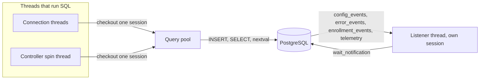

# Database library

`DatabaseManager` is the PostgreSQL access of `pgdemo-server` and `pgdemo-controller`. A `pqxx::connection` is not thread-safe, so the library keeps two kinds of session apart: a fixed pool for queries, and one connection that only runs `LISTEN`. The schema and the channel list are [sql/README.md](../../sql/README.md).

## Query pool

`connect()` opens `--pool-size` sessions for the server (8 by default) and `--max-devices + 1` for the controller (17 by default): one for each device queue, plus one for session, enrollment and configuration writes on the spin thread. Each session is a backend process. `acquire()` lends one to a single thread.

[`ConnectionPool`](include/db/ConnectionPool.hpp) guards only the free list. The mutex is not held while a statement runs. A caller with every session checked out waits on the condition variable. The `Lease` returns the session when it is destroyed, including when the transaction throws. `release` wakes every thread waiting for a session.

A session that has dropped is replaced while it is checked out, outside the mutex, and the new backend pid is published under the lock. `close()` marks the pool closing, wakes the waiters, waits until every lease is back, and then closes the sessions.

`with_role` checks a session out, runs `SET LOCAL ROLE` inside the transaction, and commits. The role ends with the transaction, so the next thread that receives the session does not keep the previous caller's privileges.

## Listener thread

The `LISTEN` connection is opened beside the pool, with `application_name` ending in `-listener`. It is never checked out. Every channel is registered on it, one after another, before the thread starts:

1. `register_listen_async` runs `LISTEN` on that connection and stores the callback. libpqxx keeps its handler table inside the connection object, so this phase stays on the caller thread.
2. `run_listener_loop` starts one `std::jthread`. The thread blocks in `wait_notification()` (`poll(-1)` on the socket). One socket carries every channel. When a notification arrives, libpqxx delivers it to the handler of that channel, on this thread.
3. A registration after the loop has started throws `logic_error`. The handler table and the wait would otherwise share the connection.

Callbacks run on the listener thread and stay short. They may call the query methods: the listener does not already hold a lease, so the call checks a pool session out and returns it before the callback ends. An exception from a callback is logged and the wait continues.

`disconnect` makes the listener socket unusable, so `wait_notification` throws and the thread exits. The thread is joined before the listener connection and the pool are closed.

Each process registers its own set and then starts its own thread. The server's listener demultiplexes the channels below. `config_events`, `error_events` and `enrollment_events` wake a waiting `request_id`; the four telemetry channels are a cue to read rows past the cursor. The controller listens on `enrollment_requested`, `enrollment_events`, `device_events` and `config_requested`, and only queues the payload for its spin thread. The full list is [sql/README.md](../../sql/README.md#triggers-and-notify-channels). How a wake becomes an HTTP reply is [server/src/dispatcher/README.md](../../server/src/dispatcher/README.md).

## Request ids

`generate_request_id` is one checkout. It runs `SELECT nextval('request_id_seq')` on the leased session, commits, and returns the session. The counter lives in the sequence, not in this library. Several threads may be inside `nextval` on different sessions; PostgreSQL grants each a distinct value. When that grant happens, and which values are left unused, is [server/README.md](../../server/README.md#request-ids).
