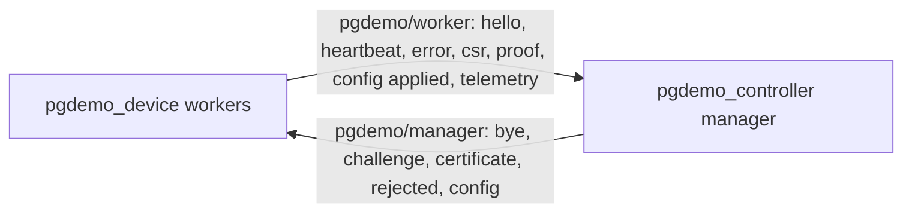

# ROS 2 interface API

The contract between the manager (`pgdemo-controller`) and its workers (`pgdemo-device`). PostgreSQL is not part of it: a worker has no database login, and the manager is the only process that writes samples. The structs live in [`msg/`](msg) and `rosidl` compiles them to `pgdemo_msgs::msg`.

ROS 2 discovers nodes as peers. Inside this system that does not grant authority. The manager publishes `pgdemo/manager/`. Workers publish `pgdemo/worker/`. A worker does not publish on the manager's topics, does not subscribe to another worker's telemetry, and ignores a manager message whose `device` is not its own name. One ROS domain runs one manager; a second controller on the same machine is stopped by `run/devices/.controller.lock`.

`hello` is the only transient-local topic (reliable, depth 1). A worker repeats it once a second until the challenge, so a manager that starts later still sees the announcement. Every other topic is reliable and volatile, depth 16.

## Control

| Topic | Struct | Publisher | Fields |
|---|---|---|---|
| `pgdemo/worker/control/hello` | `Hello` | worker | `device`, `mode` (`RUN=0`, `ENROLL=1`, `ROTATE=2`), `request_id` (`0` when running) |
| `pgdemo/worker/control/heartbeat` | `Heartbeat` | worker | `device`. Sent every 5 s while paused. Refreshes the manager's silence timer. |
| `pgdemo/worker/control/error` | `Error` | worker | `device`, `code`, `detail`. The worker cannot continue. |
| `pgdemo/manager/control/bye` | `Bye` | manager | `device`, `reason`. The worker exits. |

## Security

The nonce and the signature are raw bytes. The text the worker signs is unchanged: `"pgdemo-device-auth-v1"`, a NUL, the nonce, a NUL, the name, a NUL, and the certificate's SHA-256 fingerprint. See [docs/DEVICE_PKI.md](../docs/DEVICE_PKI.md).

| Topic | Struct | Publisher | Fields |
|---|---|---|---|
| `pgdemo/worker/security/csr` | `Csr` | worker | `device`, `csr` (PEM) |
| `pgdemo/manager/security/certificate` | `Certificate` | manager | `device`, `cert` (PEM) |
| `pgdemo/manager/security/rejected` | `Rejected` | manager | `device`, `code`, `detail` |
| `pgdemo/manager/security/challenge` | `Challenge` | manager | `device`, `nonce` (`uint8[32]`) |
| `pgdemo/worker/security/proof` | `Proof` | worker | `device`, `cert` (PEM), `signature` (`uint8[96]`, ECDSA P-384 `r‖s`) |

## Configuration

The manager forwards a desired configuration. The worker decides whether it can run with it, and only then does the controller write the database. `config_requested` is the PostgreSQL channel that wakes the controller; it is not a ROS topic.

| Topic | Struct | Publisher | Fields |
|---|---|---|---|
| `pgdemo/manager/config` | `Config` | manager | `device`, `device_id`, `rate_ms`, `amplitude`, `is_active`, `request_id` (`0` for the type defaults sent when the session goes online) |
| `pgdemo/worker/config/applied` | `ConfigApplied` | worker | `device`, `request_id`, `ok`, `code`, `detail` |

The worker accepts `rate_ms` in `[50, 10000]` and `amplitude` in `(0, 1000]`, the same bounds as `device_config`. An accepted message is applied at once and the sample timer is re-armed. A refusal is published with `ok` false (`INVALID_RATE` or `INVALID_AMPLITUDE`) and the previous configuration stays in force. The controller records `ok` as `SUCCESS` in `device_config` and a refusal as `ERROR` in `device_config_errors`. Those writes are what notify the server.

## Telemetry

A worker publishes only the topic that matches `--payload`.

| Topic | Struct | Fields |
|---|---|---|
| `pgdemo/worker/telemetry/scalar` | `ScalarSample` | `device`, `seq`, `value` |
| `pgdemo/worker/telemetry/gps` | `GpsSample` | `device`, `seq`, `origin_lon`, `origin_lat`, `radius_m`, `bearing_rad` |
| `pgdemo/worker/telemetry/xy` | `XySample` | `device`, `seq`, `x`, `y` |
| `pgdemo/worker/telemetry/xyz` | `XyzSample` | `device`, `seq`, `x`, `y`, `z` |

The manager does not insert each sample on its own. Each node has a queue and a thread that flushes that queue in one database transaction, concurrently with the other nodes. That queue, and the rest of the process lifecycle, is [controller/README.md](../controller/README.md).
