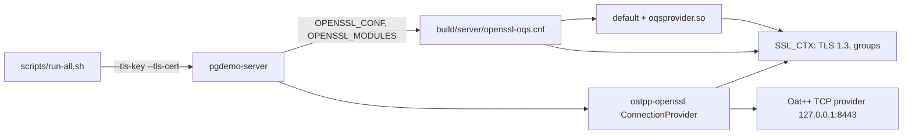

# pgdemo-server

Zone A process. It is the HTTPS API, the process that signs device certificates, and the process that serves the control panel. PostgreSQL is its only channel to `pgdemo-controller`. The schema and the channels are [sql/README.md](../sql/README.md). How a request becomes a `NOTIFY` and comes back is [docs/ARCHITECTURE.md](../docs/ARCHITECTURE.md).

Sources:

| File | Role |
|---|---|
| [`src/main.cpp`](src/main.cpp) | Options, the listener, TLS setup, routing |
| [`src/http/AuthInterceptor.hpp`](src/http/AuthInterceptor.hpp) | Bearer token on every `/api` path except login and health |
| [`src/controllers/`](src/controllers) | One Oat++ controller per group of routes |
| [`src/controllers/PanelController.hpp`](src/controllers/PanelController.hpp) | The static panel, `GET *` after the API |
| [`src/dispatcher/`](src/dispatcher) | Waits for a `request_id` to finish. [src/dispatcher/README.md](src/dispatcher/README.md) is the map, the connection threads and the query pool. |
| [`src/events/EventHub.hpp`](src/events/EventHub.hpp) | Server-Sent Events |
| [`openssl-oqs.cnf`](openssl-oqs.cnf) | TLS 1.3 and the key-exchange groups |

## REST API

Every route is TLS 1.3 on port 8443, or plain HTTP on port 8080 with `scripts/run-all.sh --http`. `client/pgdemo.sh` trusts `run/keys/tls.crt`.

A path under `/api` needs `Authorization: Bearer <JWT>` except `POST /api/auth/login` and `GET /api/health`. The check is an allow-list in [`AuthInterceptor`](src/http/AuthInterceptor.hpp): a route added later is protected. The verified `sub` and `role` go into the request. The controller then checks the role, and the query runs under `SET LOCAL ROLE demo_admin` or `demo_normal`, so PostgreSQL checks it again.

An error body is `{"error","message"}`. An unknown `/api` path is a JSON `404`, never a panel page. The token check and the panel do not overlap: `/API/x`, `/%61pi/x` and `//api/x` count as `/api` too.

| Method and path | Role | What it does |
|---|---|---|
| `POST /api/auth/login` | public | `{"username","password"}` → ES384 token |
| `GET /api/health` | public | Listener liveness |
| `GET /api/auth/me` | any | Identity and the PostgreSQL group used for the request |
| `GET /api/db/info` | any | Server version, backend PIDs, libpqxx version, SSE and Dispatcher counters |
| `GET /api/device-types` | any | Device types: payload and default configuration |
| `GET /api/devices` | any | Every device with its type, last sample, `identity` and process state. A GPS device returns `lon` and `lat`; an `xy` device returns `x` and `y`; an `xyz` device returns `x`, `y` and `z` |
| `GET /api/devices/{name}` | any | One device, its last sample, its current certificate and identity, its process and its configuration sync state |
| `GET /api/devices/{name}/history?from=&to=&limit=` | any | Telemetry, newest first, with the partition name |
| `POST /api/devices` | admin | `{"name","type"}`: enroll. `201` with the device and its certificate once issued, `202` with the enrollment if still in progress, `422` if refused (`CAPACITY`, `CSR_*`), `409` if the name exists, `400` for an unknown type |
| `DELETE /api/devices/{name}` | admin | Removes the device, its certificates, state, configuration and queue; the telemetry and the CRL stay |
| `GET /api/devices/{name}/certificates` | any | Every certificate the device has had, newest first, with its revocation |
| `DELETE /api/devices/{name}/certificates/{serial}` | admin | Deletes one certificate; the current one takes the device with it |
| `POST /api/devices/{name}/revoke` | admin | `{"reason"}`: revoke the current certificate. `certificateHold` suspends; any other reason is permanent. `409` if already revoked |
| `DELETE /api/devices/{name}/revoke` | admin | Lift a `certificateHold`; `409` for a permanent revocation |
| `POST /api/devices/{name}/rotate` | admin | New key and certificate; the old one is revoked as `superseded`. `409` while revoked or suspended |
| `GET /api/enrollments?device=&limit=`, `GET /api/enrollments/{id}` | any | Enrollment and rotation requests and their outcome |
| `GET /api/pki/ca` | any | The root CAs, the signing CA's fingerprint and the revoked serials |
| `GET /api/pki/origin` | any | The factory root, the manager certificate, the worker certificates that root issued, and the manager CRL (`payload`, `signature`, `signed_at`, `serials`). No private key |
| `GET /api/pki/crl` | any | The X.509 CRL in PEM, signed by the CA when requested |
| `GET /api/stream?channels=&devices=` | any | Server-Sent Events. Channels: `telemetry_scalar`, `telemetry_gps`, `telemetry_xy`, `telemetry_xyz`, `device`, `enrollment`, `config`, `error` (default all); `devices` filters by name |
| `GET /api/config` | any | `v_device_config_sync_status`: applied, desired, `SYNC`/`PENDING`/`ERROR`/`UNINITIALISED` |
| `POST /api/config` | admin | `{"device", "rate_ms"?, "amplitude"?, "is_active"?}`, a partial update |
| `GET /api/config/requests/{id}` | any | One request and its error, if any |
| `GET /api/config/history?device=&limit=` | any | Applied-configuration audit |
| `GET /api/users` | admin | User directory (no hashes) |
| `POST /api/users` | admin | `{"username","password","role"}` |
| `DELETE /api/users/{username}` | admin | The last admin cannot be removed |
| `GET /*` outside `/api` | public | The control panel, when `--webroot` is set |

`POST /api/config` returns `200` when the worker has applied the request, `422` when the worker rejects it or the request expired, `202` when it is still queued after `--config-timeout-ms`, `404` for an unknown device, `409` for a device the controller has not initialised yet, and `503` when the Dispatcher already holds 500 waiters. The server only checks the types. The worker accepts `rate_ms` in `[50, 10000]` and `amplitude` in `(0, 1000]`, and the controller records that answer. The loop is [docs/ARCHITECTURE.md](../docs/ARCHITECTURE.md).

### Request ids

`POST /api/config`, `POST /api/devices` and a rotation each take their `request_id` when the call arrives: `generate_request_id` runs `SELECT nextval('request_id_seq')` in its own transaction under `demo_admin`, commits, and returns the session to the pool. The sequence is increment 1, cache 1, and it does not cycle. PostgreSQL advances it under the sequence lock, so two connection threads, or two server processes, each receive a distinct value. The number is the order in which a pooled session executed `nextval`. The process keeps no counter of its own and reads nothing from the sequence at start-up.

`request_id` 0 is the type-default configuration sent when a device comes online. It is not a value from this sequence, and the dispatcher does not wait on it.

The value is granted before the row exists. A gap is a granted value that was never inserted, and that value is not handed out again:

- the dispatcher already holds 500 waiters, so the call answers `503` and does not insert;
- the `INSERT` fails, or inserts no row (unknown type, unknown device), after `nextval` has committed;
- rolling that insert back would not return the value either, because `nextval` is not undone with its transaction.

Enrollment and configuration share the sequence. The insert names the id it was given, so the column default on `device_enrollment` does not take a second one. The wait that follows is [src/dispatcher/README.md](src/dispatcher/README.md).

## Control panel

The server does not run Next.js. `pnpm build` writes a static export; [`PanelController`](src/controllers/PanelController.hpp) serves those files from memory on `GET *`, registered after every API controller, so it only sees a path no endpoint claimed. `/_next/static/` (hashed names) is cached `immutable`. Everything else is `no-cache`. Every file carries `X-Content-Type-Options: nosniff`, `X-Frame-Options: DENY`, `Referrer-Policy: no-referrer` and a Content-Security-Policy that allows only this origin. The pages hold no data. Hiding the administration panel from a normal user is presentation: the write is refused with `403` on `/api`.

The panel itself is a client-side MVC. There is no server-side view.

| | Where | What it holds |
|---|---|---|
| Model | [`frontend/src/lib/types.ts`](../frontend/src/lib/types.ts), [`session.ts`](../frontend/src/lib/session.ts) | The API shapes, and the token, role and expiry in `sessionStorage` |
| View | [`frontend/src/app`](../frontend/src/app), [`frontend/src/components`](../frontend/src/components) | The routes, `PanelShell`, `AdminShell`, the SVG charts and [`point-cloud.tsx`](../frontend/src/components/point-cloud.tsx) |
| Controller | [`frontend/src/lib/hooks.ts`](../frontend/src/lib/hooks.ts) and the pages | `useSession`, `useApi` and `useStream` load and refresh; the page handles the click and calls the API |

`useApi` sends `Authorization: Bearer`. `useStream` reads `GET /api/stream` with `fetch`, because `EventSource` cannot set that header and the token must not be in the URL. A `401` ends the session. Screens, roles and the build are [frontend/README.md](../frontend/README.md).

## HTTPS and oqsprovider

oatpp-openssl only wraps the TCP socket. `oatpp::openssl::Config::createDefaultServerConfigShared(cert, key)` loads the certificate and the private key and sets nothing else: no protocol version, no groups. Those come from OpenSSL. Before Oat++ creates the `SSL_CTX`, `use_openssl_beside_executable()` in [`src/main.cpp`](src/main.cpp) sets `OPENSSL_CONF` and `OPENSSL_MODULES` to the directory of the executable (`build/server/`). The build copies [`openssl-oqs.cnf`](openssl-oqs.cnf) and `oqsprovider.so` there. OpenSSL reads that file when it builds the context:

- it activates the `default` provider and the liboqs `oqsprovider`;
- `MinProtocol = TLSv1.3`, so a TLS 1.2 client gets a `protocol_version` alert;
- `Groups = ?X25519MLKEM768 / ?x25519_mlkem512 / ?x25519_hqc1 / ?X25519`. `/` separates preference tiers. The server picks the hybrid `X25519MLKEM768`, native in OpenSSL 3.5, over the classic `X25519` that curl also offers. It accepts the liboqs groups `x25519_mlkem512` and `x25519_hqc1` when a client offers them. A leading `?` skips a group this OpenSSL build does not have.

`scripts/run-all.sh --http` omits `--tls-key` and `--tls-cert`. The server then uses the plain TCP provider on port 8080 and never loads the OpenSSL config. The captures of both modes are in [../README.md](../README.md#network-captures).
