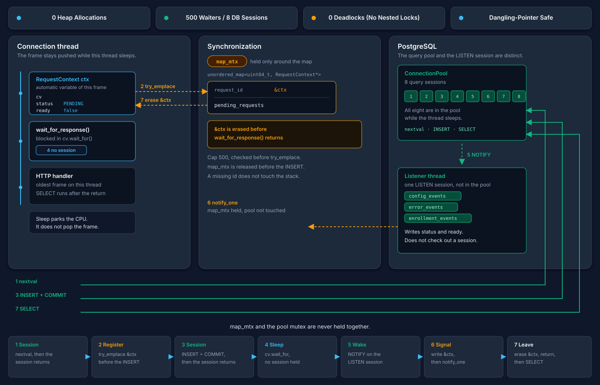
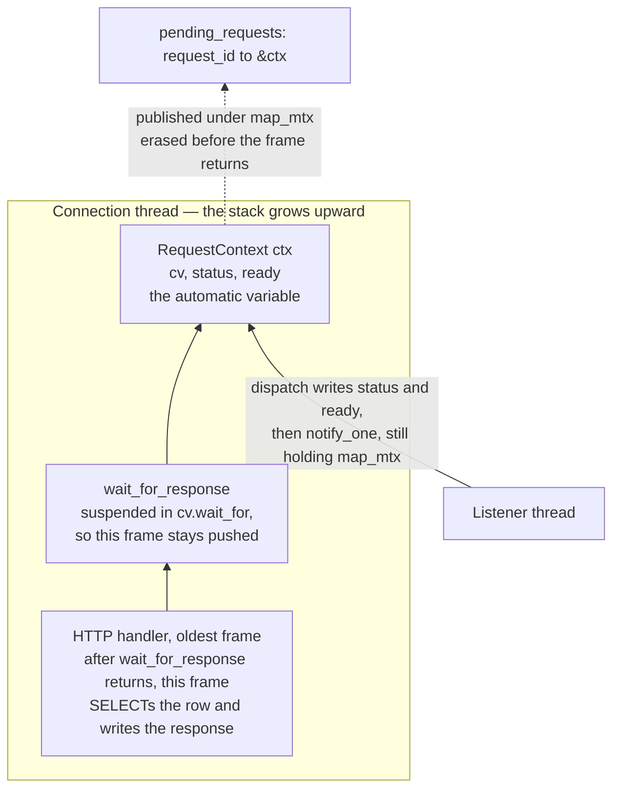
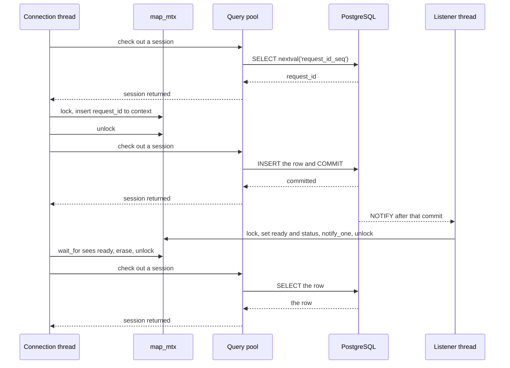

# Dispatcher

`POST /api/config`, `POST /api/devices` and a certificate rotation are synchronous for the client and asynchronous underneath. The connection thread that accepted the HTTP request blocks until PostgreSQL reports that the same `request_id` finished, or until the deadline. [`Dispatcher`](Dispatcher.hpp) is that wait. The row in `device_config_pending` or `device_enrollment` is the result; the notification only wakes the thread.



## Two different pools

One thread accepts connections. Each accepted connection is then served by its own thread for as long as the socket stays open, and that thread runs the request to the end. A waiting POST parks **that** thread on a condition variable. The thread reads the socket again only after the response has been written, so this connection stays on this request until then.

The pool is the database. `pgdemo-server` opens `--pool-size` query sessions (8 by default) and one extra session that only runs `LISTEN`. A session belongs to one thread at a time. [`ConnectionPool`](../../../libs/db/include/db/ConnectionPool.hpp) lends it out, and the pool mutex covers only the free list. A thread blocks in `acquire()` when every session is checked out, and the lease returns the session when it is destroyed.

A parked connection thread has already returned its session. The 500 waiters the dispatcher accepts and the 8 query sessions stay independent: the wait leaves the sessions in the pool, and a slow query leaves `map_mtx` free.

| Thread | While a request is in flight |
|---|---|
| Accept thread | Blocks in `accept`. Starts the connection thread and goes back to accepting. |
| Connection thread | The waiter. Checks a session out only for `nextval`, for the `INSERT`, and later for the final `SELECT`. In between it sleeps on `RequestContext::cv` with no session held. |
| Listener thread | Blocks in `wait_notification()` on the `LISTEN` session, which is not part of the pool. On `config_events`, `error_events` and `enrollment_events` it calls `dispatch`. That call takes `map_mtx` and no query session. |
| Signer thread | Enrollment only. `enrollment_csr` queues work here. Signing calls `issue_device_certificate()` or `reject_enrollment()` on a pooled session. The commit fires `enrollment_events`, and the listener thread is what wakes the waiter. |

`pg_notify` runs when the writing transaction commits, so the `SELECT` that follows the wake reads a committed row from another session.

## The map

```cpp
struct RequestContext {          // on the connection thread's stack
    std::condition_variable cv;
    ResponseStatus status;       // PENDING until dispatch
    bool ready;                  // false until dispatch
};

std::mutex map_mtx;
std::unordered_map<std::uint64_t, RequestContext*> pending_requests;
```

The map is an index. The context itself is an automatic variable of `wait_for_response`, so its storage is the stack frame of the connection thread that entered that function.

### The stack frame stays for the whole wait

A thread's stack is the chain of frames of the calls it has entered and has not returned from. `RequestContext ctx` begins at its declaration and ends when `wait_for_response` returns. `condition_variable::wait_for` suspends the thread inside that call. The suspension parks the CPU; it leaves the frame where it is. For the whole wait, `&ctx` is the address of a live object.

The dispatcher does not own the thread and does not join it. The connection thread owns its stack. The dispatcher only publishes the address, and only for the interval in which that frame is alive:

1. `ctx` exists. Then `try_emplace` stores `&ctx` under `map_mtx`.
2. The thread blocks in `wait_for`. The frame stays pushed.
3. `dispatch`, on the listener thread, writes `status` and `ready` through that pointer and calls `notify_one`. It holds `map_mtx` for the whole of that use.
4. The connection thread wakes, takes `map_mtx` again, copies the status out of `ctx`, and erases the pointer. The erase is still inside `wait_for_response`, so the frame has not been popped.
5. The function returns. Destroying `ctx` runs as the frame goes away. The thread keeps running: the handler above this frame reads the row and writes the HTTP response.



The pointer is removed while the thread is inside the function. The thread continues after that return. What ends with the erase is the publication of the address, and what ends with the return is the object. The other order would be a dangling pointer: a listener thread writing a frame the owner had already popped.

`dispatch` can write another thread's stack because the owner has promised, through `map_mtx`, that the address stays live until the writer is done. The listener holds the mutex across `notify_one`. The owner destroys `ctx` only after it has taken the same mutex and removed the pointer, so `notify_one` has already returned. A `dispatch` that arrives later looks the id up, finds nothing, and does not touch the stack.

The same order holds when the wait never starts. `SYSTEM_FULL` returns before `try_emplace`. A duplicate id makes `try_emplace` fail, so the map keeps the first waiter and this call stores nothing. Either return destroys a private `ctx`. A `submit()` that throws erases the pointer under `map_mtx` and returns from the same frame. The `INSERT` rolled back, so no notification for that id follows the pointer.

The wait state fits in the frame that the call already has. Each waiter brings its own condition variable, status and flag. The map only answers "which frame is blocked on this `request_id`".

`ready` is the condition the waiter rechecks. `notify_one` only wakes the thread; the flag is what decides that this wake belongs to this `request_id`. A notification that arrives before the thread reaches `wait_for` still sets `ready`, and the predicate is already true, so the thread does not sleep. A spurious wake finds `ready` still false and keeps waiting.

`map_mtx` is also the mutex of every condition variable. `wait_for` releases it while the thread sleeps and takes it again before looking at `ready`. Sleeping waiters do not block each other, and they do not block `dispatch`.

`submit()` runs **without** `map_mtx`. The `INSERT` may block in `acquire()` until a query session is free. Holding the map lock across that wait would stall every other registration and every `dispatch`, including the one that should complete a different request. There is no lock order between `map_mtx` and the pool mutex: the connection thread never holds both, and `dispatch` never takes a session.

## One wait

`request_id` comes from `nextval('request_id_seq')` before the wait, in its own transaction. The session is back in the pool before `wait_for_response` is called. The sequence grants that value before the id enters the map: increment 1 and cache 1, so each grant is distinct across the connection threads that share the query pool. A `503` (`SYSTEM_FULL`), or a `submit()` that throws, has already consumed it; the next call receives the following value. The same sequence feeds configuration and enrollment. [server/README.md](../../README.md#request-ids) lists the gaps.



The registration happens before the `INSERT`. A completion that lands during the insert is stored in `ready` and is not lost. If `submit()` throws, the transaction rolls back, the pointer is erased under `map_mtx`, and the caller gets `DB_ERROR`. Nothing was notified for that insert.

`dispatch` of an id that is not in the map returns. That is a late notification: the waiter already timed out and erased itself, or nobody waited. The notification is not queued for a later request. Identifiers are not reused.

After the wait, the connection thread checks a session out once more and reads the row. The HTTP status follows the row, not the enumerator the dispatcher returned:

| Row | Reply |
|---|---|
| `SUCCESS`, or an enrollment `ISSUED` | `200`, or `201` for a new device |
| Still `PENDING` or `CSR_SUBMITTED` | `202`. The row stays. The controller forwards a configuration again when it next reads the queue; an enrollment is polled at `GET /api/enrollments/{id}`. |
| `ERROR`, `TIMEOUT`, `REJECTED`, `EXPIRED` | `422` |

A `TIMEOUT` from the condition variable means the connection thread stopped waiting. It does not mean PostgreSQL marked the row `TIMEOUT`. The JSON field `dispatcher` records which of the two happened. A notification that commits in the same instant the deadline fires is still visible to the `SELECT`, and the reply follows the row.

## Who wakes a waiter

| Channel | `dispatch` status | When |
|---|---|---|
| `config_events` | `SUCCESS` | The controller committed `device_config` because the worker accepted the request. |
| `error_events` | `ERROR` | The controller committed `device_config_errors` (the worker refused, or the request aged out). A session that becomes `AUTH_FAILED` uses this channel too, with no `request_id`, and does not touch the map. |
| `enrollment_events` | `SUCCESS` if the payload status is `ISSUED`, otherwise `ERROR` | The signer thread committed the certificate or the rejection. |

`enrollment_csr` does not wake the waiter. It only queues the CSR for the signer thread. The connection thread stays parked until `enrollment_events`.

Telemetry notifications never enter the map. The listener thread, on those channels, checks a query session out and reads rows past `telemetry_read_cursor`. That checkout competes with the short transactions of the connection threads, not with the threads sleeping in `wait_for`.

## Limits

`MAX_PENDING` is 500. The check runs under `map_mtx` before the pointer is inserted, and `submit()` is not called. The HTTP layer answers `503`. The `request_id` taken from the sequence is left unused. Each accepted waiter is one connection thread blocked for up to `--config-timeout-ms` (2 s) or `--enroll-timeout-ms` (5 s). The cap bounds how many of those threads can sit in the map at once.

An id that is already in the map is refused with `DB_ERROR` and is not inserted twice. `pending()` reports the size of the map under the same mutex; `GET /api/db/info` exposes it as `dispatcher_waiters`.
