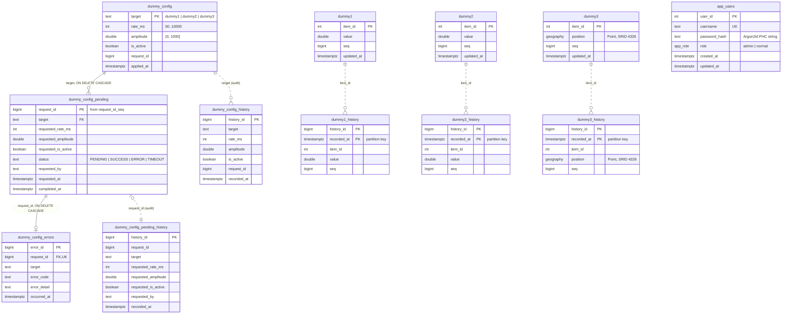
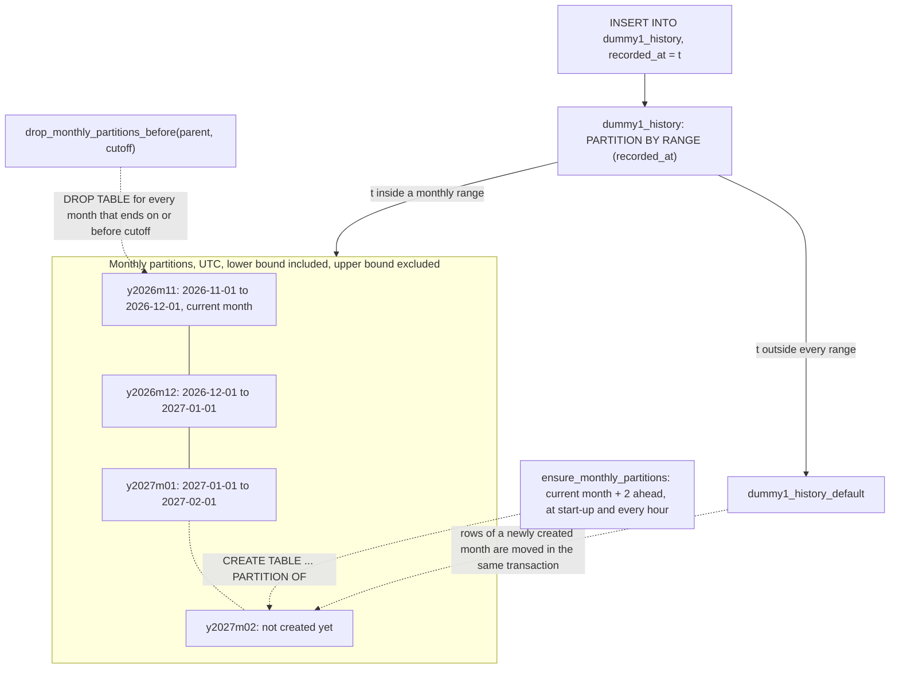
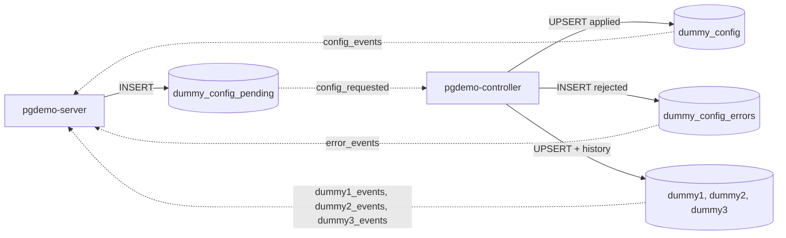

# Database schema

The six files in this directory are the whole contract between `pgdemo-server` (zone A) and `pgdemo-controller` (zone B). Neither process knows the other; both only know these tables, views, functions and channels.

## Loading order

[`scripts/db-init.sh`](../scripts/db-init.sh) loads the files as a superuser: `00_roles.sql` against the `postgres` database (roles belong to the cluster), then `01` to `05` against `pgdemo`. Every file is idempotent, so running it again upgrades an existing database. Each file switches to `SET ROLE demo_owner`, so `demo_owner` owns every object; the controller and the server own nothing.

| File | Contents |
|---|---|
| [`00_roles.sql`](00_roles.sql) | Cluster roles and role memberships |
| [`01_data.sql`](01_data.sql) | PostGIS, the live tables `dummy1`–`dummy3`, their monthly-partitioned histories and the partition maintenance functions |
| [`02_config.sql`](02_config.sql) | Control plane: request id sequence, applied configuration, request queue, errors and audits |
| [`03_users.sql`](03_users.sql) | `app_users`, the `app_role` type, `auth_fetch_user()` and the last-admin guard |
| [`04_triggers.sql`](04_triggers.sql) | `NOTIFY` triggers, one channel per table plus the control-plane channels |
| [`05_views.sql`](05_views.sql) | Views and every `GRANT` |

PostGIS lives in schema `extensions`, not in `public`. `05_views.sql` revokes everything on `public` from `PUBLIC`, and a PostGIS installed there would lose `ST_Project` for the demo roles. The login roles carry `search_path = public, extensions`, because `SET LOCAL ROLE` does not change the session's `search_path`.

## Entity relationships

Solid lines are foreign keys. Dotted lines are logical links without a foreign key: history and audit rows must outlive the rows they describe.



## Data plane

### Live tables

`dummy1`, `dummy2` and `dummy3` hold one snapshot row per `item_id`. The controller's producer thread for each table UPSERTs that row and, in the same transaction, appends a row to the table's history. They are three separate tables on purpose: each has its own trigger and its own `NOTIFY` channel, so one listener connection multiplexes them.

| Table | Columns | Constraints and indexes |
|---|---|---|
| `dummy1` | `item_id INT`, `value DOUBLE PRECISION`, `seq BIGINT`, `updated_at TIMESTAMPTZ` | PK `item_id`, `CHECK (item_id > 0)`; sine wave |
| `dummy2` | same as `dummy1` | same; counter with noise |
| `dummy3` | `item_id INT`, `position geography(Point, 4326)`, `seq BIGINT`, `updated_at TIMESTAMPTZ` | PK `item_id`, GiST on `position`; GPS orbit built with `ST_Project` |

`updated_at` defaults to `clock_timestamp()`, the real write time rather than the transaction start.

### Partitioned history

`dummy1_history`, `dummy2_history` and `dummy3_history` are append-only and `PARTITION BY RANGE (recorded_at)`, one partition per UTC month plus a `DEFAULT` partition. They repeat the live table's columns and add `history_id BIGINT GENERATED ALWAYS AS IDENTITY` and `recorded_at TIMESTAMPTZ`.

- **Primary key `(history_id, recorded_at)`.** PostgreSQL requires the partition key inside every unique constraint of a partitioned table.
- **Index `(item_id, recorded_at DESC)`**, declared once on the parent; PostgreSQL creates it on every partition. `dummy3_history` also has a GiST index on `position`.
- **Partition names** follow `<table>_yYYYYmMM`, and the bounds are `[first day of the month, first day of the next month)` in UTC.
- **Grants live on the parent only.** Partitions carry no privileges for the demo roles, so every read and write goes through the parent and its routing.

The partitions in a database installed in November 2026 (`\d+ dummy1_history`):

```text
dummy1_history
├── dummy1_history_y2026m11   [2026-11-01 00:00Z, 2026-12-01 00:00Z)   current month
├── dummy1_history_y2026m12   [2026-12-01 00:00Z, 2027-01-01 00:00Z)   created ahead
├── dummy1_history_y2027m01   [2027-01-01 00:00Z, 2027-02-01 00:00Z)   created ahead
└── dummy1_history_default    DEFAULT: any recorded_at outside the months above
```

#### Partition space

The `recorded_at` axis is cut into UTC months. A row goes to the partition of its month, or to `DEFAULT` when that month has no partition yet. Two `SECURITY DEFINER` functions move the window forward:



- **Created ahead.** `ensure_monthly_partitions(parent, from_month, months_ahead)` creates the current month and the next `months_ahead` (2 by default) that do not exist yet. The install runs it once per table; the controller runs it at start-up and every `--maintenance-interval-s` (3600 s by default). `y2027m02` appears when the controller's maintenance runs in December 2026.
- **DEFAULT is a safety net, not a destination.** PostgreSQL refuses to create a partition while `DEFAULT` holds rows of its range. The function parks those rows in a temporary table, creates the partition and inserts them back through the parent, all in one transaction.
- **Retention without `DELETE`.** `drop_monthly_partitions_before(parent, cutoff)` drops each monthly partition whose month ends on or before `cutoff`. Dropping a table is instant and leaves nothing to vacuum. `DEFAULT` is never dropped.
- **Pruning.** A query with a `recorded_at` range scans only the partitions that overlap it. Use UTC bounds, because the month boundaries are UTC.
- **Visible routing.** `GET /api/history/{table}` returns `tableoid::regclass` with each row, so the client sees the partition that stored it.

## Control plane

The server writes the *desired* configuration and the controller writes the *applied* configuration. Requests travel as rows, and `NOTIFY` only wakes the other side.

| Object | Role |
|---|---|
| `request_id_seq` | `BIGINT` sequence. Several server instances can enqueue concurrently without coordinating. |
| `dummy_config` | Applied state, one row per target. `CHECK (target IN ('dummy1', 'dummy2', 'dummy3'))`, `rate_ms BETWEEN 50 AND 10000`, `amplitude > 0 AND amplitude <= 1000`. The `CHECK`s back up the controller's own validation, so the applied state can never be invalid. Seeded with `dummy1` 500 ms / 10, `dummy2` 1000 ms / 5, `dummy3` 1000 ms / 250 m (for `dummy3`, `amplitude` is the orbit radius in metres). |
| `dummy_config_pending` | Desired state and durable queue. `status` goes from `PENDING` to `SUCCESS`, `ERROR` or `TIMEOUT`. Values are only loosely constrained (`requested_rate_ms > 0`): an out-of-range request is accepted, travels the loop and comes back as `ERROR` with a reason. Partial index `(requested_at) WHERE status = 'PENDING'` for the queue scan, and `(target, requested_at DESC)`. |
| `dummy_config_errors` | Why a request failed, at most one row per request (`request_id UNIQUE`). Index `(target, occurred_at DESC)`. |
| `dummy_config_history` | Audit of every applied configuration, seeded with the initial values. |
| `dummy_config_pending_history` | Audit of every enqueue. `request_id` is not a foreign key, so the audit survives queue cleanup. |

## Users

`app_users` stores Argon2id PHC strings (`$argon2id$v=19$m=65536,t=3,p=1$<salt>$<hash>`); plain passwords never reach the database.

- `username` matches `^[a-z][a-z0-9_.-]{2,63}$` and is unique.
- `password_hash` must start with `$argon2id$`.
- `role` is the enum `app_role` (`admin`, `normal`), default `normal`.
- `trg_app_users_last_admin` (`BEFORE DELETE OR UPDATE OF role`) refuses to delete or demote the last admin, with SQLSTATE `23514` (`check_violation`).
- `trg_app_users_touch` (`BEFORE UPDATE`) sets `updated_at`.

## Views

| View | Contents | Readers |
|---|---|---|
| `v_dummy_config_sync_status` | Per target: the applied configuration, the latest request (`LEFT JOIN LATERAL`, newest `requested_at`) and the latest error. `sync` is `PENDING` while that request is `PENDING`, `ERROR` when it ended in `ERROR` or `TIMEOUT`, and `SYNC` otherwise. Backs `GET /api/config`. | `demo_normal`, `demo_admin` |
| `v_users_directory` | `app_users` without `password_hash` | `demo_admin` |

## Functions

| Function | Kind | Purpose |
|---|---|---|
| `ensure_monthly_partitions(parent regclass, from_month date, months_ahead int)` | `SECURITY DEFINER`, returns the created names | Create monthly partitions ahead and move parked `DEFAULT` rows. `EXECUTE` for `demo_controller`. |
| `drop_monthly_partitions_before(parent regclass, cutoff date)` | `SECURITY DEFINER`, returns the dropped names | Retention by whole months. Not granted to any demo role; run it as `demo_owner` or a superuser. |
| `auth_fetch_user(p_username text)` | `SECURITY DEFINER`, `STABLE` | Return one user's hash and role for login. The only object `demo_server` can use with its base role. |
| `protect_last_admin()` | trigger | Body of `trg_app_users_last_admin` |
| `touch_updated_at()` | trigger | Body of `trg_app_users_touch` |
| `notify_dummy1_change()`, `notify_dummy2_change()`, `notify_dummy3_change()`, `notify_config_request()`, `notify_config_change()`, `notify_config_error()` | trigger | Build the JSON payload and call `pg_notify` |

Both partition functions accept only the three history tables as `parent`, pin `search_path` and `TimeZone = 'UTC'`, and take `pg_advisory_xact_lock(parent)` so that concurrent callers on the same table run one after another. Being `SECURITY DEFINER`, they run as `demo_owner`: creating or dropping a partition requires owning the parent, and the controller must not own tables.

## Triggers and NOTIFY channels

All of them are `AFTER ... FOR EACH ROW` triggers.

| Channel | Source | Trigger | Listener | Payload (JSON) |
|---|---|---|---|---|
| `dummy1_events` | `dummy1` INSERT, UPDATE | `trg_dummy1_notify` | server | `table`, `action`, `item_id`, `value`, `seq`, `ts` |
| `dummy2_events` | `dummy2` INSERT, UPDATE | `trg_dummy2_notify` | server | `table`, `action`, `item_id`, `value`, `seq`, `ts` |
| `dummy3_events` | `dummy3` INSERT, UPDATE | `trg_dummy3_notify` | server | `table`, `action`, `item_id`, `lon`, `lat` (`ST_X`/`ST_Y`), `seq`, `ts` |
| `config_requested` | `dummy_config_pending` INSERT | `trg_config_pending_notify` | controller | `action`, `request_id`, `target` |
| `config_events` | `dummy_config` INSERT, UPDATE | `trg_config_notify` | server | `action`, `target`, `rate_ms`, `amplitude`, `is_active`, `request_id`, `applied_at` |
| `error_events` | `dummy_config_errors` INSERT | `trg_config_error_notify` | server | `request_id`, `target`, `error_code`, `error_detail`, `occurred_at` |



`pg_notify()` is transactional: the notification leaves when the writing transaction commits, so a listener never sees state that might roll back. The payload limit is 8000 bytes, and these payloads stay well below it. A notification is a wake-up signal, not the message: the tables are the source of truth, and a listener that was down catches up by reading them (the controller drains `PENDING` rows at start-up).

## Roles and privileges

| Role | Login | Purpose |
|---|---|---|
| `demo_owner` | no | Owns every object. `SECURITY DEFINER` functions run as it. |
| `demo_normal` | no | Group behind the JWT role `normal`: read only. |
| `demo_admin` | no | Group behind the JWT role `admin`. Member of `demo_normal`, plus enqueue and user management. |
| `demo_server` | yes | Zone A. `NOINHERIT`, and holds `demo_admin` and `demo_normal` `WITH INHERIT FALSE, SET TRUE`: each API request runs under `SET LOCAL ROLE demo_admin` or `demo_normal`, chosen from the verified JWT. |
| `demo_controller` | yes | Zone B. Least privilege on the queue, the applied configuration and the data. No access to `app_users`. |

Passwords for the two login roles are set by `scripts/db-init.sh`, never in these files.

| Object | `demo_normal` | `demo_admin` | `demo_controller` | `demo_server` (base) |
|---|---|---|---|---|
| `dummy1`, `dummy2`, `dummy3` | SELECT | SELECT | SELECT, INSERT, UPDATE | – |
| `dummy1_history`, `dummy2_history`, `dummy3_history` | SELECT | SELECT | INSERT | – |
| `dummy_config` | SELECT | SELECT | SELECT, INSERT, UPDATE | – |
| `dummy_config_pending` | SELECT | SELECT, INSERT | SELECT, UPDATE | – |
| `dummy_config_errors` | SELECT | SELECT | INSERT | – |
| `dummy_config_history` | SELECT | SELECT | INSERT | – |
| `dummy_config_pending_history` | – | INSERT | – | – |
| `request_id_seq` | – | USAGE | – | – |
| `app_users` | – | SELECT of the non-secret columns; INSERT `username`, `password_hash`, `role`; UPDATE `password_hash`, `role`; DELETE | – | – |
| `v_dummy_config_sync_status` | SELECT | SELECT | – | – |
| `v_users_directory` | – | SELECT | – | – |
| `auth_fetch_user()` | – | – | – | EXECUTE |
| `ensure_monthly_partitions()` | – | – | EXECUTE | – |

`demo_admin` inherits everything in the `demo_normal` column. It can write `password_hash` but cannot read it. [`docs/ARCHITECTURE.md`](../docs/ARCHITECTURE.md#authorization-twice) explains how the server picks the group for each request, and why PostgreSQL enforces the same authorization as the HTTP layer.

## Inspecting the live schema

With the local superuser over the Unix socket, as in the README's quick start:

```bash
psql -h /var/run/postgresql -d pgdemo -c '\dt+'                 # tables and sizes
psql -h /var/run/postgresql -d pgdemo -c '\d+ dummy1_history'   # partitions and their bounds
psql -h /var/run/postgresql -d pgdemo -c '\dp'                  # privileges, including column grants
psql -h /var/run/postgresql -d pgdemo -c '\df+ ensure_monthly_partitions'
psql -h /var/run/postgresql -d pgdemo -c \
    "SELECT tableoid::regclass AS partition, count(*) FROM dummy1_history GROUP BY 1"
```
