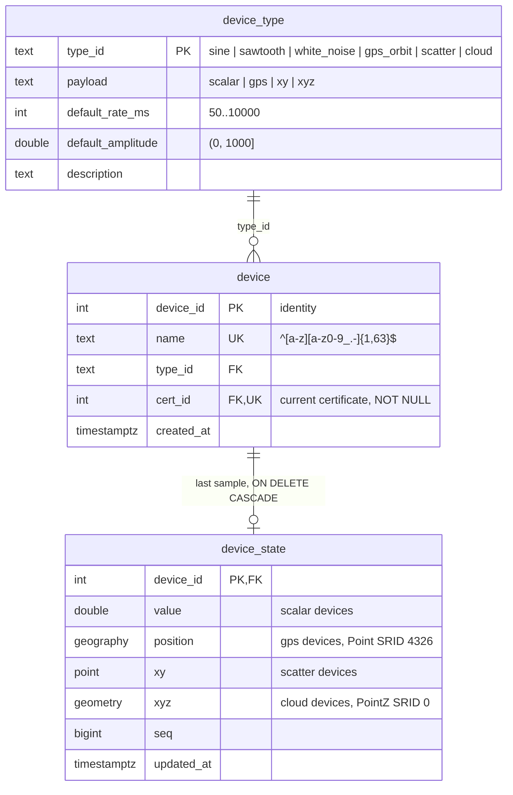
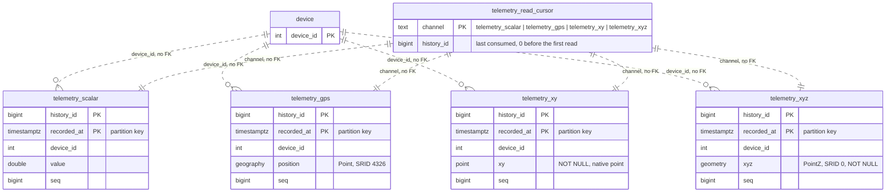
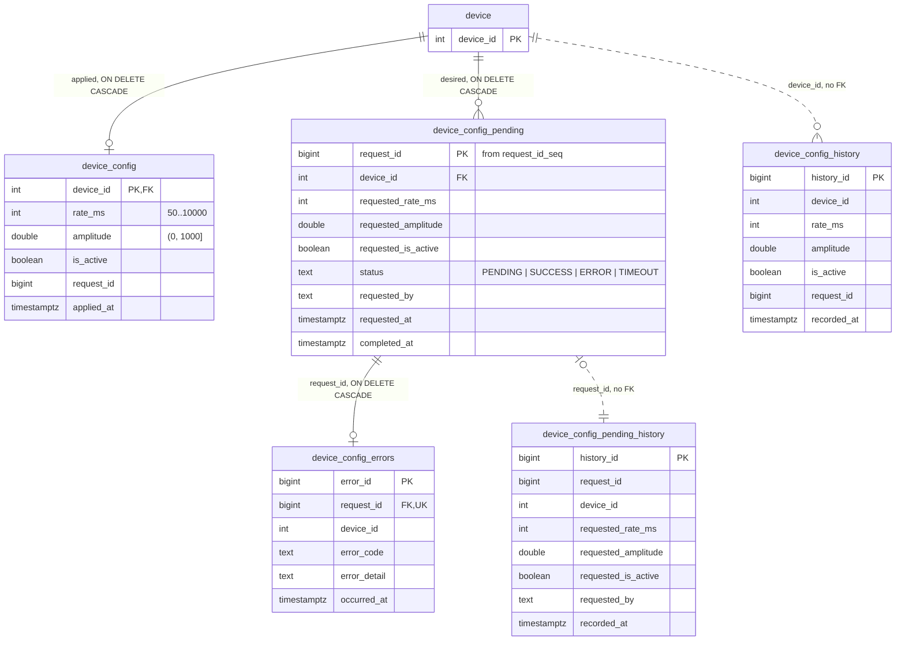
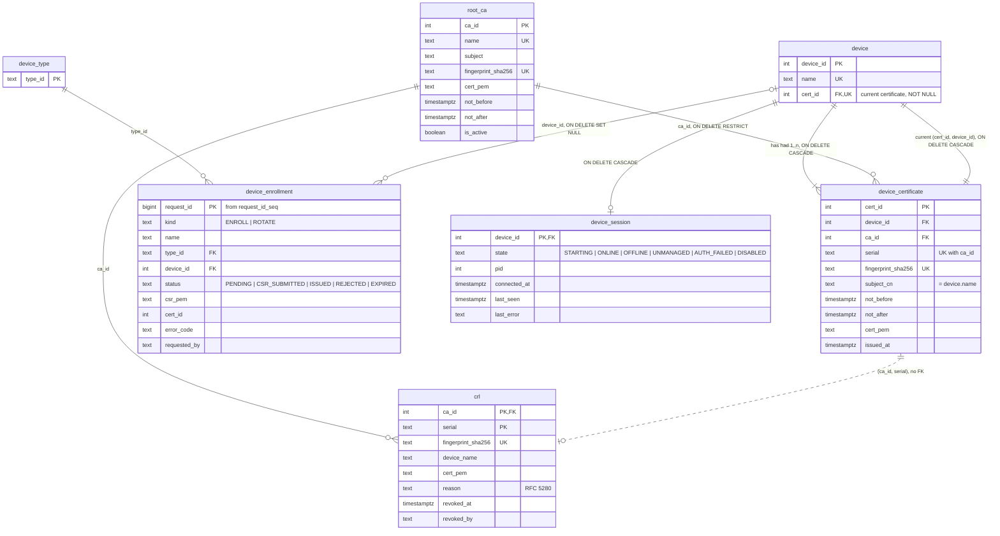
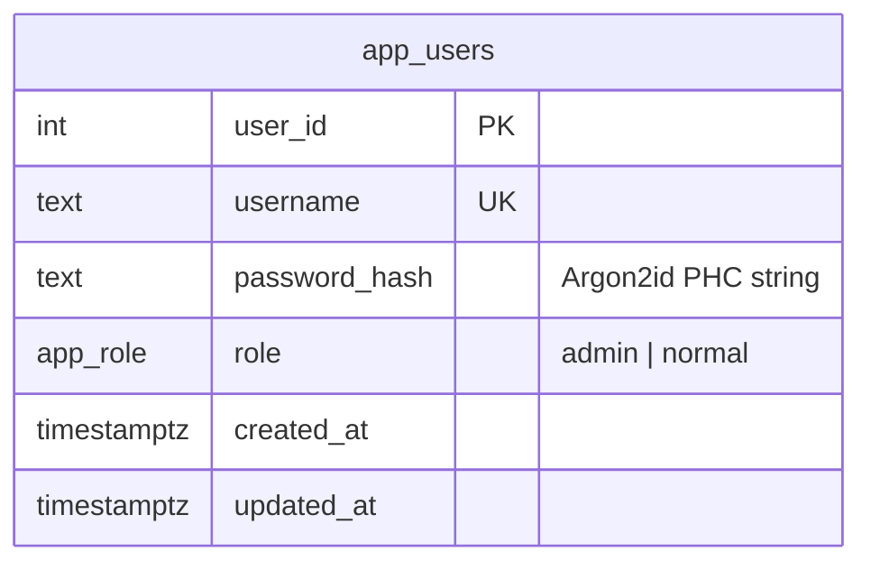
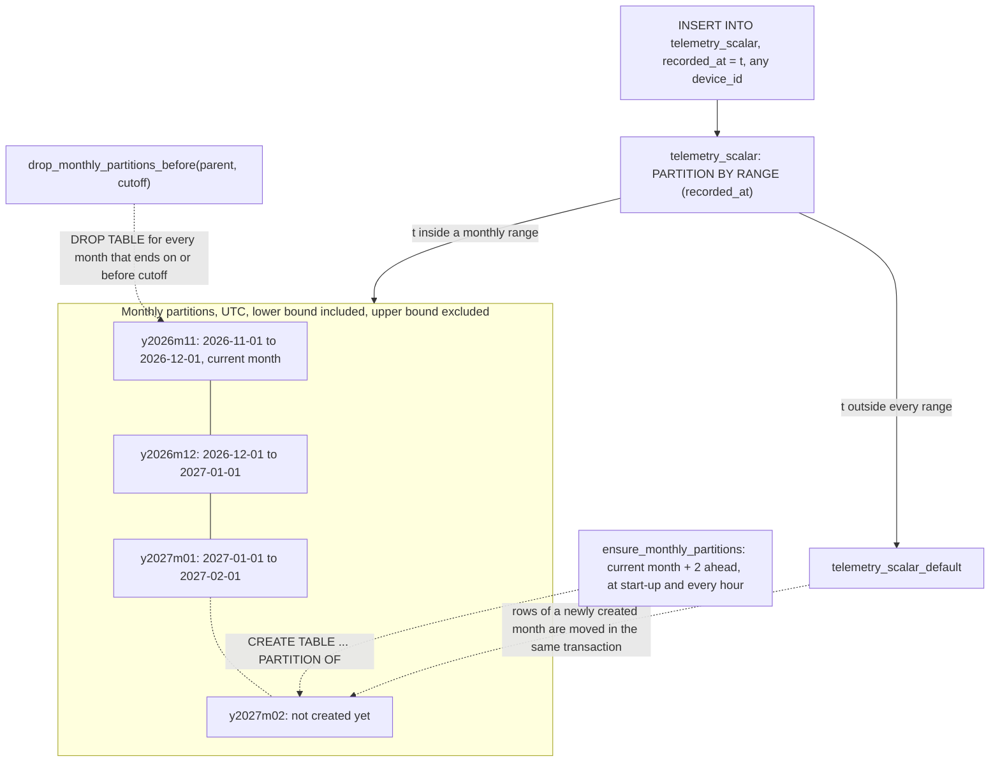
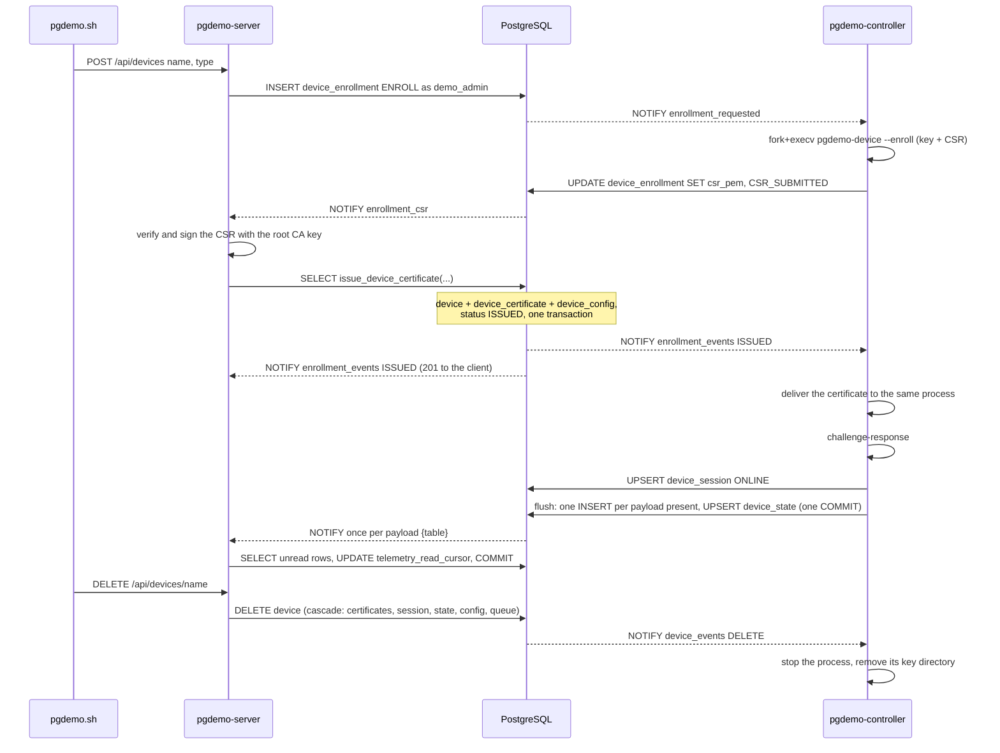
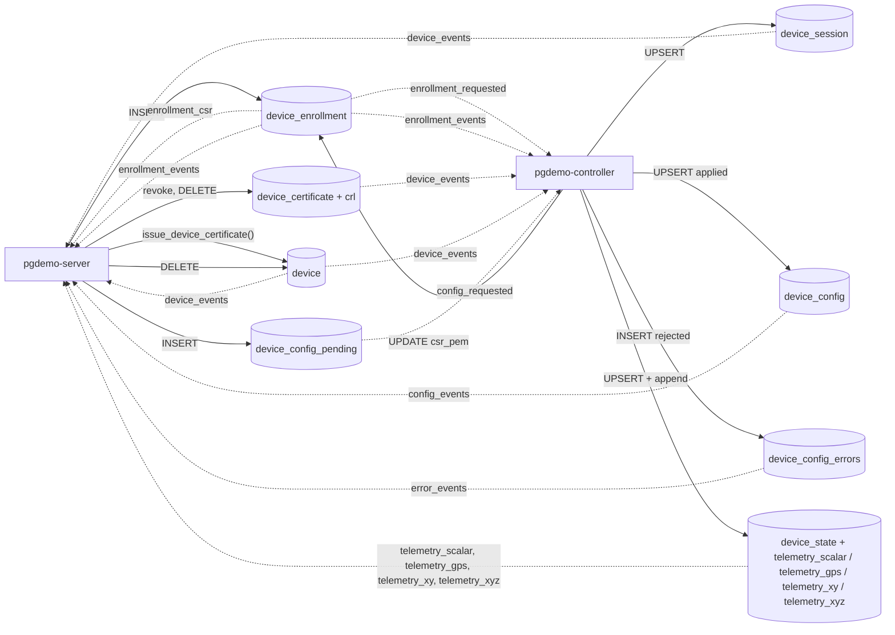

# Database schema

The seven files in this directory are the whole contract between `pgdemo-server` (zone A) and `pgdemo-controller` (zone B). Neither process knows the other; both only know these tables, views, functions and channels.

The model is IoT-shaped. A device is a row of `device`, not a table: adding one needs no schema change, no new channel and no rebuild. Tables are cut by the *shape* of the data instead (`telemetry_scalar`, `telemetry_gps`, `telemetry_xy`, `telemetry_xyz`), and configuration hangs off `device_id`. Every device is bound to an X.509 certificate issued by an internal root CA; nobody inserts into `device` directly, a device appears when its first certificate is issued ([docs/DEVICE_PKI.md](../docs/DEVICE_PKI.md)).

## Loading order

[`scripts/db-init.sh`](../scripts/db-init.sh) loads the files as a superuser: `00_roles.sql` against the `postgres` database (roles belong to the cluster), then `01` to `05` against `pgdemo`. Every file is idempotent within this model, so running it again keeps an existing database. Each file switches to `SET ROLE demo_owner`, so `demo_owner` owns every object; the controller and the server own nothing. After loading, `db-init.sh` generates the device root CA if `run/ca/` has none ([`scripts/gen-device-ca.sh`](../scripts/gen-device-ca.sh)) and inserts its certificate into `root_ca`.

A database created with an earlier schema (one table per dummy, or devices without certificates) is not migrated: recreate it with `scripts/db-init.sh --reset`.

| File | Contents |
|---|---|
| [`00_roles.sql`](00_roles.sql) | Cluster roles and role memberships |
| [`01_data.sql`](01_data.sql) | PostGIS, `device_type`, `device`, `device_state`, the monthly-partitioned `telemetry_scalar`, `telemetry_gps`, `telemetry_xy` and `telemetry_xyz`, the server's `telemetry_read_cursor`, and the partition maintenance functions |
| [`02_config.sql`](02_config.sql) | Configuration: request id sequence, applied configuration, request queue, errors and audits, all keyed by `device_id` |
| [`03_identity.sql`](03_identity.sql) | Device identity: `root_ca`, `device_certificate`, `crl`, `device_enrollment`, `device_session`, the binding foreign keys, `issue_device_certificate()`, `reject_enrollment()`, and the seed enrollments |
| [`03_users.sql`](03_users.sql) | `app_users`, the `app_role` type, `auth_fetch_user()` and the last-admin guard |
| [`04_triggers.sql`](04_triggers.sql) | `NOTIFY` triggers: one channel per topic, with the device in the payload |
| [`05_views.sql`](05_views.sql) | Views and every `GRANT` |

PostGIS lives in schema `extensions`, not in `public`. `05_views.sql` revokes everything on `public` from `PUBLIC`, and a PostGIS installed there would lose `ST_Project` for the demo roles. The login roles carry `search_path = public, extensions`, because `SET LOCAL ROLE` does not change the session's `search_path`.

## Entity relationships

The tables fall into five domains. `device` is the hub of the first four. Solid lines are foreign keys. Dotted lines are logical links without a foreign key: telemetry and the configuration audits outlive the device, and a CRL entry outlives the certificate. `app_users` has no foreign key into any of them and stays last.

### Device

The registry and the latest sample. `device_state` is deleted with the device.



### Telemetry

Append-only history, one table per payload, plus the server's read cursor. None of these rows reference `device`.



### Configuration

The applied row and the request queue belong to the device and disappear with it. The two history tables do not.



### Identity

A device and its current certificate point at each other. Enrollments and the process session hang off the device; the CRL does not point back at the certificate.



`app_users` is the directory of panel accounts. It shares no key with a device.



## Device

| Table | Columns | Constraints and indexes |
|---|---|---|
| `device_type` | `type_id TEXT`, `payload TEXT`, `default_rate_ms INT`, `default_amplitude DOUBLE PRECISION`, `description TEXT` | PK `type_id`; `payload IN ('scalar', 'gps', 'xy', 'xyz')`; the defaults obey the same ranges as `device_config` |
| `device` | `device_id INT` identity, `name TEXT`, `type_id TEXT`, `cert_id INT`, `created_at TIMESTAMPTZ` | PK `device_id`; `name` unique and `~ '^[a-z][a-z0-9_.-]{1,63}$'`; FK `type_id`; index on `type_id`; `cert_id NOT NULL UNIQUE` with FK `(cert_id, device_id)` to `device_certificate` (see [Device identity](#device-identity)) |
| `device_state` | `device_id INT`, `value DOUBLE PRECISION`, `position geography(Point, 4326)`, `xy point`, `xyz geometry(PointZ, 0)`, `seq BIGINT`, `updated_at TIMESTAMPTZ` | PK and FK `device_id ON DELETE CASCADE`; exactly one of `value`, `position`, `xy` and `xyz`; GiST on `position` |

`device_type` is seeded with six types. `amplitude` is the peak for `sine` and `sawtooth`, the standard deviation for `white_noise`, the orbit radius in metres for `gps_orbit`, the half-extent of the square for `scatter`, and the half-extent of the cube for `cloud`. `white_noise`, `scatter` and `cloud` are not enrolled by `03_identity.sql`; they appear when an admin registers a device of that type.

| `type_id` | `payload` | Default rate | Default amplitude | Generator |
|---|---|---|---|---|
| `sine` | `scalar` | 500 ms | 10 | `amplitude * sin(2*pi*seq/40 + phase)` |
| `sawtooth` | `scalar` | 1000 ms | 5 | `amplitude * (seq % 50) / 50` plus Gaussian noise |
| `white_noise` | `scalar` | 500 ms | 1 | normal draw with standard deviation `amplitude` |
| `gps_orbit` | `gps` | 1000 ms | 250 m | orbit around Madrid, point built with `ST_Project` |
| `scatter` | `xy` | 500 ms | 100 | independent uniform `x` and `y` in `[-amplitude, amplitude]` |
| `cloud` | `xyz` | 500 ms | 100 | independent uniform `x`, `y` and `z` in `[-amplitude, amplitude]` |

`device` starts empty. `03_identity.sql` queues three enrollments, `dummy1` (`sine`), `dummy2` (`sawtooth`) and `dummy3` (`gps_orbit`), so the client, the captures and the end-to-end suite keep their arguments; the devices appear when the controller first runs and their certificates are issued. A later scalar type without a generator of its own gets `sine`. `gps` uses the orbit, `xy` uses the square and `xyz` uses the cube.

## Telemetry

### Writing a sample

Each device is a `pgdemo-device` worker that publishes its samples on `pgdemo/worker/telemetry/scalar`, `pgdemo/worker/telemetry/gps`, `pgdemo/worker/telemetry/xy` or `pgdemo/worker/telemetry/xyz`. The manager queues them and writes a batch in one transaction: every sample is inserted into the history table of its payload, and `device_state` is updated once per device with the latest `seq`. The `INSERT` into each history table fires that table's channel once for the statement. The notification names the table. The server reads the rows with `history_id` above `telemetry_read_cursor` and sets that cursor to the last row of the select, in the same transaction.

```sql
WITH up AS (
  INSERT INTO device_state (device_id, value, seq, updated_at) VALUES ($1, $2, $3, clock_timestamp())
  ON CONFLICT (device_id) DO UPDATE SET value = EXCLUDED.value, seq = EXCLUDED.seq,
    updated_at = EXCLUDED.updated_at
  RETURNING device_id, value, seq, updated_at)
INSERT INTO telemetry_scalar (device_id, value, seq, recorded_at)
SELECT device_id, value, seq, updated_at FROM up;
```

For a GPS device the value is `ST_Project(ST_SetSRID(ST_MakePoint(lon, lat), 4326)::geography, radius, bearing)`, with the distance and azimuth cast to `double precision` because PostGIS also has an `ST_Project(geography, geography, float8)` overload. A scatter sample is one native `point(x, y)`; the read takes `xy[0]` and `xy[1]`. The message still carries two doubles, because the IDL has no point type. A cloud sample is `ST_SetSRID(ST_MakePoint(x, y, z), 0)`, a `geometry(PointZ, 0)`; the read takes `ST_X`, `ST_Y` and `ST_Z`.

### Partitioned telemetry

`telemetry_scalar`, `telemetry_gps`, `telemetry_xy` and `telemetry_xyz` are append-only and `PARTITION BY RANGE (recorded_at)`, one partition per UTC month plus a `DEFAULT` partition. Each carries `device_id` and the sample, and adds `history_id BIGINT GENERATED ALWAYS AS IDENTITY` and `recorded_at TIMESTAMPTZ`.

`telemetry_read_cursor` has one row per history table. `channel` is `telemetry_scalar`, `telemetry_gps`, `telemetry_xy` or `telemetry_xyz`, and `history_id` is the last one the server consumed (`0` before the first read). The server locks that row, selects rows with a greater `history_id`, and sets the cursor to the last selected `history_id` before it commits. The next read starts after that row. The predicate is `history_id` only: `recorded_at` is not an order across transactions.

- **No foreign key to `device`.** Removing a device keeps its telemetry. A foreign key would also have to be checked on every one of the most frequent writes.
- **Primary key `(history_id, recorded_at)`.** PostgreSQL requires the partition key inside every unique constraint of a partitioned table.
- **Index `(device_id, recorded_at DESC)`**, declared once on the parent; PostgreSQL creates it on every partition. `telemetry_gps` also has a GiST index on `position`.
- **Partition names** follow `<table>_yYYYYmMM`, and the bounds are `[first day of the month, first day of the next month)` in UTC.
- **Grants live on the parent only.** Partitions carry no privileges for the demo roles, so every read and write goes through the parent and its routing.

The partitions in a database installed in November 2026 (`\d+ telemetry_scalar`; `telemetry_gps`, `telemetry_xy` and `telemetry_xyz` have the same months). `telemetry_xy` stores each sample in a native `point`. `telemetry_xyz` stores each sample in a `geometry(PointZ, 0)`:

```text
telemetry_scalar
├── telemetry_scalar_y2026m11   [2026-11-01 00:00Z, 2026-12-01 00:00Z)   current month
├── telemetry_scalar_y2026m12   [2026-12-01 00:00Z, 2027-01-01 00:00Z)   created ahead
├── telemetry_scalar_y2027m01   [2027-01-01 00:00Z, 2027-02-01 00:00Z)   created ahead
└── telemetry_scalar_default    DEFAULT: any recorded_at outside the months above
```

#### Partition space

The `recorded_at` axis is cut into UTC months. A row goes to the partition of its month, or to `DEFAULT` when that month has no partition yet. Every device of the same payload shares these partitions. Two `SECURITY DEFINER` functions move the window forward:



- **Created ahead.** `ensure_monthly_partitions(parent, from_month, months_ahead)` creates the current month and the next `months_ahead` (2 by default) that do not exist yet. The install runs it once per table; the controller runs it at start-up and every `--maintenance-interval-s` (3600 s by default). `y2027m02` appears when the controller's maintenance runs in December 2026.
- **DEFAULT is a safety net, not a destination.** PostgreSQL refuses to create a partition while `DEFAULT` holds rows of its range. The function parks those rows in a temporary table, creates the partition and inserts them back through the parent, all in one transaction.
- **Retention without `DELETE`.** `drop_monthly_partitions_before(parent, cutoff)` drops each monthly partition whose month ends on or before `cutoff`. Dropping a table is instant and leaves nothing to vacuum. `DEFAULT` is never dropped.
- **Pruning.** A query with a `recorded_at` range scans only the partitions that overlap it, and the `(device_id, recorded_at DESC)` index narrows each one to the device. Use UTC bounds, because the month boundaries are UTC.
- **Visible routing.** `GET /api/devices/{name}/history` returns `tableoid::regclass` with each row, so the client sees the partition that stored it.

## Configuration

The server writes the *desired* configuration and the controller writes the *applied* configuration. Requests travel as rows, and `NOTIFY` only wakes the other side.

| Object | Role |
|---|---|
| `request_id_seq` | `BIGINT` sequence, increment 1, cache 1, no cycle. `nextval` is atomic across sessions and is not undone when its transaction rolls back. The configuration queue and enrollments share it. A granted value that is never inserted stays unused. |
| `device_config` | Applied state, one row per device. `rate_ms BETWEEN 50 AND 10000`, `amplitude > 0 AND amplitude <= 1000`. The `CHECK`s back up the worker's validation, so the applied state can never be invalid. Created from the type defaults by `issue_device_certificate()` when a device is enrolled (the controller writes them again if missing), and updated by the controller when the worker accepts a request. |
| `device_config_pending` | Desired state and durable queue. `status` goes from `PENDING` to `SUCCESS`, `ERROR` or `TIMEOUT`. Values are only loosely constrained (`requested_rate_ms > 0`): an out-of-range request is accepted, travels the loop and comes back as `ERROR` with a reason. Partial index `(requested_at) WHERE status = 'PENDING'` for the queue scan, and `(device_id, requested_at DESC)`. |
| `device_config_errors` | Why a request failed, at most one row per request (`request_id UNIQUE`). Index `(device_id, occurred_at DESC)`. |
| `device_config_history` | Audit of every applied configuration, including the type defaults a device starts with. |
| `device_config_pending_history` | Audit of every enqueue. `request_id` is not a foreign key, so the audit survives queue cleanup and device removal. |

The controller reads the `PENDING` rows without locking them and forwards each one to the worker. When the worker answers, it locks that row with `SELECT ... FROM device_config_pending p JOIN device d ... WHERE p.request_id = $1 AND p.status = 'PENDING' FOR UPDATE OF p` and writes `SUCCESS` or `ERROR`. `OF p` locks only the queue row: the controller has no `UPDATE` on `device`, and locking `device` rows would need it.

### Device lifecycle



- `POST /api/devices` waits up to `--enroll-timeout-ms` (5 s) for the enrollment: `201` with the device and its certificate once it is `ISSUED`, `202` with the enrollment if the controller has not answered yet (poll `GET /api/enrollments/{id}`), `422` if it was rejected (`CAPACITY`, `CSR_*`).
- `POST /api/config` for a device the controller has not initialised yet answers `409 not_initialised`: a partial update needs an applied state to start from.
- Deleting a device removes its `device_certificate`, `device_session`, `device_state`, `device_config`, `device_config_pending` and `device_config_errors` rows (`ON DELETE CASCADE`; the cascade runs as the table owner, so `demo_admin` needs no privilege on those tables). Telemetry, the CRL and both audits stay.
- At start-up the controller resets every session to `OFFLINE`, reads every device and every open enrollment, initialises the applied state of any device that lacks one and starts a process for each, so a device enrolled while it was down is picked up.

## Device identity

Every device is bound to an X.509 certificate (ECDSA P-384) signed by the internal root CA in `root_ca`. The trust model, the enrollment and authentication protocols and the controller's supervision of device processes are in [docs/DEVICE_PKI.md](../docs/DEVICE_PKI.md); this section covers the schema.

| Table | Contents | Constraints |
|---|---|---|
| `root_ca` | The CA certificates the database trusts: `name`, `subject`, `fingerprint_sha256`, `cert_pem`, validity, `is_active` | `name` and `fingerprint_sha256` unique. Inserted by `db-init.sh` as the owner; nobody else writes it. The private key is never in the database |
| `device_certificate` | Every certificate ever issued to a device: `device_id`, `ca_id`, `serial`, `fingerprint_sha256`, `subject_cn`, validity, `cert_pem`, `issued_at` | Unique `(ca_id, serial)` and `fingerprint_sha256`; unique `(cert_id, device_id)` as the target of the binding; FK `device_id` `ON DELETE CASCADE` (deferred); FK `ca_id` `ON DELETE RESTRICT`; `check_certificate_subject` makes `subject_cn` equal the device name |
| `crl` | One row per revoked certificate: `(ca_id, serial)` PK, `fingerprint_sha256`, `device_name`, `cert_pem`, `reason`, `revoked_at`, `revoked_by` | No FK to `device_certificate`, so an entry outlives the certificate and the device. `reason` is one of six RFC 5280 names (`unspecified`, `keyCompromise`, `affiliationChanged`, `superseded`, `cessationOfOperation`, `certificateHold`). `protect_crl` refuses `UPDATE` and `DELETE` unless the reason is `certificateHold`: a hold can be lifted (deleted) or made permanent (updated) |
| `device_enrollment` | Enrollment and rotation requests: `request_id` (from `request_id_seq`), `kind` (`ENROLL`, `ROTATE`), `name`, `type_id`, `device_id`, `status`, `csr_pem`, `cert_id`, `error_code`, `error_detail`, `requested_by`, timestamps | Partial unique index on `name` while `PENDING` or `CSR_SUBMITTED`; FK `device_id` `ON DELETE SET NULL`, so the history outlives the device. `check_enrollment` refuses an `ENROLL` for a taken name and takes a rotation's name and type from its device; `check_enrollment_transition` allows only `PENDING` to `CSR_SUBMITTED`, then `ISSUED`, with `REJECTED` or `EXPIRED` from either |
| `device_session` | The controller's view of each device process: `state`, `pid`, `connected_at`, `last_seen`, `last_error` | PK and FK `device_id` `ON DELETE CASCADE`. Written only by the controller |

How the original requirements map onto constraints:

| Requirement | Mechanism |
|---|---|
| A device is never without a certificate | `device.cert_id NOT NULL` |
| Its current certificate is its own | FK `device(cert_id, device_id)` to `device_certificate(cert_id, device_id)`, deferred so the device and its first certificate commit together |
| A device may have had several certificates | `device_certificate.device_id` is not unique; rotation adds a row and moves `device.cert_id` |
| Deleting the current certificate deletes the device | The binding FK is `ON DELETE CASCADE`. Deleting an older certificate leaves the device alone |
| Revoked means out of service, not deleted | Revoking inserts into `crl`; the device row, its certificates and its telemetry stay, and `v_device_identity` reports `REVOKED` |
| A revocation is permanent | `protect_crl`; only a `certificateHold` entry can be lifted (deleted) |

`issue_device_certificate(request_id, ca_fingerprint, serial, fingerprint, subject_cn, not_before, not_after, cert_pem)` is the only way a certificate enters the database. It is `SECURITY DEFINER` (owner `demo_owner`, `search_path` pinned) and only `demo_server` may execute it. It locks the enrollment, checks it is `CSR_SUBMITTED`, that the subject is the requested name and that the CA is an active `root_ca`, then for `ENROLL` inserts the device, its first certificate and its `device_config` (plus history) from the type defaults, and for `ROTATE` inserts the new certificate, moves `device.cert_id` and revokes the previous certificate as `superseded` unless it was already revoked. `reject_enrollment(request_id, code, detail)` closes a request without a certificate; the server calls it when a CSR fails verification.

`v_device_identity` joins each device with its current certificate, its CA and the CRL, and derives `identity`:

| `identity` | Condition (first match) |
|---|---|
| `REVOKED` | The current certificate is in `crl` with any reason but `certificateHold` |
| `SUSPENDED` | It is in `crl` as `certificateHold` |
| `CA_INACTIVE` | Its CA is no longer `is_active`, or has expired |
| `EXPIRED` | `now()` is outside its validity |
| `ACTIVE` | Otherwise |

The controller runs a process only for an `ACTIVE` device, and refuses an authentication whose certificate is not the current one or is in the CRL.

## Users

`app_users` stores Argon2id PHC strings (`$argon2id$v=19$m=65536,t=3,p=1$<salt>$<hash>`); plain passwords never reach the database.

- `username` matches `^[a-z][a-z0-9_.-]{2,63}$` and is unique.
- `password_hash` must start with `$argon2id$`.
- `role` is the enum `app_role` (`admin`, `normal`), default `normal`.
- `trg_app_users_last_admin` (`BEFORE DELETE OR UPDATE OF role`) refuses to delete or demote the last admin, with SQLSTATE `23514` (`check_violation`).
- `trg_app_users_touch` (`BEFORE UPDATE`) sets `updated_at`.

## Views

| View | Contents | Readers |
|---|---|---|
| `v_devices` | Every device with its type, `payload`, last sample, `identity` and `session`. GPS devices expose `lon` and `lat` (`ST_X`/`ST_Y` of `position`). Scatter devices expose `x` and `y` from the native `point`. Cloud devices expose `x`, `y` and `z` from `ST_X`, `ST_Y` and `ST_Z` of the `PointZ`; `x` and `y` fall back to the point when `xyz` is null. Backs `GET /api/devices`. | `demo_normal`, `demo_admin` |
| `v_device_identity` | Every device with its current certificate (`serial`, `fingerprint`, validity), its CA, its CRL entry if any, the derived `identity`, the number of certificates it has had, and its session (`session`, `pid`, `connected_at`, `last_seen`, `last_error`). Backs `GET /api/devices/{name}` and the controller's decisions. | `demo_normal`, `demo_admin`, `demo_controller` |
| `v_device_config_sync_status` | Per device: the applied configuration, the latest request (`LEFT JOIN LATERAL`, newest `requested_at`) and the latest error. `sync` is `PENDING` while that request is `PENDING`, `ERROR` when it ended in `ERROR` or `TIMEOUT`, `UNINITIALISED` while the device has no applied state, and `SYNC` otherwise. Backs `GET /api/config`. | `demo_normal`, `demo_admin` |
| `v_users_directory` | `app_users` without `password_hash` | `demo_admin` |

## Functions

| Function | Kind | Purpose |
|---|---|---|
| `ensure_monthly_partitions(parent regclass, from_month date, months_ahead int)` | `SECURITY DEFINER`, returns the created names | Create monthly partitions ahead and move parked `DEFAULT` rows. `EXECUTE` for `demo_controller`. |
| `drop_monthly_partitions_before(parent regclass, cutoff date)` | `SECURITY DEFINER`, returns the dropped names | Retention by whole months. Not granted to any demo role; run it as `demo_owner` or a superuser. |
| `auth_fetch_user(p_username text)` | `SECURITY DEFINER`, `STABLE` | Return one user's hash and role for login. The only object `demo_server` can use with its base role. |
| `protect_last_admin()` | trigger | Body of `trg_app_users_last_admin` |
| `touch_updated_at()` | trigger | Body of `trg_app_users_touch` |
| `issue_device_certificate(...)` | `SECURITY DEFINER` | Record a signed certificate for an enrollment: create the device or rotate it (see [Device identity](#device-identity)). `EXECUTE` for `demo_server`. |
| `reject_enrollment(p_request_id bigint, p_code text, p_detail text)` | `SECURITY DEFINER`, returns whether the request was still open | Close an enrollment without a certificate. `EXECUTE` for `demo_server`. |
| `check_certificate_subject()`, `protect_crl()`, `check_enrollment()`, `check_enrollment_transition()` | trigger | The identity invariants of `03_identity.sql` |
| `notify_telemetry_batch()`, `notify_device_change()`, `notify_crl_change()`, `notify_session_change()`, `notify_enrollment()`, `notify_config_request()`, `notify_config_change()`, `notify_config_error()` | trigger | Build the JSON payload and call `pg_notify` |

Both partition functions accept only `telemetry_scalar`, `telemetry_gps`, `telemetry_xy` and `telemetry_xyz` as `parent`, pin `search_path` and `TimeZone = 'UTC'`, and take `pg_advisory_xact_lock(parent)` so that concurrent callers on the same table run one after another. Being `SECURITY DEFINER`, they run as `demo_owner`: creating or dropping a partition requires owning the parent, and the controller must not own tables.

## Triggers and NOTIFY channels

The telemetry triggers are `AFTER INSERT FOR EACH STATEMENT` on the history tables. The rest are `AFTER ... FOR EACH ROW`. Channels are per topic, never per device, so the set of `LISTEN`s stays the same however many devices are registered. A telemetry payload names the table. Every other payload carries the device (`device_id` and the name, `device`).

| Channel | Source | Trigger | Listener | Payload (JSON) |
|---|---|---|---|---|
| `telemetry_scalar` | `telemetry_scalar` INSERT | `trg_telemetry_scalar_notify` | server | `table` |
| `telemetry_gps` | `telemetry_gps` INSERT | `trg_telemetry_gps_notify` | server | `table` |
| `telemetry_xy` | `telemetry_xy` INSERT | `trg_telemetry_xy_notify` | server | `table` |
| `telemetry_xyz` | `telemetry_xyz` INSERT | `trg_telemetry_xyz_notify` | server | `table` |
| `device_events` | `device` INSERT, DELETE (`action` `INSERT`, `DELETE`), UPDATE of `cert_id` (`ROTATED`) | `trg_device_notify`, `trg_device_rotate_notify` | controller, server | `action`, `device_id`, `device`, `type_id`, `cert_id` |
| `device_events` | `crl` INSERT, UPDATE (`REVOKED`), DELETE (`UNREVOKED`) | `trg_crl_notify` | controller, server | `action`, `device_id`, `device`, `serial`, `reason`, `current` (whether it is the device's current certificate) |
| `device_events` | `device_session` INSERT, change of `state` (`action` is the new state) | `trg_device_session_notify` | server | `action`, `device_id`, `device`, `pid`, `last_error` |
| `enrollment_requested` | `device_enrollment` INSERT | `trg_device_enrollment_notify` | controller | `request_id`, `kind`, `device`, `device_id` |
| `enrollment_csr` | `device_enrollment` status becomes `CSR_SUBMITTED` | `trg_device_enrollment_status_notify` | server | `request_id`, `device` |
| `enrollment_events` | `device_enrollment` status becomes `ISSUED`, `REJECTED` or `EXPIRED` | `trg_device_enrollment_status_notify` | controller, server | `request_id`, `kind`, `device`, `status`, `device_id`, `cert_id`, `error_code` |
| `config_requested` | `device_config_pending` INSERT | `trg_config_pending_notify` | controller | `action`, `request_id`, `device_id` |
| `config_events` | `device_config` INSERT, UPDATE | `trg_config_notify` | server | `action`, `device_id`, `device`, `rate_ms`, `amplitude`, `is_active`, `request_id`, `applied_at` |
| `error_events` | `device_config_errors` INSERT; `device_session` state becomes `AUTH_FAILED` (`error_code` `AUTH_FAILED`, no `request_id`) | `trg_config_error_notify`, `trg_device_session_notify` | server | `request_id`, `device_id`, `device`, `error_code`, `error_detail`, `occurred_at` |

Outside telemetry, the device name is read from `device` by primary key inside the trigger, so a listener can filter or display without a second query. On each telemetry table the server queries the unread rows, advances `telemetry_read_cursor` to the last `history_id` of that select, and then republishes one SSE event per row (`device_id`, `device`, `action` `INSERT`, `seq`, `ts`, and `value`, `lon`/`lat`, `x`/`y` or `x`/`y`/`z`). The other channels are republished as the SSE events `device`, `enrollment`, `config` and `error`. `GET /api/stream?devices=` filters them by name.



`pg_notify()` is transactional: the notification leaves when the writing transaction commits, so a listener never sees state that might roll back. The payload limit is 8000 bytes, and these payloads stay well below it. A notification is a wake-up signal, not the message: the tables are the source of truth, and a listener that was down catches up by reading them (the controller reads every device and every open enrollment and drains `PENDING` rows at start-up, and the server signs any `CSR_SUBMITTED` enrollment it finds when it starts).

## Roles and privileges

| Role | Login | Purpose |
|---|---|---|
| `demo_owner` | no | Owns every object. `SECURITY DEFINER` functions run as it. |
| `demo_normal` | no | Group behind the JWT role `normal`: read only. |
| `demo_admin` | no | Group behind the JWT role `admin`. Member of `demo_normal`, plus enrollment, revocation and removal of devices, enqueue and user management. It cannot create a device or a certificate. |
| `demo_server` | yes | Zone A. `NOINHERIT`, and holds `demo_admin` and `demo_normal` `WITH INHERIT FALSE, SET TRUE`: each API request runs under `SET LOCAL ROLE demo_admin` or `demo_normal`, chosen from the verified JWT. Its base role is the certificate authority and the telemetry reader: it reads CSRs, calls `issue_device_certificate()`, reads the history tables and updates `telemetry_read_cursor`. |
| `demo_controller` | yes | Zone B. Least privilege on the device registry and identity (read only), the enrollment status, the sessions, the queue, the applied configuration and the data. No access to `app_users`. |

Passwords for the two login roles are set by `scripts/db-init.sh`, never in these files.

| Object | `demo_normal` | `demo_admin` | `demo_controller` | `demo_server` (base) |
|---|---|---|---|---|
| `device_type` | SELECT | SELECT | SELECT | – |
| `device` | SELECT | SELECT, DELETE | SELECT | SELECT `device_id`, `name` |
| `root_ca` | SELECT | SELECT | SELECT | SELECT |
| `device_certificate` | SELECT | SELECT, DELETE | SELECT | – |
| `crl` | SELECT | SELECT; INSERT; UPDATE `reason`, `revoked_at`, `revoked_by`; DELETE (all limited by `protect_crl`) | SELECT | – |
| `device_enrollment` | SELECT | SELECT; INSERT `request_id`, `kind`, `name`, `type_id`, `device_id`, `requested_by` | SELECT; UPDATE `status`, `csr_pem`, `csr_at`, `error_code`, `error_detail`, `decided_at` | SELECT `request_id`, `kind`, `name`, `type_id`, `status`, `csr_pem`, `requested_by` |
| `device_session` | SELECT | SELECT | SELECT, INSERT, UPDATE | – |
| `device_state` | SELECT | SELECT | SELECT, INSERT, UPDATE | – |
| `telemetry_scalar`, `telemetry_gps`, `telemetry_xy`, `telemetry_xyz` | SELECT | SELECT | INSERT | SELECT |
| `telemetry_read_cursor` | – | – | – | SELECT, UPDATE |
| `device_config` | SELECT | SELECT | SELECT, INSERT, UPDATE | – |
| `device_config_pending` | SELECT | SELECT, INSERT | SELECT, UPDATE | – |
| `device_config_errors` | SELECT | SELECT | INSERT | – |
| `device_config_history` | SELECT | SELECT | INSERT | – |
| `device_config_pending_history` | – | INSERT | – | – |
| `request_id_seq` | – | USAGE | – | – |
| `app_users` | – | SELECT of the non-secret columns; INSERT `username`, `password_hash`, `role`; UPDATE `password_hash`, `role`; DELETE | – | – |
| `v_devices`, `v_device_config_sync_status` | SELECT | SELECT | – | – |
| `v_device_identity` | SELECT | SELECT | SELECT | – |
| `v_users_directory` | – | SELECT | – | – |
| `auth_fetch_user()` | – | – | – | EXECUTE |
| `issue_device_certificate()`, `reject_enrollment()` | – | – | – | EXECUTE |
| `ensure_monthly_partitions()` | – | – | EXECUTE | – |

`demo_admin` inherits everything in the `demo_normal` column. It can write `password_hash` but cannot read it. Identity columns (`device.device_id`, `history_id`, `error_id`) need no sequence privilege: the identity sequence is used on behalf of the table. [`docs/ARCHITECTURE.md`](../docs/ARCHITECTURE.md#authorization-twice) explains how the server picks the group for each request, and why PostgreSQL enforces the same authorization as the HTTP layer.

## Scaling notes

The model scales in the number of devices without schema changes, but the demo keeps a few simplifications that a real fleet would not.

- **One `NOTIFY` per insert.** A history `INSERT` notifies once for the statement, and the server reads the new rows by `history_id`. Committing a transaction that called `pg_notify` still takes a cluster-wide lock on the notification queue, so the commits of those batches serialize. At a few hundred batches per second this is invisible; at thousands it becomes the bottleneck, and a listener that falls behind fills the 8 GB queue. Beyond that: logical decoding (CDC) of the telemetry tables with `pgoutput`, or a broker (MQTT, Kafka, NATS), with PostgreSQL as the store and the control plane.
- **Partitioning only by time.** Every device of one payload shares each month's partition. With many devices and long retention, subpartition each month by `HASH (device_id)`, or move the telemetry to TimescaleDB hypertables, which do both.
- **One `device_state` row per device.** It is UPDATE-heavy: keep `fillfactor` below 100 so the updates stay HOT, and let autovacuum run often on it.
- **Row Level Security.** All authenticated users see every device. Tenants or owners would add an owner column to `device` and RLS policies on `device`, `device_state` and the telemetry tables keyed by `device_id`.
- **One process per device, one batch per window.** The manager supervises a `pgdemo-device` worker per device (bounded by `--max-devices`). Samples share one queue and are written when 64 are queued or 100 ms have passed: one transaction, one `INSERT` per payload, and one `NOTIFY` per statement. A larger fleet would run devices on their own hosts with mutual TLS to an ingestion endpoint, using the same certificates.
- **No OCSP, no intermediate CA.** Revocation is checked against the `crl` table at every authentication and pushed to the controller by `NOTIFY`; the signed X.509 CRL (`GET /api/pki/crl`) is for external verifiers. A real PKI would keep the root offline and sign with an intermediate.

## Inspecting the live schema

With the local superuser over the Unix socket, as in the README's quick start:

```bash
psql -h /var/run/postgresql -d pgdemo -c '\dt+'                    # tables and sizes
psql -h /var/run/postgresql -d pgdemo -c '\d+ telemetry_scalar'    # partitions and their bounds
psql -h /var/run/postgresql -d pgdemo -c '\dp'                     # privileges, including column grants
psql -h /var/run/postgresql -d pgdemo -c '\df+ ensure_monthly_partitions'
psql -h /var/run/postgresql -d pgdemo -c 'SELECT * FROM v_devices'
psql -h /var/run/postgresql -d pgdemo -c \
    "SELECT tableoid::regclass AS partition, device_id, count(*) FROM telemetry_scalar GROUP BY 1, 2"
```
