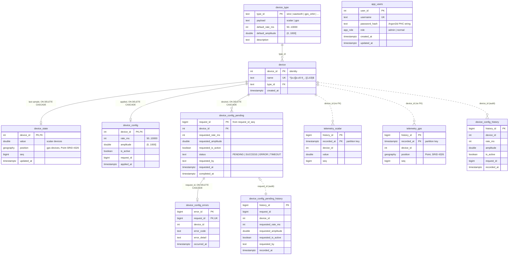
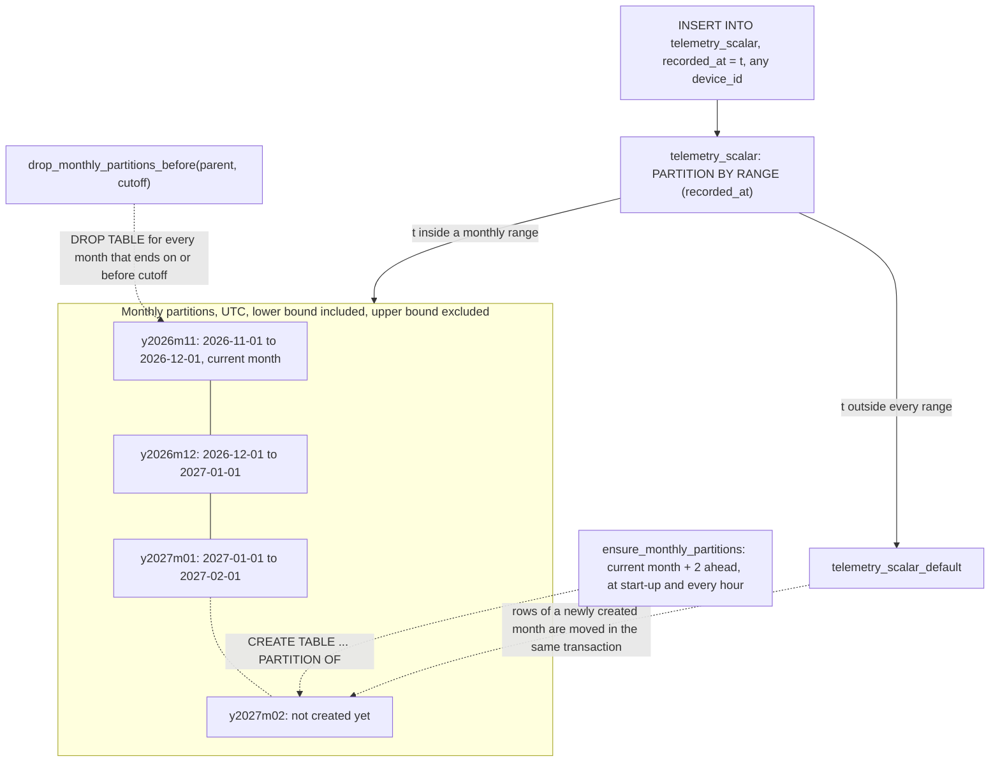
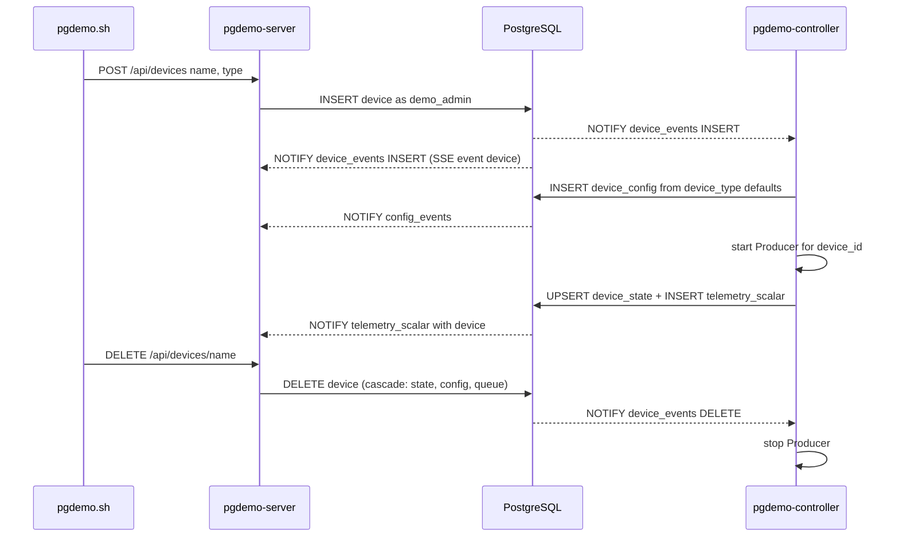
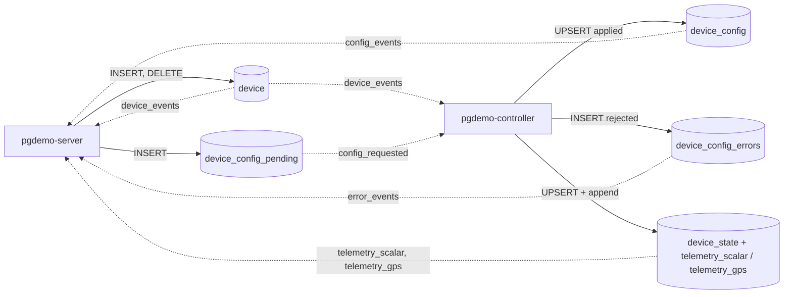

# Database schema

The six files in this directory are the whole contract between `pgdemo-server` (zone A) and `pgdemo-controller` (zone B). Neither process knows the other; both only know these tables, views, functions and channels.

The model is IoT-shaped. A device is a row of `device`, not a table: registering one is an `INSERT` and needs no schema change, no new channel and no rebuild. Tables are cut by the *shape* of the data instead (`telemetry_scalar`, `telemetry_gps`), and configuration hangs off `device_id`.

## Loading order

[`scripts/db-init.sh`](../scripts/db-init.sh) loads the files as a superuser: `00_roles.sql` against the `postgres` database (roles belong to the cluster), then `01` to `05` against `pgdemo`. Every file is idempotent within this model, so running it again keeps an existing database. Each file switches to `SET ROLE demo_owner`, so `demo_owner` owns every object; the controller and the server own nothing.

A database created with the earlier one-table-per-dummy schema is not migrated: recreate it with `scripts/db-init.sh --reset`.

| File | Contents |
|---|---|
| [`00_roles.sql`](00_roles.sql) | Cluster roles and role memberships |
| [`01_data.sql`](01_data.sql) | PostGIS, `device_type`, `device`, `device_state`, the monthly-partitioned `telemetry_scalar` and `telemetry_gps`, and the partition maintenance functions |
| [`02_config.sql`](02_config.sql) | Control plane: request id sequence, applied configuration, request queue, errors and audits, all keyed by `device_id` |
| [`03_users.sql`](03_users.sql) | `app_users`, the `app_role` type, `auth_fetch_user()` and the last-admin guard |
| [`04_triggers.sql`](04_triggers.sql) | `NOTIFY` triggers: one channel per topic, with the device in the payload |
| [`05_views.sql`](05_views.sql) | Views and every `GRANT` |

PostGIS lives in schema `extensions`, not in `public`. `05_views.sql` revokes everything on `public` from `PUBLIC`, and a PostGIS installed there would lose `ST_Project` for the demo roles. The login roles carry `search_path = public, extensions`, because `SET LOCAL ROLE` does not change the session's `search_path`.

## Entity relationships

Solid lines are foreign keys. Dotted lines are logical links without a foreign key: telemetry and audit rows must outlive the device they describe.



## Data plane

### Devices

| Table | Columns | Constraints and indexes |
|---|---|---|
| `device_type` | `type_id TEXT`, `payload TEXT`, `default_rate_ms INT`, `default_amplitude DOUBLE PRECISION`, `description TEXT` | PK `type_id`; `payload IN ('scalar', 'gps')`; the defaults obey the same ranges as `device_config` |
| `device` | `device_id INT` identity, `name TEXT`, `type_id TEXT`, `created_at TIMESTAMPTZ` | PK `device_id`; `name` unique and `~ '^[a-z][a-z0-9_.-]{1,63}$'`; FK `type_id`; index on `type_id` |
| `device_state` | `device_id INT`, `value DOUBLE PRECISION`, `position geography(Point, 4326)`, `seq BIGINT`, `updated_at TIMESTAMPTZ` | PK and FK `device_id ON DELETE CASCADE`; `CHECK ((value IS NULL) <> (position IS NULL))`, so a row holds a scalar or a position, never both; GiST on `position` |

`device_type` is seeded with three types. `amplitude` is the peak value for the scalar types and the orbit radius in metres for `gps_orbit`.

| `type_id` | `payload` | Default rate | Default amplitude | Controller generator |
|---|---|---|---|---|
| `sine` | `scalar` | 500 ms | 10 | `amplitude * sin(2*pi*seq/40 + phase)` |
| `sawtooth` | `scalar` | 1000 ms | 5 | `amplitude * (seq % 50) / 50` plus Gaussian noise |
| `gps_orbit` | `gps` | 1000 ms | 250 m | orbit around Madrid, point built with `ST_Project` |

`device` is seeded with `dummy1` (`sine`), `dummy2` (`sawtooth`) and `dummy3` (`gps_orbit`), so the client, the captures and the end-to-end suite keep their arguments. A type added later without a generator of its own gets `sine` (scalar) or `gps_orbit` (gps) from the controller.

### Writing a sample

The controller runs one producer thread per device. Each tick is one statement: a CTE UPSERTs `device_state` and the outer `INSERT` appends the same values to the telemetry table of the device's payload. Both rows commit, and notify, together.

```sql
WITH up AS (
  INSERT INTO device_state (device_id, value, seq, updated_at) VALUES ($1, $2, $3, clock_timestamp())
  ON CONFLICT (device_id) DO UPDATE SET value = EXCLUDED.value, seq = EXCLUDED.seq,
    updated_at = EXCLUDED.updated_at
  RETURNING device_id, value, seq, updated_at)
INSERT INTO telemetry_scalar (device_id, value, seq, recorded_at)
SELECT device_id, value, seq, updated_at FROM up;
```

For a GPS device the value is `ST_Project(ST_SetSRID(ST_MakePoint(lon, lat), 4326)::geography, radius, bearing)`, with the distance and azimuth cast to `double precision` because PostGIS also has an `ST_Project(geography, geography, float8)` overload.

### Partitioned telemetry

`telemetry_scalar` and `telemetry_gps` are append-only and `PARTITION BY RANGE (recorded_at)`, one partition per UTC month plus a `DEFAULT` partition. Each carries `device_id` and the sample, and adds `history_id BIGINT GENERATED ALWAYS AS IDENTITY` and `recorded_at TIMESTAMPTZ`.

- **No foreign key to `device`.** Removing a device keeps its telemetry. A foreign key would also have to be checked on every one of the most frequent writes.
- **Primary key `(history_id, recorded_at)`.** PostgreSQL requires the partition key inside every unique constraint of a partitioned table.
- **Index `(device_id, recorded_at DESC)`**, declared once on the parent; PostgreSQL creates it on every partition. `telemetry_gps` also has a GiST index on `position`.
- **Partition names** follow `<table>_yYYYYmMM`, and the bounds are `[first day of the month, first day of the next month)` in UTC.
- **Grants live on the parent only.** Partitions carry no privileges for the demo roles, so every read and write goes through the parent and its routing.

The partitions in a database installed in November 2026 (`\d+ telemetry_scalar`; `telemetry_gps` is identical):

```text
telemetry_scalar
├── telemetry_scalar_y2026m11   [2026-11-01 00:00Z, 2026-12-01 00:00Z)   current month
├── telemetry_scalar_y2026m12   [2026-12-01 00:00Z, 2027-01-01 00:00Z)   created ahead
├── telemetry_scalar_y2027m01   [2027-01-01 00:00Z, 2027-02-01 00:00Z)   created ahead
└── telemetry_scalar_default    DEFAULT: any recorded_at outside the months above
```

#### Partition space

The `recorded_at` axis is cut into UTC months. A row goes to the partition of its month, or to `DEFAULT` when that month has no partition yet. Every device of the same payload shares these partitions. Two `SECURITY DEFINER` functions move the window forward:



- **Created ahead.** `ensure_monthly_partitions(parent, from_month, months_ahead)` creates the current month and the next `months_ahead` (2 by default) that do not exist yet. The install runs it once per table; the controller runs it at start-up and every `--maintenance-interval-s` (3600 s by default). `y2027m02` appears when the controller's maintenance runs in December 2026.
- **DEFAULT is a safety net, not a destination.** PostgreSQL refuses to create a partition while `DEFAULT` holds rows of its range. The function parks those rows in a temporary table, creates the partition and inserts them back through the parent, all in one transaction.
- **Retention without `DELETE`.** `drop_monthly_partitions_before(parent, cutoff)` drops each monthly partition whose month ends on or before `cutoff`. Dropping a table is instant and leaves nothing to vacuum. `DEFAULT` is never dropped.
- **Pruning.** A query with a `recorded_at` range scans only the partitions that overlap it, and the `(device_id, recorded_at DESC)` index narrows each one to the device. Use UTC bounds, because the month boundaries are UTC.
- **Visible routing.** `GET /api/devices/{name}/history` returns `tableoid::regclass` with each row, so the client sees the partition that stored it.

## Control plane

The server writes the *desired* configuration and the controller writes the *applied* configuration. Requests travel as rows, and `NOTIFY` only wakes the other side.

| Object | Role |
|---|---|
| `request_id_seq` | `BIGINT` sequence. Several server instances can enqueue concurrently without coordinating. |
| `device_config` | Applied state, one row per device. `rate_ms BETWEEN 50 AND 10000`, `amplitude > 0 AND amplitude <= 1000`. The `CHECK`s back up the controller's own validation, so the applied state can never be invalid. Written only by the controller: seeded for `dummy1`–`dummy3` from their type defaults, created from the type defaults when a device is registered, and updated for every request it applies. |
| `device_config_pending` | Desired state and durable queue. `status` goes from `PENDING` to `SUCCESS`, `ERROR` or `TIMEOUT`. Values are only loosely constrained (`requested_rate_ms > 0`): an out-of-range request is accepted, travels the loop and comes back as `ERROR` with a reason. Partial index `(requested_at) WHERE status = 'PENDING'` for the queue scan, and `(device_id, requested_at DESC)`. |
| `device_config_errors` | Why a request failed, at most one row per request (`request_id UNIQUE`). Index `(device_id, occurred_at DESC)`. |
| `device_config_history` | Audit of every applied configuration, including the type defaults a device starts with. |
| `device_config_pending_history` | Audit of every enqueue. `request_id` is not a foreign key, so the audit survives queue cleanup and device removal. |

The controller drains the queue with `SELECT ... FROM device_config_pending p JOIN device d ... FOR UPDATE OF p SKIP LOCKED`. `OF p` locks only the queue row: the controller has no `UPDATE` on `device`, and locking `device` rows would need it.

### Device lifecycle



- `POST /api/config` for a device the controller has not initialised yet answers `409 not_initialised`: a partial update needs an applied state to start from.
- Deleting a device removes its `device_state`, `device_config`, `device_config_pending` and `device_config_errors` rows (`ON DELETE CASCADE`; the cascade runs as the table owner, so `demo_admin` needs no privilege on those tables). Telemetry and both audits stay.
- At start-up the controller reads every device, initialises the applied state of any device that lacks one and starts a producer for each, so a device registered while it was down is picked up.

## Users

`app_users` stores Argon2id PHC strings (`$argon2id$v=19$m=65536,t=3,p=1$<salt>$<hash>`); plain passwords never reach the database.

- `username` matches `^[a-z][a-z0-9_.-]{2,63}$` and is unique.
- `password_hash` must start with `$argon2id$`.
- `role` is the enum `app_role` (`admin`, `normal`), default `normal`.
- `trg_app_users_last_admin` (`BEFORE DELETE OR UPDATE OF role`) refuses to delete or demote the last admin, with SQLSTATE `23514` (`check_violation`).
- `trg_app_users_touch` (`BEFORE UPDATE`) sets `updated_at`.

## Views

| View | Contents | Readers |
|---|---|---|
| `v_devices` | Every device with its type, `payload` and last sample; GPS devices expose `lon` and `lat` (`ST_X`/`ST_Y`). Backs `GET /api/devices`. | `demo_normal`, `demo_admin` |
| `v_device_config_sync_status` | Per device: the applied configuration, the latest request (`LEFT JOIN LATERAL`, newest `requested_at`) and the latest error. `sync` is `PENDING` while that request is `PENDING`, `ERROR` when it ended in `ERROR` or `TIMEOUT`, `UNINITIALISED` while the device has no applied state, and `SYNC` otherwise. Backs `GET /api/config`. | `demo_normal`, `demo_admin` |
| `v_users_directory` | `app_users` without `password_hash` | `demo_admin` |

## Functions

| Function | Kind | Purpose |
|---|---|---|
| `ensure_monthly_partitions(parent regclass, from_month date, months_ahead int)` | `SECURITY DEFINER`, returns the created names | Create monthly partitions ahead and move parked `DEFAULT` rows. `EXECUTE` for `demo_controller`. |
| `drop_monthly_partitions_before(parent regclass, cutoff date)` | `SECURITY DEFINER`, returns the dropped names | Retention by whole months. Not granted to any demo role; run it as `demo_owner` or a superuser. |
| `auth_fetch_user(p_username text)` | `SECURITY DEFINER`, `STABLE` | Return one user's hash and role for login. The only object `demo_server` can use with its base role. |
| `protect_last_admin()` | trigger | Body of `trg_app_users_last_admin` |
| `touch_updated_at()` | trigger | Body of `trg_app_users_touch` |
| `notify_device_sample()`, `notify_device_change()`, `notify_config_request()`, `notify_config_change()`, `notify_config_error()` | trigger | Build the JSON payload and call `pg_notify` |

Both partition functions accept only `telemetry_scalar` and `telemetry_gps` as `parent`, pin `search_path` and `TimeZone = 'UTC'`, and take `pg_advisory_xact_lock(parent)` so that concurrent callers on the same table run one after another. Being `SECURITY DEFINER`, they run as `demo_owner`: creating or dropping a partition requires owning the parent, and the controller must not own tables.

## Triggers and NOTIFY channels

All of them are `AFTER ... FOR EACH ROW` triggers. Channels are per topic, never per device: the device travels in the payload (`device_id` and the name, `device`), so the set of `LISTEN`s stays the same however many devices are registered.

| Channel | Source | Trigger | Listener | Payload (JSON) |
|---|---|---|---|---|
| `telemetry_scalar` | `device_state` INSERT, UPDATE with `value` | `trg_device_state_notify` | server | `device_id`, `device`, `action`, `value`, `seq`, `ts` |
| `telemetry_gps` | `device_state` INSERT, UPDATE with `position` | `trg_device_state_notify` | server | `device_id`, `device`, `action`, `lon`, `lat`, `seq`, `ts` |
| `device_events` | `device` INSERT, DELETE | `trg_device_notify` | controller, server | `action`, `device_id`, `device`, `type_id` |
| `config_requested` | `device_config_pending` INSERT | `trg_config_pending_notify` | controller | `action`, `request_id`, `device_id` |
| `config_events` | `device_config` INSERT, UPDATE | `trg_config_notify` | server | `action`, `device_id`, `device`, `rate_ms`, `amplitude`, `is_active`, `request_id`, `applied_at` |
| `error_events` | `device_config_errors` INSERT | `trg_config_error_notify` | server | `request_id`, `device_id`, `device`, `error_code`, `error_detail`, `occurred_at` |

The device name in each payload is read from `device` by primary key inside the trigger, so a listener can filter or display without a second query. The server republishes these channels as the SSE events `telemetry_scalar`, `telemetry_gps`, `device`, `config` and `error`, and `GET /api/stream?devices=` filters them by that name.



`pg_notify()` is transactional: the notification leaves when the writing transaction commits, so a listener never sees state that might roll back. The payload limit is 8000 bytes, and these payloads stay well below it. A notification is a wake-up signal, not the message: the tables are the source of truth, and a listener that was down catches up by reading them (the controller reads every device and drains `PENDING` rows at start-up).

## Roles and privileges

| Role | Login | Purpose |
|---|---|---|
| `demo_owner` | no | Owns every object. `SECURITY DEFINER` functions run as it. |
| `demo_normal` | no | Group behind the JWT role `normal`: read only. |
| `demo_admin` | no | Group behind the JWT role `admin`. Member of `demo_normal`, plus the device registry, enqueue and user management. |
| `demo_server` | yes | Zone A. `NOINHERIT`, and holds `demo_admin` and `demo_normal` `WITH INHERIT FALSE, SET TRUE`: each API request runs under `SET LOCAL ROLE demo_admin` or `demo_normal`, chosen from the verified JWT. |
| `demo_controller` | yes | Zone B. Least privilege on the device registry (read only), the queue, the applied configuration and the data. No access to `app_users`. |

Passwords for the two login roles are set by `scripts/db-init.sh`, never in these files.

| Object | `demo_normal` | `demo_admin` | `demo_controller` | `demo_server` (base) |
|---|---|---|---|---|
| `device_type` | SELECT | SELECT | SELECT | – |
| `device` | SELECT | SELECT; INSERT `name`, `type_id`; DELETE | SELECT | – |
| `device_state` | SELECT | SELECT | SELECT, INSERT, UPDATE | – |
| `telemetry_scalar`, `telemetry_gps` | SELECT | SELECT | INSERT | – |
| `device_config` | SELECT | SELECT | SELECT, INSERT, UPDATE | – |
| `device_config_pending` | SELECT | SELECT, INSERT | SELECT, UPDATE | – |
| `device_config_errors` | SELECT | SELECT | INSERT | – |
| `device_config_history` | SELECT | SELECT | INSERT | – |
| `device_config_pending_history` | – | INSERT | – | – |
| `request_id_seq` | – | USAGE | – | – |
| `app_users` | – | SELECT of the non-secret columns; INSERT `username`, `password_hash`, `role`; UPDATE `password_hash`, `role`; DELETE | – | – |
| `v_devices`, `v_device_config_sync_status` | SELECT | SELECT | – | – |
| `v_users_directory` | – | SELECT | – | – |
| `auth_fetch_user()` | – | – | – | EXECUTE |
| `ensure_monthly_partitions()` | – | – | EXECUTE | – |

`demo_admin` inherits everything in the `demo_normal` column. It can write `password_hash` but cannot read it. Identity columns (`device.device_id`, `history_id`, `error_id`) need no sequence privilege: the identity sequence is used on behalf of the table. [`docs/ARCHITECTURE.md`](../docs/ARCHITECTURE.md#authorization-twice) explains how the server picks the group for each request, and why PostgreSQL enforces the same authorization as the HTTP layer.

## Scaling notes

The model scales in the number of devices without schema changes, but the demo keeps a few simplifications that a real fleet would not.

- **One `NOTIFY` per sample.** Committing a transaction that called `pg_notify` takes a cluster-wide lock on the notification queue, so those commits serialize. At a few hundred samples per second this is invisible; at thousands it becomes the bottleneck, and a listener that falls behind fills the 8 GB queue. Alternatives, from least to most infrastructure:
  - batched wake-ups: notify once per batch, or once per interval from the writer, and let listeners read the new rows by `history_id`;
  - logical decoding (CDC) of `device_state` or the telemetry tables with `pgoutput`, which needs no trigger and no queue lock;
  - a broker (MQTT, Kafka, NATS) for telemetry, with PostgreSQL as the store and the control plane.
- **Partitioning only by time.** Every device of one payload shares each month's partition. With many devices and long retention, subpartition each month by `HASH (device_id)`, or move the telemetry to TimescaleDB hypertables, which do both.
- **One `device_state` row per device.** It is UPDATE-heavy: keep `fillfactor` below 100 so the updates stay HOT, and let autovacuum run often on it.
- **Row Level Security.** All authenticated users see every device. Tenants or owners would add an owner column to `device` and RLS policies on `device`, `device_state` and the telemetry tables keyed by `device_id`.
- **One thread per device in the controller.** Fine for a demo with a handful of devices; a fleet needs a scheduler over a small thread pool, or devices that write for themselves through an ingestion endpoint.

## Inspecting the live schema

With the local superuser over the Unix socket, as in the README's quick start:

```bash
psql -h /var/run/postgresql -d pgdemo -c '\dt+'                    # tables and sizes
psql -h /var/run/postgresql -d pgdemo -c '\d+ telemetry_scalar'    # partitions and their bounds
psql -h /var/run/postgresql -d pgdemo -c '\dp'                     # privileges, including column grants
psql -h /var/run/postgresql -d pgdemo -c '\df+ ensure_monthly_partitions'
psql -h /var/run/postgresql -d pgdemo -c 'SELECT * FROM v_devices'
psql -h /var/run/postgresql -d pgdemo -c \
    "SELECT tableoid::regclass AS partition, device_id, count(*) FROM telemetry_scalar GROUP BY 1, 2"
```
