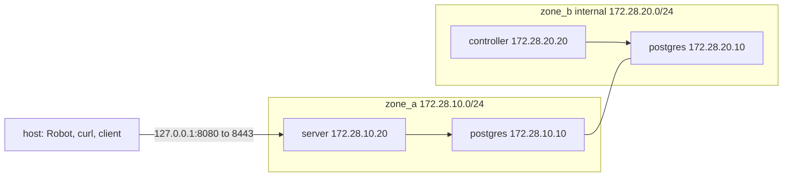

# End-to-end virtualization

The suite runs the demo's own compose file as a throwaway project. Robot Framework, `curl`, `jq` and [`client/pgdemo.sh`](../../client/pgdemo.sh) stay on the host. PostgreSQL, the one-shot `init` container, the server and the controller run in containers. Nothing in the suite uses the host `build/` tree.

[`docker/Dockerfile`](../../docker/Dockerfile) builds one image, `pgdemo:latest`: a build stage compiles the three binaries (`pgdemo-server`, `pgdemo-controller`, `pgdemo-device`), and the runtime stage keeps them plus `sql/`, `scripts/` and `webroot/`, the built control panel. `up --build` produces that image. Compose then starts `init`, `server` and `controller` from it and picks the command of each service.

The suites cover the API (01 to 09), the panel as static files with its headers and its boundary with `/api` (10), and the panel in a real browser (11 to 13, with [Robot Framework Browser](https://robotframework-browser.org/), which drives Playwright and Chromium).

## CLI

From the repository root. The development stack has to be stopped first: it publishes the same `127.0.0.1:8080` and uses the same `172.28.*` subnets. A host `scripts/run-all.sh --http` has to be stopped too, because it listens on `127.0.0.1:8080`. Docker with compose v2, `curl`, `jq` and Node.js with npm (for the browser) must be on the host.

`webroot/` must hold the panel before the image is built: run `scripts/fetch-webroot.sh` (the panel CI released from `main`) or `pnpm build` in `frontend/` (needs Catalyst; see [frontend/README.md](../../frontend/README.md)). The suite setup checks for `webroot/index.html` and stops with "ejecuta scripts/fetch-webroot.sh o pnpm build en frontend/" otherwise, rather than failing in every UI test later.

```bash
python3 -m venv .venv && .venv/bin/pip install -r tests/e2e/requirements.txt
.venv/bin/rfbrowser init chromium
scripts/fetch-webroot.sh          # or: (cd frontend && pnpm build)

# Compose interpolates the file before it will stop anything. `down` does not
# use these values; they only have to be set.
POSTGRES_PASSWORD=x DEMO_ADMIN_PASSWORD=x \
  docker compose -f docker/compose.yaml down

.venv/bin/robot --outputdir build/e2e tests/e2e
```

The same run with every compose command, client call and HTTP response echoed:

```bash
.venv/bin/robot --variable E2E_DEBUG:true --outputdir build/e2e tests/e2e
```

The argument is the `tests/e2e` directory, so `__init__.robot` runs setup and teardown around the child suites. A path to one `.robot` file skips that and the stack never starts. Select a child suite or a single test with the directory still as the target:

```bash
.venv/bin/robot --outputdir build/e2e --suite 01__server_without_controller tests/e2e
.venv/bin/robot --outputdir build/e2e --test "Health is public" tests/e2e
```

`--outputdir` receives `report.html`, `log.html`, `output.xml` and, after teardown, `compose.log`. `E2E_DEBUG` also accepts `1` or `yes`.

The UI suites save a screenshot at each step into `<outputdir>/screens/`, embedded in `log.html`. To refresh the captures in [frontend/README.md](../../frontend/README.md), copy them to `frontend/docs/screens/` as well:

```bash
.venv/bin/robot --outputdir build/e2e --variable UI_SCREENSHOTS:frontend/docs/screens tests/e2e
```

`--variable UI_HEADLESS:false` shows the browser window while the UI suites run.

## An isolated compose project

[`resources/stack.resource`](resources/stack.resource) always invokes:

```bash
docker compose -p pgdemo-e2e -f docker/compose.yaml --env-file run/e2e/compose.env
```

The file is the demo's [`docker/compose.yaml`](../../docker/compose.yaml). The project name prefixes every network and volume with `pgdemo-e2e_`, so `down -v` removes `pgdemo-e2e_pgdata`, `pgdemo-e2e_demo-run`, `pgdemo-e2e_ca-keys` and `pgdemo-e2e_device-keys` and leaves the `pgdemo_` volumes alone. Each run therefore starts with a new root CA and no device keys.

Each run generates `POSTGRES_PASSWORD` and `DEMO_ADMIN_PASSWORD` with `secrets.token_hex` and writes them to `run/e2e/compose.env`. That directory lives inside the repository, not in `/tmp`: a snap-packaged Docker CLI cannot see the host's `/tmp`. `run/` is gitignored, and the suite teardown deletes `run/e2e`. Compose would let a variable exported in the shell override that file, so the suite removes both names from the environment it passes to `docker compose`.

## Networks

`postgres` is attached to both zones and is the only path between them. `zone_b` is an `internal` network, so it has no route out, including none to `zone_a`. The host publishes a single port, bound to loopback.



| Address | Who holds it |
|---|---|
| `127.0.0.1:8080` | The host, mapped to `server:8443` (HTTPS) |
| `172.28.10.10` | `postgres` on `zone_a` |
| `172.28.10.20` | `server` on `zone_a` |
| `172.28.20.10` | `postgres` on `zone_b` |
| `172.28.20.20` | `controller` on `zone_b` |

`06__network_zones.robot` checks the boundary from inside the controller container: opening `/dev/tcp/172.28.10.20/8443` fails, and opening `/dev/tcp/172.28.20.10/5432` succeeds.

## What is shared with the development stack

Volumes are isolated by the project name. Three things are not, because [`docker/compose.yaml`](../../docker/compose.yaml) fixes them for every project:

- The published port `127.0.0.1:8080`.
- The subnets `172.28.10.0/24` and `172.28.20.0/24`.
- The image tag `pgdemo:latest`.

The development stack (`docker compose -p pgdemo`, the default project name) has to be stopped before the suite runs, or the port and the subnets collide. A build in either project replaces the local `pgdemo:latest` image the other one would start.

## Lifecycle

`__init__.robot` owns setup and teardown. The child suites run in file-name order and share the containers.

1. **Setup.** `down -v --remove-orphans`, then `up -d --build --wait server`. That starts `postgres`, waits for its health check, runs `init` (`scripts/db-init.sh`, which exits when the schema, the device CA and the admin user exist) and starts `server`. The controller is not started, so no device exists yet: the seeds are `PENDING` enrollments, and `01__server_without_controller.robot` checks that, queues one more enrollment and reads the published CA. The suite then copies the server certificate out of the container and polls `GET https://127.0.0.1:8080/api/health`.
2. **Controller.** `02__controller_drains_queue.robot` runs `up -d --no-deps --wait controller`. `--no-deps` matters because `init` has already completed; asking compose for its dependencies would run it again. The seeds and the queued enrollment then enroll: their processes come online with certificates from the CA, and their keys are in the controller's container and not in the server's.
3. **Device lifecycle.** `08__device_lifecycle.robot` enrolls `sensor-a` through the API with an SSE stream already filtered to it, waits for its process to authenticate and for its telemetry, reconfigures it and removes it, together with its key directory.
4. **Device identity.** `09__device_identity.robot` enrolls `ident-a` and drives its certificate: a hold that stops the process and is lifted, a rotation, deleting the old certificate (the device stays) and checking the signed CRL with `openssl`, a permanent revocation (the device stays, out of service), and deleting the current certificate (the device goes). It finally restarts the controller with `PGDEMO_MAX_DEVICES=2`, checks that the third device is `UNMANAGED` and a new enrollment gets `422 CAPACITY`, and restores the limit.
5. **Panel over HTTP.** `10__panel.robot` loads every page without a token (they are public static HTML), checks the security headers (CSP, `nosniff`, `DENY`, `no-referrer`), that hashed bundles under `/_next/static/` are JavaScript and `immutable` while pages are `no-cache`, that an unknown page is the 404 page with status 404, that encoded `..` cannot leave the webroot, and that `/api` keeps its rules whatever the spelling (`/API`, `/%61pi`, `//api`): 401 without a token, a JSON 404 for an unknown endpoint, and 403 for every admin write with the token of `alice`, the normal user from 05.
6. **Panel in a browser.** Each UI suite opens its own Chromium at 1440x900 and finds elements by `data-testid`, reading states from `data-state` (the API value, not the Spanish label); the keywords are in [`resources/ui.resource`](resources/ui.resource).
   - `11__ui_login_and_roles.robot`: the login page, a refused password, `alice` seeing only the visualization tabs and being sent back from `/admin/`, the user menu with role and PostgreSQL group, logout, the admin's amber entry, and a forged token ending the session (`/?expired=1`).
   - `12__ui_visualization.robot`, as `alice`: live rows and `seq` over SSE, the device detail (chart, history, certificates), configuration, the GPS map moving, PKI with the CRL, events filtered on the server by device and by channel, pause, and the system tab.
   - `13__ui_admin.robot`, as the admin, on its own device `ui-a`: enrollment and a 409, a configuration applied and a `422 INVALID_RATE`, certificateHold and its release, a rotation and the deletion of the superseded certificate, a confirmed `keyCompromise` revocation that shows up in the CRL, and the removal; then a user created, a duplicate, the user deleted, and the last admin refused. The suite teardown deletes `ui-a` and `ui-user` through the API if a failed test left them, so 99 sees the fleet as 09 left it.
7. **Shutdown check.** `99__shutdown.robot` runs `compose stop server controller`. The services set `init: true`, so tini is pid 1 and delivers `SIGTERM` to `scripts/run-all.sh`, which stops the process and leaves `listener exiting` in its log. `compose cp server:/app/run/logs` then copies those logs out of the `demo-run` volume. `server` and `controller` share that volume, and `cp` works while the container is stopped.
8. **Teardown.** `compose logs` is saved as `compose.log` in the Robot `--outputdir`, then `down -v --remove-orphans` runs again and `run/e2e` is removed.

## Console output

The console shows Robot's own progress. `--variable E2E_DEBUG:true` (also `1` or `yes`) echoes every `docker compose` command, client call, `curl` and HTTP response as it happens. A command that exits non-zero is printed either way. The checks themselves are the `.robot` files.
