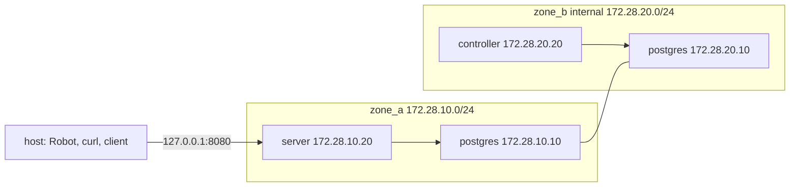

# End-to-end virtualization

The suite runs the demo's own compose file as a throwaway project. Robot Framework, `curl`, `jq` and [`client/pgdemo.sh`](../../client/pgdemo.sh) stay on the host. PostgreSQL, the one-shot `init` container, the server and the controller run in containers. Nothing in the suite uses the host `build/` tree.

[`docker/Dockerfile`](../../docker/Dockerfile) builds one image, `pgdemo:latest`: a build stage compiles both binaries, and the runtime stage keeps them plus `sql/` and `scripts/`. `up --build` produces that image. Compose then starts `init`, `server` and `controller` from it and picks the command of each service.

## An isolated compose project

[`resources/stack.resource`](resources/stack.resource) always invokes:

```bash
docker compose -p pgdemo-e2e -f docker/compose.yaml --env-file run/e2e/compose.env
```

The file is the demo's [`docker/compose.yaml`](../../docker/compose.yaml). The project name prefixes every network and volume with `pgdemo-e2e_`, so `down -v` removes `pgdemo-e2e_pgdata` and `pgdemo-e2e_demo-run` and leaves `pgdemo_pgdata` and `pgdemo_demo-run` alone.

Each run generates `POSTGRES_PASSWORD` and `DEMO_ADMIN_PASSWORD` with `secrets.token_hex` and writes them to `run/e2e/compose.env`. That directory lives inside the repository, not in `/tmp`: a snap-packaged Docker CLI cannot see the host's `/tmp`. `run/` is gitignored, and the suite teardown deletes `run/e2e`.

## Networks

`postgres` is attached to both zones and is the only path between them. `zone_b` is an `internal` network, so it has no route out, including none to `zone_a`. The host publishes a single port, bound to loopback.



| Address | Who holds it |
|---|---|
| `127.0.0.1:8080` | The host, mapped to `server:8080` |
| `172.28.10.10` | `postgres` on `zone_a` |
| `172.28.10.20` | `server` on `zone_a` |
| `172.28.20.10` | `postgres` on `zone_b` |
| `172.28.20.20` | `controller` on `zone_b` |

`06__network_zones.robot` checks the boundary from inside the controller container: opening `/dev/tcp/172.28.10.20/8080` fails, and opening `/dev/tcp/172.28.20.10/5432` succeeds.

## What is shared with the development stack

Volumes are isolated by the project name. Three things are not, because [`docker/compose.yaml`](../../docker/compose.yaml) fixes them for every project:

- The published port `127.0.0.1:8080`.
- The subnets `172.28.10.0/24` and `172.28.20.0/24`.
- The image tag `pgdemo:latest`.

The development stack (`docker compose -p pgdemo`, the default project name) has to be stopped before the suite runs, or the port and the subnets collide. A build in either project replaces the local `pgdemo:latest` image the other one would start.

## Lifecycle

`__init__.robot` owns setup and teardown. The child suites run in file-name order and share the containers.

1. **Setup.** `down -v --remove-orphans`, then `up -d --build --wait server`. That starts `postgres`, waits for its health check, runs `init` (`scripts/db-init.sh`, which exits when the schema and the admin user exist) and starts `server`. The controller is not started. The suite then copies the server certificate out of the container and polls `GET https://127.0.0.1:8080/api/health`.
2. **Controller.** `02__controller_drains_queue.robot` runs `up -d --no-deps --wait controller`. `--no-deps` matters because `init` has already completed; asking compose for its dependencies would run it again.
3. **Shutdown check.** `07__shutdown.robot` runs `compose stop server controller`. The services set `init: true`, so tini is pid 1 and delivers `SIGTERM` to `scripts/run-all.sh`, which stops the process and leaves `listener exiting` in its log. `compose cp server:/app/run/logs` then copies those logs out of the `demo-run` volume. `server` and `controller` share that volume, and `cp` works while the container is stopped.
4. **Teardown.** `compose logs` is saved as `compose.log` in the Robot `--outputdir`, then `down -v --remove-orphans` runs again and `run/e2e` is removed.

## Console output

The console shows Robot's own progress. `--variable E2E_DEBUG:true` (also `1` or `yes`) echoes every `docker compose` command, client call, `curl` and HTTP response as it happens. A command that exits non-zero is printed either way. The checks themselves are the `.robot` files.
